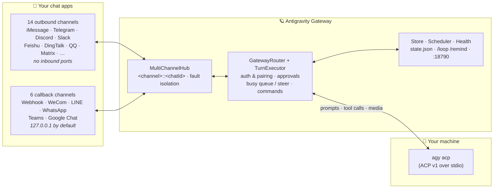

<div align="center">

[English](README.md) | [简体中文](README.zh-CN.md) | [繁體中文](README.zh-TW.md) | **日本語** | [한국어](README.ko.md)

# 🪐 Antigravity Gateway

### どのチャットアプリからでも、手元の Google Antigravity エージェントを操作。

セルフホストの 1 プロセスで、あなた自身の **`agy acp`** を **20 のメッセージングプラットフォーム**（iMessage、Telegram、Discord、Slack、Feishu、DingTalk、QQ、WeCom、Matrix など）につなぎます。ツール承認、ライブ進捗、セッション管理、スケジュール実行に対応し、ほとんどのチャネルは**公開ドメイン、ポート転送、リバースプロキシが不要**です。

<p>
  <a href="https://github.com/Relogys/Antigravity-gateway/actions/workflows/ci.yml"></a>
  <a href="https://github.com/Relogys/Antigravity-gateway/actions/workflows/security.yml"></a>
  <a href="https://github.com/Relogys/Antigravity-gateway/releases"></a>
  = 22" />
  
  
  
  
</p>

<p>
  <a href="#compliance"><b>⚖️ 利用規約とコンプライアンス</b></a> ·
  <a href="#quick-start"><b>クイックスタート</b></a> ·
  <a href="docs/QUICKSTART.md">3 分ガイド</a> ·
  <a href="#channels">対応チャネル</a> ·
  <a href="#commands">コマンド</a> ·
  <a href="#configuration">設定</a> ·
  <a href="#security">セキュリティ</a> ·
  <a href="CHANGELOG.md">変更履歴</a>
</p>

</div>

---

<a id="compliance"></a>

## ⚖️ 利用規約とコンプライアンス

> [!CAUTION]
> **インストール前に必ずこのセクションをお読みください。** Antigravity Gateway は非公式のサードパーティ製ソフトウェアです。Google 自身の Antigravity 規約はサードパーティからのサービス利用を制限しており、接続するすべてのアカウント、プラン、チャットプラットフォームについての責任は**利用者本人のみ**が負います。

### このプロジェクトについて

- **独立した非公式プロジェクトです。** コミュニティによるオープンソースプロジェクトであり、Google、Apple、Photon、いずれのチャットプラットフォームによって作られたものでも、提携、後援、推奨されたものでも**ありません**。「Google」「Gemini」「Antigravity」は Google LLC の商標です。その他の名称はそれぞれの所有者に帰属します。
- **あなた自身の `agy` 用の、単一ユーザー向けセルフホストクライアントです。** ゲートウェイは、**あなた**が**自分のマシン**にインストールしてサインインした公式 Antigravity CLI を、ローカルのサブプロセスとして起動します（`agy acp`、Agent Client Protocol v1、stdio 上の JSON-RPC。Google がエディタ向けに公開しているものと同じインターフェースです）。クォータ確認では `agy -p /usage --output-format json` を実行します。認証は `agy` 側の設定そのままです：あなた本人の対話型サインイン、またはあなた自身の `GEMINI_API_KEY`。

### 行わないこと、また利用・改変によって行わせてはならないこと

- ❌ **リバースプロキシや中継は行いません。** OpenAI 互換その他のモデル API を公開せず、Google のモデルエンドポイントを直接呼び出すこともありません。
- ❌ **OAuth トークンの抽出・中継は行いません。** `agy` がキャッシュした認証情報や OAuth トークンを読み取り、コピー、保存、更新、転送することは一切ありません。
- ❌ **アカウントやクォータの共有、プール、ローテーション、転売は行いません。** 1 つのゲートウェイに 1 人の所有者、所有者本人のアカウントのみです。
- ❌ **クォータ、レート制限、安全フィルター、人による確認プロンプトの回避は行いません。**
- ❌ **個人アカウントを使った多人数向け公開サービスにはしません。** `ALLOWED_SENDERS` とペアリングは自分自身だけにしてください。他人（グループメンバー、友人、顧客）に自分の個人アカウントを操作させることは、本プロジェクトのサポート対象外です。

上記のいずれかを追加するフォークや改変は本プロジェクトの目的外であり、その作者と利用者がすべての結果を負います。

### 個人（コンシューマー）向け Antigravity サインインの既知のリスク

この部分は特に注意してお読みください：

- **[Google Antigravity 追加利用規約](https://antigravity.google/terms)** には、本サービスを濫用、損害、妨害、阻害してはならず、それには *「当社が提供していない製品と組み合わせて本サービスを使用すること」* が含まれること、*「サードパーティのソフトウェア、ツール、またはサービスを使用して本サービスにアクセスすることは本契約違反である」* こと、そしてそれが *「Antigravity および/または Gemini CLI アカウントの停止または終了の理由となり得る」* ことが記載されています。
- **[Google Antigravity FAQ](https://antigravity.google/docs/faq)** には *「コンシューマープランでは、`agy` をサードパーティのコーディングエージェントやアプリケーションでラップすること、またはアカウントの切り替えを自動化することはサポートされない」* とあり、サードパーティのツールには **Gemini Enterprise** または **Google AI Studio の API キー**を推奨しています。
- 本ゲートウェイは、まさに `agy` をラップする**サードパーティのアプリケーション**です。このようなローカル ACP クライアントがコンシューマープランで許可されるかどうかを、Google は公には確認していません（公開の確認依頼：[google-antigravity/antigravity-cli#711](https://github.com/google-antigravity/antigravity-cli/issues/711)）。

**したがって、個人の Google アカウント（無料版、Google AI Pro、Google AI Ultra）で本ゲートウェイを動かすことが許可されていると考えないでください。** よりリスクの低い構成は、`agy` の認証にあなた自身の **`GEMINI_API_KEY`**、**Gemini Enterprise** のサインイン、または **Gemini Enterprise Agent Platform** の認証情報を使うことです。これらは Google が [ACP ガイド](https://antigravity.google/docs/ide/extensions/acp/)で ACP クライアント向けに挙げている方法です。これらの製品にもそれぞれ規約があり、それにも従う必要があります。

（上記の規約の引用は日本語訳です。英語の原文が優先します。）

### Gemini API キーを使う場合

**[Gemini API 追加利用規約](https://ai.google.dev/gemini-api/terms)** が適用されます。主な内容：18 歳以上であること、利用可能な地域でのみ使用すること、Google AI Studio と Gemini API はコンシューマー向けではなく業務・ビジネス目的であること、**[生成 AI の使用禁止に関するポリシー](https://policies.google.com/terms/generative-ai/use-policy)** に従うこと、そしてエージェント型サービスでは *「人による確認の要求を自動的に回避してはならない」* こと。そのため：

- `APPROVAL_MODE=interactive`（または `sandbox`）のままにしてください。`APPROVAL_MODE=auto` と `/yolo` は `agy` を `--dangerously-skip-permissions` 付きで起動し、すべてのツール呼び出しを自動承認します。
- 無料枠では、Google がプロンプトと応答を製品改善に利用し、人間のレビュアーが読む場合があります。機密情報や個人情報は送らないでください。

### あなたのデータ

どのチャットチャネルから送った内容も、プロンプトとして Google に届きます。Antigravity の規約には、Google がやり取りを記録すること、人間のレビュアーが読む場合があること、機密情報を送信しないよう求めることが書かれています。接続したチャットプラットフォームも、それぞれのポリシーに基づいてメッセージを閲覧・保存します。

### 知っておくべきオプトイン機能

`ANTIGRAVITY_LS_ADDRESS` + `ANTIGRAVITY_CSRF_TOKEN`（`.env.example` には記載なし。**両方**を設定したときだけ有効）を設定すると、ゲートウェイはセッションのタイトルとタグをローカルの Antigravity アプリの `ConversationService/UpdateConversation` エンドポイントに送信し、サイドバーでゲートウェイのセッションをグループ化します。これは公開ドキュメントのあるインターフェースではありません。**最も厳格に準拠したい場合は、どちらも設定しないでください。**

### チャットプラットフォームの規約

接続する各プラットフォームには、それぞれ利用規約、開発者ポリシー、ボットや自動化に関するルール、レート制限、コンテンツに関するルールがあり、すべてに従う必要があります。対象には Apple（iMessage）と Photon、Telegram、Discord、Slack、Feishu/Lark、DingTalk、QQ、WeCom、LINE、WhatsApp（Meta）、Microsoft Teams、Google Chat、Matrix ホームサーバー、Mattermost、Zulip、Rocket.Chat、Signal、IRC ネットワークが含まれます。

### 責任と保証

- 上記の Google 規約と各チャットプラットフォームの規約を守る責任は、利用者本人にあります。**違反によるアカウント停止、BAN、クォータの喪失、料金、データ損失その他の結果は、すべて利用者自身の責任です。**
- 本ソフトウェアは [MIT ライセンス](LICENSE)のもと、**「現状のまま」(AS IS)、いかなる保証もなく**提供されます。作者および貢献者は、その使用から生じるいかなる請求や損害についても責任を負いません。
- このセクションは法的助言ではありません。規約は変わります。利用前および利用中に、最新版をご自身で確認してください。

<details>
<summary><b>このセクションの根拠とした規約とポリシー</b>（2026-11-26 に確認）</summary>

- Google Antigravity 追加利用規約：<https://antigravity.google/terms>
- Google Antigravity FAQ：<https://antigravity.google/docs/faq>
- Google Antigravity、その他のエディタ（ACP）：<https://antigravity.google/docs/ide/extensions/acp/>
- Google 利用規約：<https://policies.google.com/terms>
- 生成 AI の使用禁止に関するポリシー：<https://policies.google.com/terms/generative-ai/use-policy>
- Gemini API 追加利用規約：<https://ai.google.dev/gemini-api/terms>
- ACP 統合に関する公開の確認依頼：<https://github.com/google-antigravity/antigravity-cli/issues/711>

</details>

---

## ✨ なぜ必要か

`agy` はキーボードの前では優秀です。Antigravity Gateway があれば、席を離れても自分のエージェントを使い続けられます：

- 📱 **スマホから依頼。** iMessage、Telegram、Feishu でメッセージを送ると、エージェントがあなたのマシンで作業し、同じチャットで返信します。
- ✅ **ツールをリモート承認。** 権限リクエストがチャットに転送されます。Telegram と Discord ではネイティブボタンをタップ、どこでも `/approve` や `/deny` で返信できます。
- 🧭 **長いターンも把握。** ライブ進捗カード、`/stop`、`/steer`、ビジー時キュー、停滞アラート。
- ⏰ **自動化。** 定期実行の `/loop` プロンプト（間隔、毎日の時刻、5 フィールド cron）と、再起動後も残るトークン消費ゼロの `/remind` 通知。
- 🔒 **デフォルトで安全。** フェイルクローズの許可リストと 8 文字の DM ペアリング、ループバックのみの待ち受け、エージェント環境からのチャネル秘密情報の除去。

---

## 🧩 仕組み



有効化された各チャネルは 1 つの共有ルーターにつながるため、どのプラットフォームでも認証、承認、コマンド、セッション処理が同じになります。1 つのチャネルに障害が起きても、他のチャネルは動き続けます。

---

<a id="channels"></a>

## 📡 対応チャネル

`.env` に認証情報を入れると、そのチャネルが自動的に有効になります。任意の組み合わせを同時に動かせます。

| プラットフォーム | キー | 接続方式 | 受信ポートが必要？ |
| :--- | :--- | :--- | :---: |
| 📱 **iMessage / SMS / RCS**（Photon） | `photon` | TLS 上の Spectrum gRPC（`spectrum-ts`） | 不要 |
| ✈️ **Telegram** | `telegram` | Bot API ロングポーリング | 不要 |
| 🎮 **Discord** | `discord` | Gateway WebSocket（`discord.js`） | 不要 |
| 💼 **Slack** | `slack` | Socket Mode（`@slack/bolt`） | 不要 |
| 🪶 **Feishu / Lark** | `feishu` | 公式 WSClient の常時接続 | 不要 |
| 🔔 **DingTalk** | `dingtalk` | Stream Mode WebSocket | 不要 |
| 🐧 **QQ（OneBot v11 経由）**（NapCat / LLOneBot / Lagrange） | `onebot` | フォワード WebSocket | 不要 |
| 🤖 **QQ 公式ボット** | `qqbot` | OpenAPI v2 WebSocket ゲートウェイ | 不要 |
| 🧩 **Matrix**（Element、Beeper、Synapse） | `matrix` | `/sync` ロングポーリング | 不要 |
| 💬 **Mattermost** | `mattermost` | WebSocket + REST v4 | 不要 |
| 🖥️ **IRC** | `irc` | TCP/TLS クライアント | 不要 |
| 💬 **Zulip** | `zulip` | リアルタイムイベントのロングポーリング | 不要 |
| 🚀 **Rocket.Chat** | `rocketchat` | DDP WebSocket + REST | 不要 |
| 🔒 **Signal**（signal-cli-rest-api） | `signal` | WebSocket、ポーリングにフォールバック | 不要 |
| 🔗 **汎用 Webhook / HTTP API** | `webhook` | `POST /v1/messages`、SSE `/v1/events` | ループバック `:18791` |
| 🏢 **WeCom**（自社構築アプリ） | `wecom` | 暗号化コールバック + REST プッシュ | ループバック `:18792` |
| 🟢 **LINE** | `line` | Messaging API webhook | ループバック `:18793` |
| 📗 **WhatsApp Cloud API** | `whatsapp` | Graph API webhook | ループバック `:18794` |
| 🟣 **Microsoft Teams** | `teams` | Bot Framework / 送信 webhook | ループバック `:18795` |
| 🔵 **Google Chat** | `googlechat` | Chat アプリのイベント / 受信 webhook | ループバック `:18796` |

SDK を使うのは 5 チャネルだけです（`spectrum-ts`、`discord.js`、`@slack/bolt`、`@larksuiteoapi/node-sdk`、`dingtalk-stream`）。残りの 15 チャネルは、Node 標準の `fetch`、`WebSocket`、`net`/`tls`、`crypto` で作られた依存関係ゼロのアダプターです。

> [!TIP]
> 初めてなら **Telegram が最も手軽**です：ボットトークン 1 つで、公開ドメインは不要。全プラットフォームの設定手順は **[docs/QUICKSTART.md](docs/QUICKSTART.md)** にあります。

---

<a id="quick-start"></a>

## 🚀 クイックスタート

**必要なもの：** Node.js **22 以上**（24 推奨）、`pnpm`（`corepack enable pnpm`）、`PATH` 上にあり認証済みの Antigravity CLI `agy`（`agy --version`。どのサインイン方法を使うべきかは[コンプライアンス](#compliance)を参照）、そして少なくとも 1 つのチャネルの認証情報。

### ソースから

```bash
git clone https://github.com/Relogys/Antigravity-gateway.git
cd Antigravity-gateway

pnpm setup          # interactive wizard: pick channels, write .env
pnpm build          # compile once
pnpm cli doctor     # check Node, agy, channels, allowlist and ports
pnpm cli start      # start the background daemon
pnpm cli logs -n 120
```

<details>
<summary>手動で設定したい場合</summary>

```bash
pnpm install
cp .env.example .env      # PowerShell: Copy-Item .env.example .env
# fill in ONE channel in .env
pnpm build && pnpm cli doctor && pnpm cli start
```

開発中にホットリロードしたい場合は `pnpm dev` を使います。
</details>

### リリースから（タグに固定したインストーラー）

インストーラーは GitHub Releases からリリースの tarball と `SHA256SUMS.txt` をダウンロードし、tarball の SHA-256 チェックサムを検証してから `npm install -g` を実行します。このチェックサムが対象とするのは tarball だけで、インストーラー自体は含まれません。インストーラーは必ずリリースタグから（`main` からではなく）ダウンロードし、中身を確認してから実行してください。

```bash
# macOS / Linux: リリースタグから取得し、確認してから実行
curl -fsSLO https://raw.githubusercontent.com/Relogys/Antigravity-gateway/v0.4.2/scripts/install.sh
less install.sh
bash install.sh --version v0.4.2
```

```powershell
# Windows (PowerShell): リリースタグから取得し、確認してから実行
Invoke-WebRequest https://raw.githubusercontent.com/Relogys/Antigravity-gateway/v0.4.2/scripts/install.ps1 -OutFile install.ps1
notepad .\install.ps1
powershell -ExecutionPolicy Bypass -File .\install.ps1 -Version v0.4.2
```

グローバルコマンドは `antigravity-gateway` です（`antigravity-gateway init`、`antigravity-gateway doctor`、`antigravity-gateway service install` など）。`.env` があるディレクトリで実行してください。

### 最初のメッセージ

1. ボットに DM を送ります。許可リストが未設定なら、**8 文字のペアリングコード**が返ってきます。
2. 自分のマシンで承認します：`pnpm cli pair approve <CODE>`。
3. あとは普通にチャットします。`agy` の作業中はメッセージが既読になり 👀 リアクションが付き、完了すると 👍（エラー時は 👎）に変わります。

> [!NOTE]
> `agy` が未認証の場合、ゲートウェイは起動しますが返信しません。ターミナルで一度 `agy` を実行してサインインするか、`GEMINI_API_KEY` を設定してください。

---

## 🎛️ 機能

<table>
<tr>
<td width="50%" valign="top">

**エージェント制御**
- 対話・サンドボックス・自動の 3 種類のツール承認をチャットごとに切り替え
- Telegram（インラインキーボード）と Discord（ボタンコンポーネント）のネイティブ承認ボタン。入力コマンドと同じ許可リストと依頼者チェックを適用
- ビジー時のポリシー：`queue`、`interrupt`、`steer`
- チャットからモデル、推論強度、ACP モードを切り替え
- ACP セッションの一覧、再開、タイトル付け、圧縮
- チャネルごとのセッショングループ、作業ディレクトリ、ワークスペースブックマーク（`/cwd @alias`）
- 一時的な失敗の自動リトライと、上流の ACP セッション期限切れ時の自動復旧

</td>
<td width="50%" valign="top">

**チャット体験**
- プラットフォームごとのネイティブ表示：iMessage のスタイル、Telegram HTML、IRC・LINE・Signal・OneBot 向けのプレーンテキスト整形
- Telegram、Discord、Slack では 1 枚のライブ進捗カードをその場で更新
- Photon、Telegram、Discord、WhatsApp、Matrix から受け取った画像を添付として `agy` に渡す
- 連続した短いメッセージを 1 つのプロンプトにまとめる
- 長い返信をきれいに分割し、コードフェンスを崩さない

</td>
</tr>
<tr>
<td valign="top">

**自動化**
- `/loop` 定期プロンプト：間隔（`30m`、`2h`、`1d`）、`daily HH:MM`、または標準の 5 フィールド cron
- スケジュール実行は独立したセッションで動き、チャットの履歴や作業ディレクトリに影響しない
- AI トークンを消費しない一方向通知 `/remind`
- トークン消費ゼロのクォータ確認 `/usage`（残量低下時に警告）
- スクリプトからメッセージを送る `pnpm cli send`
- CI イベントをチャットに投稿する GitHub Action

</td>
<td valign="top">

**運用**
- PID ロックとグレースフル停止を備えたデーモン CLI
- launchd、systemd `--user`、タスクスケジューラによる自動起動
- `/healthz`、`/readyz`、`/status`、Prometheus `/metrics` エンドポイント
- 秘密情報をマスクする JSON ログ（`LOG_FORMAT=json`、任意）
- 秘密情報を含まないバックアップと移行（`pnpm cli export` / `import`）
- GHCR の Docker イメージ（`amd64` + `arm64`）
- 半開きのストリームを再接続する Photon ハートビート監視

</td>
</tr>
</table>

---

<a id="commands"></a>

## 💬 チャットコマンド

どのチャットでも `/help` で全一覧を表示できます。多くのコマンドは `-h` で使い方を表示します。

**常に使用可能（ターン実行中も可）**

| コマンド | 内容 |
| :--- | :--- |
| `/stop` | 実行中のターンをキャンセル |
| `/new [title]` · `/reset` | 新しいセッションを開始（タイトル指定可） |
| `/steer <prompt>` · `/s` | 現在のターンを中断して方向転換 |
| `/queue [prompt\|list\|clear]` · `/q` | 後続プロンプトをキューに追加、一覧表示、クリア |
| `/busy [queue\|interrupt\|steer]` | ターン実行中に届いたメッセージの扱いを選択 |
| `/approve [once\|session\|always]` · `/deny [reason]` | 保留中のツール権限に応答（Telegram / Discord ではボタンも可） |
| `/yolo` | このチャットの自動承認を切り替え（グループでは管理者のみ） |
| `/progress [auto\|edit\|silence\|off\|keep\|delete]` | ライブ進捗の表示方式と、カードを残すかどうか |
| `/verbose [off\|brief\|full]` | 進捗通知の詳しさ |
| `/status` · `/ping` | セッション、モデル、キュー、稼働時間 |
| `/channels` | 全チャネルの接続状態 |
| `/usage` | Antigravity の 5 時間・週間クォータ（トークン消費ゼロ） |
| `/sethome` | このチャットを復旧時のホームに設定 |
| `/whoami` · `/version` · `/help` | ゲートウェイから見たあなた、バージョン、ヘルプ |

**アイドル時**

| コマンド | 内容 |
| :--- | :--- |
| `/retry` | このチャットの直前のプロンプトを再実行 |
| `/model [slug]` · `/effort [low\|medium\|high\|xhigh]` | モデルと推論強度の表示・切り替え |
| `/mode [default\|accept-edits\|auto\|plan]` | ACP セッションモード |
| `/approvals [auto\|interactive\|sandbox]` | ツール承認ポリシー |
| `/sessions [channel\|all]` · `/groups` | セッション一覧、チャネルのセッショングループの要約 |
| `/resume <id\|index>` · `/title [name]` | 保存済みセッションの再開、名前の変更 |
| `/compact` · `/compress` | コンテキストを要約して圧縮 |
| `/cwd [path\|@alias]` | 作業ディレクトリを変更（新しいセッションを開始） |
| `/cwd save <alias> [path]` · `/cwd rm <alias>` · `/cwd list` | ワークスペースブックマークの管理 |
| `/discard` | ローカルのセッション状態とキューを破棄 |
| `/loop [list\|add <dur> <prompt>\|rm\|pause\|resume <id>]` | 間隔指定のループ |
| `/loop daily <HH:MM> <prompt>` · `/loop cron "<m h dom mon dow>" <prompt>` | 毎日または 5 フィールド cron のループ |
| `/remind <dur> <text>` | 一方向リマインダー（トークン消費ゼロ） |

**iMessage のみ（Photon）**：`/poll <q> | <a> | <b>` ネイティブ投票 · `/bg [preset|clear|list]` 24 種類の背景から選択 · `/unsend` 直前の返信を取り消し（約 2 分以内）· `/card` 連絡先カードを共有。

---

## 🛠️ 管理 CLI

```bash
pnpm cli init [--yes] [--channels 1,2]   # setup wizard (alias: pnpm setup)
pnpm cli start [--foreground]     # start (daemon by default)
pnpm cli stop | restart           # graceful, PID-verified
pnpm cli logs -n 200              # tail the rotating log
pnpm cli status                   # live health + store summary
pnpm cli doctor [--json] [--probe-acp]   # check Node, agy and every channel
pnpm cli usage                    # 0-token quota check
pnpm cli send --channel telegram --to <chatId> "Hi"

pnpm cli pair list | clear
pnpm cli pair approve <CODE>
pnpm cli pair revoke telegram:<userId>

pnpm cli export [--out <file>] [--include-auth]
pnpm cli import <file> [--dry-run] [--overwrite] [--include-auth] [--remap-cwd <from>=<to>]

pnpm cli service install | uninstall | status
pnpm cli service print --platform darwin|linux   # preview the unit file
```

`export` は、セッション、スケジュールされたループ、ワークスペースブックマークをバージョン付き JSON バンドルに書き出します。`.env` は決して含まれず、許可リストとペアリングも `--include-auth` を付けない限り含まれません。`--remap-cwd` はマシンや OS 間で移行するときにパスを書き換えます。

---

<a id="configuration"></a>

## ⚙️ 設定

設定はすべて `.env` にあります。**[`.env.example`](.env.example) がコメント付きの完全なリファレンスです。** 値を空にすると、その機能やチャネルは無効になります。

### 基本設定

```env
# Who may talk to the agent. Photon: E.164 numbers or Apple ID emails.
# Other channels: "<channel>:<userId>", e.g. telegram:123456789
ALLOWED_SENDERS=
ADMIN_SENDERS=                 # may approve others' requests and /yolo in groups
ALLOW_GROUPS=false
GROUP_MENTION_PATTERNS=@agy,@antigravity

AGY_BIN=agy
DEFAULT_CWD=.                  # per channel: TELEGRAM_CWD=, PHOTON_CWD=, ...
WORKSPACE_ALIASES=             # e.g. api=/srv/api,web=/srv/web  ->  /cwd @api
APPROVAL_MODE=interactive      # interactive | sandbox | auto
DEFAULT_MODEL=
DEFAULT_EFFORT=
GEMINI_API_KEY=                # optional; disables /usage reporting
AGY_PASSTHROUGH_ENV=           # stripped env var names to pass to agy anyway

DATA_DIR=./data
LOG_DIR=
LOG_LEVEL=info
LOG_FORMAT=text                # text | json
```

許可リストがすべて空の場合は**すべて拒否**され、DM にはペアリングコードが返されます。

<details>
<summary><b>チャネルの認証情報</b>（各チャネルを有効にするもの）</summary>

| チャネル | 必須 | よく使う任意項目 |
| :--- | :--- | :--- |
| `photon` | `SPECTRUM_PROJECT_ID`, `SPECTRUM_PROJECT_SECRET` | `PHOTON_READ_RECEIPTS`, `PHOTON_REACTIONS`, `PHOTON_MAX_CHUNK_CHARS=1600`, `PHOTON_HEARTBEAT_TIMEOUT_MS`, `PHOTON_PROBE_SPACE_ID` |
| `telegram` | `TELEGRAM_BOT_TOKEN` | `TELEGRAM_ALLOWED_USERS`, `TELEGRAM_POLL_TIMEOUT_SEC` |
| `discord` | `DISCORD_BOT_TOKEN` | `DISCORD_ALLOWED_USERS`, `DISCORD_ALLOW_GUILDS` |
| `slack` | `SLACK_BOT_TOKEN` (`xoxb-`), `SLACK_APP_TOKEN` (`xapp-`) | `SLACK_ALLOWED_USERS` |
| `feishu` | `FEISHU_APP_ID`, `FEISHU_APP_SECRET` | `FEISHU_DOMAIN=feishu\|lark`, `FEISHU_ALLOWED_USERS` |
| `dingtalk` | `DINGTALK_CLIENT_ID`, `DINGTALK_CLIENT_SECRET` | `DINGTALK_ALLOWED_USERS` |
| `onebot` | `ONEBOT_WS_URL` | `ONEBOT_ACCESS_TOKEN`, `ONEBOT_SELF_ID`, `ONEBOT_ALLOWED_USERS` |
| `qqbot` | `QQBOT_APP_ID`, `QQBOT_CLIENT_SECRET` | `QQBOT_SANDBOX`, `QQBOT_ALLOWED_USERS` |
| `wecom` | `WECOM_CORP_ID`, `WECOM_AGENT_ID`, `WECOM_SECRET` | `WECOM_TOKEN`, `WECOM_ENCODING_AES_KEY`, `WECOM_HOST`, `WECOM_PORT` |
| `matrix` | `MATRIX_HOMESERVER_URL`, `MATRIX_ACCESS_TOKEN` | `MATRIX_USER_ID`, `MATRIX_ALLOWED_USERS` |
| `mattermost` | `MATTERMOST_BASE_URL`, `MATTERMOST_BOT_TOKEN` | `MATTERMOST_ALLOWED_USERS` |
| `line` | `LINE_CHANNEL_ACCESS_TOKEN`, `LINE_CHANNEL_SECRET` | `LINE_HOST`, `LINE_PORT` |
| `irc` | `IRC_HOST`, `IRC_CHANNELS` | `IRC_PORT=6697`, `IRC_TLS`, `IRC_NICK`, `IRC_PASSWORD` |
| `whatsapp` | `WHATSAPP_ACCESS_TOKEN`, `WHATSAPP_PHONE_NUMBER_ID` | `WHATSAPP_VERIFY_TOKEN`, `WHATSAPP_APP_SECRET`, `WHATSAPP_WEBHOOK_*` |
| `zulip` | `ZULIP_SITE`, `ZULIP_BOT_EMAIL`, `ZULIP_API_KEY` | `ZULIP_STREAMS`, `ZULIP_REQUIRE_MENTION` |
| `rocketchat` | `ROCKETCHAT_URL`, `ROCKETCHAT_USER_ID`, `ROCKETCHAT_AUTH_TOKEN` | `ROCKETCHAT_REQUIRE_MENTION` |
| `signal` | `SIGNAL_API_URL`, `SIGNAL_ACCOUNT` | `SIGNAL_POLL_INTERVAL_MS` |
| `teams` | `TEAMS_WEBHOOK_SECRET`、**または** `TEAMS_APP_ID` + `TEAMS_APP_PASSWORD`、**または** `TEAMS_INCOMING_WEBHOOK_URL` | `TEAMS_TENANT_ID`, `TEAMS_WEBHOOK_*` |
| `googlechat` | `GOOGLECHAT_WEBHOOK_URL`、`GOOGLECHAT_ACCESS_TOKEN`、`GOOGLECHAT_VERIFICATION_TOKEN` のいずれか | `GOOGLECHAT_AUDIENCE`（推奨）, `GOOGLECHAT_WEBHOOK_*` |
| `webhook` | `WEBHOOK_ENABLED=true` | `WEBHOOK_TOKEN`, `WEBHOOK_SECRET`, `WEBHOOK_CALLBACK_URL`, `WEBHOOK_FIXED_SENDER`, `WEBHOOK_REPLAY_WINDOW_SEC`, `WEBHOOK_REQUIRE_TIMESTAMP` |

どのチャネルも `<CHANNEL>_ALLOWED_USERS` を受け付け、`ALLOWED_SENDERS` およびペアリング済みの送信者とマージされます。

**Photon のヒント：** 送信に使うハンドルを *Photon Dashboard → Users* に登録してください（正確な識別子は `https://debug.photon.codes` で確認できます）。共有の iMessage プールでは、Apple デバイスからプロジェクトの番号へ**最初の**メッセージを送ってください。そうしないと返信が `Target not allowed for this project` で失敗します。
</details>

<details>
<summary><b>長いターンと進捗</b></summary>

```env
TOOL_PROGRESS_MODE=auto            # auto | edit | silence | off
TOOL_PROGRESS_KEEP=false           # true keeps a summary card after the reply
TOOL_PROGRESS_EDIT_INTERVAL_MS=1500
PROGRESS_SILENCE_MS=120000         # pulse after this much silence (0 = off)
SESSION_STALL_TIMEOUT_MS=300000    # warn once when a turn stalls
TURN_MAX_RETRIES=2                 # retries for transient ACP failures
INGRESS_DEBOUNCE_MS=350            # merge rapid-fire bubbles
AUTO_BOOTSTRAP_CHANNEL_SESSION=true
QUOTA_WARN_THRESHOLD=15            # % of 5-hour quota left
```

`auto` は、プラットフォームが許す場合は 1 枚のカードをその場で編集し、iMessage では Apple の 5 回までの編集制限に収まるよう短い通知を使います。
</details>

<details>
<summary><b>ヘルスチェック、メトリクス、ローカルポート</b></summary>

```env
HEALTH_ENABLED=false
HEALTH_HOST=127.0.0.1
HEALTH_PORT=18790
HEALTH_TOKEN=          # Bearer token for /status and /metrics; set it if you bind beyond loopback
```

| エンドポイント | 意味 |
| :--- | :--- |
| `GET /healthz` | 生存確認：少なくとも 1 チャネルが接続中なら `200` |
| `GET /readyz` | 準備完了確認：設定済みの全チャネルが接続中の場合のみ `200` |
| `GET /status` | チャネルごとの詳細診断（エラーはマスク済み） |
| `GET /metrics` | Prometheus テキスト形式。カーディナリティは有限で、送信者やチャットの ID は含まない |

| ポート | 用途 |
| :--- | :--- |
| `18790` | ヘルスサーバー |
| `18791`–`18796` | `webhook`、`wecom`、`line`、`whatsapp`、`teams`、`googlechat` のコールバック |

デフォルトではすべて `127.0.0.1` にバインドします。コールバックは、そのプラットフォームが必要とする場合に限り、自分で用意した TLS リバースプロキシやトンネル経由でのみ公開してください。
</details>

<details>
<summary><b>Webhook / HTTP API</b></summary>

```bash
curl -X POST http://127.0.0.1:18791/v1/messages \
  -H "Authorization: Bearer $WEBHOOK_TOKEN" \
  -H "Content-Type: application/json" \
  -d '{"chatId":"ops","text":"summarize the git log for today","wait":true}'
```

`"wait": true` を指定すると `{ "ok": true, "messageId": "...", "replies": [...] }` が同期的に返ります。それ以外の場合は `GET /v1/events`（SSE）を購読するか、`WEBHOOK_CALLBACK_URL` を設定します。リクエストには `X-Webhook-Signature: sha256=<hmac>` で署名でき、`X-Webhook-Timestamp` と `X-Webhook-Id` でリプレイを防げます。トークンもシークレットもない場合、ゲートウェイはループバック以外へのバインドを拒否します。

このエンドポイントは自分のスクリプトやツールのためのものです。他人にエージェントを提供する目的では使わないでください（[コンプライアンス](#compliance)参照）。
</details>

---

## 📦 デプロイ

### サービスとして実行

```bash
pnpm build
pnpm cli service install     # macOS launchd · Linux systemd --user · Windows Task Scheduler
```

スクリプトのほうがよい場合は [`scripts/`](scripts/) を参照してください：`install-launchd.sh`、`install-systemd.sh`、`install-task.ps1`、およびクラッシュ時バックオフ付きスーパーバイザー `start-gateway.sh` / `start-gateway.ps1`（2 秒→60 秒のバックオフ、5 MB でログをローテーション）。

### Docker

```bash
cp .env.example .env               # fill in at least one channel
docker compose pull && docker compose up -d     # or: docker compose up -d --build
curl http://127.0.0.1:18790/healthz
```

イメージ：`ghcr.io/relogys/antigravity-gateway`（`latest` と `vX.Y.Z`、`amd64` + `arm64`）。非 root で動作し、`.env` を読み取り専用で読み込み、状態は `./data` に保存し、公開するのは `127.0.0.1:18790` だけです。`agy` は同梱されていません：自分のバイナリと自分の認証情報をマウントするか、自分の `GEMINI_API_KEY` を設定してください。Linux では先に `mkdir -p data && sudo chown -R 1000:1000 data` を実行してください。詳しくは [Docker ガイド](docs/QUICKSTART.md#4-docker--容器部署)を参照。

### GitHub Actions から通知

```yaml
- uses: Relogys/Antigravity-gateway/.github/actions/notify@v0.4.2
  with:
    url: ${{ secrets.GATEWAY_WEBHOOK_URL }}
    secret: ${{ secrets.GATEWAY_WEBHOOK_SECRET }}
    chat-id: ops-alerts
    text: "Deployed ${{ github.ref_name }}"
```

---

<a id="security"></a>

## 🔐 セキュリティ

- **フェイルクローズのアクセス制御。** 未知の送信者にはペアリングコードしか返しません：紛らわしくない 8 文字、有効期限 1 時間、5 回間違えるとロック。
- **グループでの承認は依頼者に紐付け。** ツール呼び出しを発生させた本人か `ADMIN_SENDERS` のメンバーだけが、コマンドでもボタンでも承認できます。グループでの `/yolo` は管理者のみ。
- **クリーンな子プロセス環境。** `agy acp` を起動する前に、ゲートウェイは全チャネルの認証情報の変数群（`TELEGRAM_*`、`SLACK_*` など）と自身の内部設定（許可リスト、ヘルス・進捗関連の設定、`ANTIGRAVITY_*`）を取り除きます。`PATH`、`HOME`、`GEMINI_API_KEY`、Google Cloud の設定などその他の変数は `agy` に渡ります。`AGY_PASSTHROUGH_ENV` で、取り除かれた特定のキーを個別に通すことができます。
- **コールバックの検証。** Webhook（Bearer + HMAC + リプレイ防止）、Google Chat（`GOOGLECHAT_AUDIENCE` による RS256 OIDC）、WeCom（WXBizMsgCrypt）、LINE、WhatsApp、Teams の署名を、ディスパッチ前に検証します。Authorization ヘッダーは線形時間で解析します。
- **チャットへの漏えい防止。** すべてのチャネルで `file:///` の IDE パスを除去し、送信側の `MEDIA:` は `.env*`、`.ssh`、秘密鍵を拒否し、ヘルスのエラーはマスクします。
- **堅牢な状態保存。** プロセス間のストアロック、`.bak` へのロールバック、破損ファイルの隔離。
- **CI チェック。** プッシュごとに CodeQL、依存関係の監査、`pnpm audit:secrets` を実行。

脆弱性を見つけた場合は、公開 issue ではなく [SECURITY.md](SECURITY.md) の手順に従ってください。

---

## 🧱 独自チャネルの追加

`src/channels/<name>.ts` を作成して [`BaseChannelAdapter`](src/channels/base.ts) を継承し、`createAdapter(config)` をエクスポートして、[`src/config.ts`](src/config.ts) に設定ブロックを追加します：

```ts
import type { GatewayConfig } from "../config.js";
import { BaseChannelAdapter, type InboundHandler } from "./base.js";
import type { ChannelAdapter, OutboundMessage } from "../types.js";

export class MyChatAdapter extends BaseChannelAdapter {
  readonly name = "my-chat";

  async start(onMessage: InboundHandler): Promise<void> {
    this.handler = onMessage;
    this.setConnected(true);
    // call `await this.emit({ ... })` with the raw chatId and senderId
  }

  async stop(): Promise<void> {
    this.setConnected(false);
  }

  async sendMessage(msg: OutboundMessage) {
    this.noteOutbound();
    return { messageId: "outbound-id" };
  }
}

export function createAdapter(config: GatewayConfig): ChannelAdapter {
  return new MyChatAdapter();
}
```

任意のフック（`sendTyping`、`markRead`、`react`、`editMessage`、`deleteMessage`）は自動的に検出されます。`editMessage` と `deleteMessage` を実装するとライブ進捗カードが使えます。

---

## 🧪 開発

```bash
pnpm install
pnpm dev            # run from source with tsx
pnpm typecheck
pnpm test           # vitest, 42 test files
pnpm probe:acp      # smoke-test the agy ACP connection
pnpm audit:secrets
```

CI は Ubuntu（Node 22 と 24）、macOS（Apple Silicon、Node 24）、Windows（Node 24）、および Docker ビルドで実行されます。Markdown や `LICENSE` だけを変更する PR は重いマトリクスをスキップしますが、必須チェックは引き続き報告されます。`vX.Y.Z` タグを付けると、GHCR イメージと、npm tarball および `SHA256SUMS.txt` 付きの GitHub Release が公開されます。

<details>
<summary>プロジェクト構成</summary>

```
src/
├── acp/           # agy acp client, sessions, permissions, quota
├── channels/      # 20 adapters + hub, registry, formatting, media
├── gateway/       # router, turn executor, burst coalescing, progress, scheduler, store
│   └── commands/  # session, system, loop and Photon slash commands
├── photon/        # iMessage adapter, formatting, staleness probe
├── backup.ts      # export / import bundles
├── cli.ts         # admin CLI (start/stop/doctor/pair/export/service/…)
├── wizard.ts      # pnpm setup onboarding
├── health.ts      # /healthz /readyz /status /metrics
└── index.ts       # entry point
scripts/           # installers, service installers, supervisors, audits
docs/QUICKSTART.md # per-platform setup and troubleshooting
```
</details>

---

## 📚 その他

- [docs/QUICKSTART.md](docs/QUICKSTART.md)：各プラットフォームの認証情報、Docker、日常運用、トラブルシューティング
- [CHANGELOG.md](CHANGELOG.md)：各リリースの変更点
- [SECURITY.md](SECURITY.md)：脆弱性の報告

## 📄 ライセンス

[MIT](LICENSE) © Relogys。「現状のまま」、いかなる保証もなく提供されます。

<sub>Antigravity Gateway は独立したオープンソースプロジェクトであり、Google との提携関係はなく、Google による後援や推奨も受けていません。[利用規約とコンプライアンス](#compliance)を参照してください。</sub>
