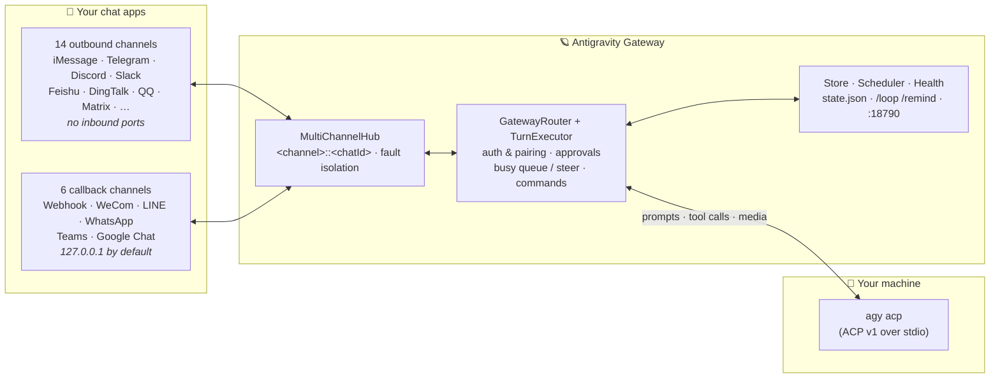

<div align="center">

[English](README.md) | [简体中文](README.zh-CN.md) | [繁體中文](README.zh-TW.md) | [日本語](README.ja.md) | **한국어**

# 🪐 Antigravity Gateway

### 어떤 채팅 앱에서든 내 컴퓨터의 Google Antigravity 에이전트를 조작하세요.

셀프 호스팅 프로세스 하나로 내 **`agy acp`** 를 **20개 메시징 플랫폼**(iMessage, Telegram, Discord, Slack, Feishu, DingTalk, QQ, WeCom, Matrix 등)에 연결합니다. 도구 승인, 실시간 진행 상황, 세션, 예약 실행을 지원하며, 대부분의 채널은 **공개 도메인, 포트 포워딩, 리버스 프록시가 필요 없습니다**.

<p>
  <a href="https://github.com/Relogys/Antigravity-gateway/actions/workflows/ci.yml"></a>
  <a href="https://github.com/Relogys/Antigravity-gateway/actions/workflows/security.yml"></a>
  <a href="https://github.com/Relogys/Antigravity-gateway/releases"></a>
  = 22" />
  
  
  
  
</p>

<p>
  <a href="#compliance"><b>⚖️ 서비스 약관 및 규정 준수</b></a> ·
  <a href="#quick-start"><b>빠른 시작</b></a> ·
  <a href="docs/QUICKSTART.md">3분 가이드</a> ·
  <a href="#channels">채널</a> ·
  <a href="#commands">명령어</a> ·
  <a href="#configuration">설정</a> ·
  <a href="#security">보안</a> ·
  <a href="CHANGELOG.md">변경 기록</a>
</p>

</div>

---

<a id="compliance"></a>

## ⚖️ 서비스 약관 및 규정 준수

> [!CAUTION]
> **설치 전에 이 섹션을 꼭 읽으세요.** Antigravity Gateway는 비공식 서드파티 소프트웨어입니다. Google의 Antigravity 약관은 서드파티를 통한 서비스 접근을 제한하며, 여기에 연결하는 모든 계정, 요금제, 채팅 플랫폼에 대한 책임은 **전적으로 사용자 본인**에게 있습니다.

### 이 프로젝트는

- **독립적인 비공식 프로젝트입니다.** 커뮤니티 오픈 소스 프로젝트이며 Google, Apple, Photon 또는 어떤 채팅 플랫폼이 만든 것이 **아니고**, 이들과 제휴하거나 후원·보증을 받지도 않았습니다. "Google", "Gemini", "Antigravity"는 Google LLC의 상표이며, 그 밖의 이름은 각 소유자에게 있습니다.
- **내 `agy`를 위한 단일 사용자용 셀프 호스팅 클라이언트입니다.** 게이트웨이는 **사용자 본인**이 **자신의 컴퓨터**에 설치하고 로그인한 공식 Antigravity CLI를 로컬 하위 프로세스로 실행합니다(`agy acp`, Agent Client Protocol v1, stdio 위의 JSON-RPC. Google이 편집기용으로 문서화한 것과 같은 인터페이스입니다). 할당량 확인은 `agy -p /usage --output-format json`을 실행합니다. 인증은 `agy`에 설정된 그대로입니다: 본인의 대화형 로그인, 또는 본인의 `GEMINI_API_KEY`.

### 하지 않는 일, 그리고 이를 위해 사용하거나 수정해서는 안 되는 일

- ❌ **리버스 프록시나 중계를 하지 않습니다.** OpenAI 호환 API나 다른 모델 API를 노출하지 않으며, Google 모델 엔드포인트를 직접 호출하지도 않습니다.
- ❌ **OAuth 토큰을 추출하거나 중계하지 않습니다.** `agy`가 캐시한 자격 증명이나 OAuth 토큰을 읽거나, 복사, 저장, 갱신, 전달하지 않습니다.
- ❌ **계정이나 할당량을 공유, 풀링, 순환, 재판매하지 않습니다.** 게이트웨이 하나에 소유자 한 명, 소유자 본인의 계정만 사용합니다.
- ❌ **할당량, 속도 제한, 안전 필터, 사람의 확인 요청을 우회하지 않습니다.**
- ❌ **개인 계정을 여러 사람이 쓰는 공개 서비스로 만들지 않습니다.** `ALLOWED_SENDERS`와 페어링은 본인만 등록하세요. 다른 사람(그룹 멤버, 친구, 고객)이 내 개인 계정을 조작하게 하는 것은 이 프로젝트가 지원하는 사용 방식이 아닙니다.

위 기능을 추가한 포크나 수정본은 이 프로젝트의 목적을 벗어나며, 그 결과는 해당 작성자와 사용자가 모두 책임집니다.

### 개인(소비자) Antigravity 로그인 사용 시 알려진 위험

이 부분은 주의해서 읽어 주세요:

- **[Google Antigravity 추가 서비스 약관](https://antigravity.google/terms)** 은 서비스를 남용, 손상, 방해 또는 교란해서는 안 되며 여기에는 *"당사가 제공하지 않는 제품과 함께 서비스를 사용하는 것"* 이 포함되고, *"서드파티 소프트웨어, 도구 또는 서비스를 사용해 서비스에 접근하는 것은 본 계약 위반"* 이며, 이는 *"Antigravity 및/또는 Gemini CLI 계정의 정지 또는 해지 사유가 될 수 있다"* 고 명시합니다.
- **[Google Antigravity FAQ](https://antigravity.google/docs/faq)** 는 *"소비자 요금제에서는 `agy`를 서드파티 코딩 에이전트나 애플리케이션으로 감싸거나 계정 전환을 자동화하는 것을 지원하지 않는다"* 고 밝히며, 서드파티 도구에는 **Gemini Enterprise** 또는 **Google AI Studio API 키**를 권장합니다.
- 이 게이트웨이는 바로 `agy`를 감싸는 **서드파티 애플리케이션**입니다. Google은 이런 로컬 ACP 클라이언트가 소비자 요금제에서 허용되는지 공개적으로 확인하지 않았습니다(공개 확인 요청: [google-antigravity/antigravity-cli#711](https://github.com/google-antigravity/antigravity-cli/issues/711)).

**따라서 개인 Google 계정(무료, Google AI Pro, Google AI Ultra)으로 이 게이트웨이를 실행하는 것이 허용된다고 가정하지 마세요.** 위험이 더 낮은 방법은 `agy`가 본인의 **`GEMINI_API_KEY`**, **Gemini Enterprise** 로그인, 또는 **Gemini Enterprise Agent Platform** 자격 증명으로 인증하도록 하는 것입니다. 이는 Google이 [ACP 가이드](https://antigravity.google/docs/ide/extensions/acp/)에서 ACP 클라이언트용으로 안내하는 방법입니다. 이 제품들에도 각자의 약관이 있으며, 그것 역시 지켜야 합니다.

(위 약관 인용은 한국어 번역이며, 영어 원문이 우선합니다.)

### Gemini API 키를 사용하는 경우

**[Gemini API 추가 서비스 약관](https://ai.google.dev/gemini-api/terms)** 이 적용되며, 주요 내용은 다음과 같습니다: 만 18세 이상이어야 하고, 이용 가능한 지역에서만 사용해야 하며, Google AI Studio와 Gemini API는 소비자용이 아니라 전문적 또는 비즈니스 목적용이고, **[생성형 AI 금지된 사용 정책](https://policies.google.com/terms/generative-ai/use-policy)** 을 따라야 하며, 에이전트형 서비스에서는 *"사람의 확인 요청을 자동으로 우회해서는 안 됩니다"*. 그러므로:

- `APPROVAL_MODE=interactive`(또는 `sandbox`)를 유지하세요. `APPROVAL_MODE=auto`와 `/yolo`는 `agy`를 `--dangerously-skip-permissions`로 실행하여 모든 도구 호출을 자동 승인합니다.
- 무료 할당량에서는 Google이 프롬프트와 응답을 제품 개선에 사용하고 사람 검토자가 읽을 수 있습니다. 민감하거나 기밀이거나 개인적인 정보를 보내지 마세요.

### 데이터

어떤 채팅 채널로 보내든 그 내용은 프롬프트로 Google에 전달됩니다. Antigravity 약관은 Google이 상호작용을 기록하고, 사람 검토자가 읽을 수 있으며, 기밀 정보를 제출하지 말 것을 안내합니다. 연결한 채팅 플랫폼도 각자의 정책에 따라 메시지를 보고 저장합니다.

### 알아 두어야 할 옵트인 기능

`ANTIGRAVITY_LS_ADDRESS` + `ANTIGRAVITY_CSRF_TOKEN`(`.env.example`에는 없음, **둘 다** 설정해야만 켜짐)을 설정하면 게이트웨이가 세션 제목과 태그를 로컬 Antigravity 앱의 `ConversationService/UpdateConversation` 엔드포인트로 보내 사이드바에서 게이트웨이 세션을 그룹으로 묶습니다. 이는 공개적으로 문서화된 인터페이스가 아닙니다. **가장 엄격하게 준수하려면 둘 다 설정하지 마세요.**

### 채팅 플랫폼 약관

연결하는 각 플랫폼에는 자체 서비스 약관, 개발자 정책, 봇 및 자동화 규칙, 속도 제한, 콘텐츠 규칙이 있으며 모두 지켜야 합니다. 여기에는 Apple(iMessage)과 Photon, Telegram, Discord, Slack, Feishu/Lark, DingTalk, QQ, WeCom, LINE, WhatsApp(Meta), Microsoft Teams, Google Chat, Matrix 홈서버, Mattermost, Zulip, Rocket.Chat, Signal, IRC 네트워크가 포함됩니다.

### 책임 및 보증

- 위 Google 약관과 모든 채팅 플랫폼 약관을 지킬 책임은 사용자 본인에게 있습니다. **위반으로 인한 계정 정지, 차단, 할당량 손실, 요금, 데이터 손실 등 모든 결과는 사용자 본인의 책임입니다.**
- 이 소프트웨어는 [MIT 라이선스](LICENSE)에 따라 **"있는 그대로(AS IS)", 어떠한 보증도 없이** 제공됩니다. 작성자와 기여자는 사용으로 인해 발생하는 어떠한 청구나 손해에 대해서도 책임지지 않습니다.
- 이 섹션은 법률 자문이 아닙니다. 약관은 바뀝니다. 사용 전과 사용 중에 최신 버전을 직접 확인하세요.

<details>
<summary><b>이 섹션의 근거가 된 약관 및 정책</b>(2026-11-26 확인)</summary>

- Google Antigravity 추가 서비스 약관: <https://antigravity.google/terms>
- Google Antigravity FAQ: <https://antigravity.google/docs/faq>
- Google Antigravity, 기타 편집기(ACP): <https://antigravity.google/docs/ide/extensions/acp/>
- Google 서비스 약관: <https://policies.google.com/terms>
- 생성형 AI 금지된 사용 정책: <https://policies.google.com/terms/generative-ai/use-policy>
- Gemini API 추가 서비스 약관: <https://ai.google.dev/gemini-api/terms>
- ACP 통합에 관한 공개 확인 요청: <https://github.com/google-antigravity/antigravity-cli/issues/711>

</details>

---

## ✨ 왜 필요한가요

`agy`는 키보드 앞에서 훌륭합니다. Antigravity Gateway를 쓰면 자리를 떠나서도 내 에이전트를 계속 사용할 수 있습니다:

- 📱 **휴대폰에서 요청.** iMessage, Telegram, Feishu로 메시지를 보내면 에이전트가 내 컴퓨터에서 작업하고 같은 채팅으로 답합니다.
- ✅ **원격으로 도구 승인.** 권한 요청이 채팅으로 전달됩니다. Telegram과 Discord에서는 네이티브 버튼을 누르고, 어디서든 `/approve` 또는 `/deny`로 답할 수 있습니다.
- 🧭 **긴 작업도 통제.** 실시간 진행 카드, `/stop`, `/steer`, 작업 중 대기열, 정체 알림.
- ⏰ **자동화.** 반복 `/loop` 프롬프트(간격, 매일 시각, 5필드 cron)와 재시작 후에도 유지되는 토큰 0개의 `/remind` 알림.
- 🔒 **기본값이 안전.** 실패 시 차단하는 허용 목록과 8자리 DM 페어링, 루프백 전용 리스너, 에이전트 환경에서 채널 비밀값 제거.

---

## 🧩 작동 방식



활성화된 모든 채널은 하나의 공유 라우터로 연결되므로, 어떤 플랫폼이든 인증, 승인, 명령어, 세션 처리가 같습니다. 한 채널에 장애가 나도 다른 채널은 계속 동작합니다.

---

<a id="channels"></a>

## 📡 지원 채널

`.env`에 자격 증명을 넣으면 해당 채널이 자동으로 켜집니다. 원하는 조합을 동시에 실행할 수 있습니다.

| 플랫폼 | 키 | 연결 방식 | 인바운드 포트 필요? |
| :--- | :--- | :--- | :---: |
| 📱 **iMessage / SMS / RCS**(Photon) | `photon` | TLS 기반 Spectrum gRPC(`spectrum-ts`) | 아니요 |
| ✈️ **Telegram** | `telegram` | Bot API 롱 폴링 | 아니요 |
| 🎮 **Discord** | `discord` | Gateway WebSocket(`discord.js`) | 아니요 |
| 💼 **Slack** | `slack` | Socket Mode(`@slack/bolt`) | 아니요 |
| 🪶 **Feishu / Lark** | `feishu` | 공식 WSClient 상시 연결 | 아니요 |
| 🔔 **DingTalk** | `dingtalk` | Stream Mode WebSocket | 아니요 |
| 🐧 **QQ(OneBot v11 경유)**(NapCat / LLOneBot / Lagrange) | `onebot` | 포워드 WebSocket | 아니요 |
| 🤖 **QQ 공식 봇** | `qqbot` | OpenAPI v2 WebSocket 게이트웨이 | 아니요 |
| 🧩 **Matrix**(Element, Beeper, Synapse) | `matrix` | `/sync` 롱 폴링 | 아니요 |
| 💬 **Mattermost** | `mattermost` | WebSocket + REST v4 | 아니요 |
| 🖥️ **IRC** | `irc` | TCP/TLS 클라이언트 | 아니요 |
| 💬 **Zulip** | `zulip` | 실시간 이벤트 롱 폴링 | 아니요 |
| 🚀 **Rocket.Chat** | `rocketchat` | DDP WebSocket + REST | 아니요 |
| 🔒 **Signal**(signal-cli-rest-api) | `signal` | WebSocket, 폴링으로 대체 | 아니요 |
| 🔗 **범용 Webhook / HTTP API** | `webhook` | `POST /v1/messages`, SSE `/v1/events` | 루프백 `:18791` |
| 🏢 **WeCom**(자체 구축 앱) | `wecom` | 암호화 콜백 + REST 푸시 | 루프백 `:18792` |
| 🟢 **LINE** | `line` | Messaging API webhook | 루프백 `:18793` |
| 📗 **WhatsApp Cloud API** | `whatsapp` | Graph API webhook | 루프백 `:18794` |
| 🟣 **Microsoft Teams** | `teams` | Bot Framework / 발신 webhook | 루프백 `:18795` |
| 🔵 **Google Chat** | `googlechat` | Chat 앱 이벤트 / 수신 webhook | 루프백 `:18796` |

SDK를 쓰는 채널은 5개뿐입니다(`spectrum-ts`, `discord.js`, `@slack/bolt`, `@larksuiteoapi/node-sdk`, `dingtalk-stream`). 나머지 15개는 Node 기본 `fetch`, `WebSocket`, `net`/`tls`, `crypto`로 만든 의존성 없는 어댑터입니다.

> [!TIP]
> 처음이라면 **Telegram이 가장 빠릅니다**: 봇 토큰 하나면 되고 공개 도메인이 필요 없습니다. 모든 플랫폼의 설정 방법은 **[docs/QUICKSTART.md](docs/QUICKSTART.md)** 에 있습니다.

---

<a id="quick-start"></a>

## 🚀 빠른 시작

**필요한 것:** Node.js **22 이상**(24 권장), `pnpm`(`corepack enable pnpm`), `PATH`에 있고 인증을 마친 Antigravity CLI `agy`(`agy --version`. 어떤 로그인을 써야 하는지는 [규정 준수](#compliance) 참고), 그리고 최소 한 채널의 자격 증명.

### 소스에서 설치

```bash
git clone https://github.com/Relogys/Antigravity-gateway.git
cd Antigravity-gateway

pnpm setup          # interactive wizard: pick channels, write .env
pnpm build          # compile once
pnpm cli doctor     # check Node, agy, channels, allowlist and ports
pnpm cli start      # start the background daemon
pnpm cli logs -n 120
```

<details>
<summary>수동으로 설정하고 싶다면</summary>

```bash
pnpm install
cp .env.example .env      # PowerShell: Copy-Item .env.example .env
# fill in ONE channel in .env
pnpm build && pnpm cli doctor && pnpm cli start
```

개발 중 핫 리로드가 필요하면 `pnpm dev`를 사용하세요.
</details>

### 릴리스에서 설치(태그에 고정된 설치 스크립트)

설치 스크립트는 GitHub Releases에서 릴리스 tarball과 `SHA256SUMS.txt`를 내려받아 tarball의 SHA-256 체크섬을 검증한 뒤 `npm install -g`를 실행합니다. 이 체크섬은 tarball만 검증하며 설치 스크립트 자체는 검증하지 않습니다. 따라서 설치 스크립트는 `main`이 아닌 릴리스 태그에서 내려받고, 내용을 확인한 뒤 실행하세요.

```bash
# macOS / Linux: 릴리스 태그에서 내려받아 확인한 뒤 실행
curl -fsSLO https://raw.githubusercontent.com/Relogys/Antigravity-gateway/v0.4.2/scripts/install.sh
less install.sh
bash install.sh --version v0.4.2
```

```powershell
# Windows (PowerShell): 릴리스 태그에서 내려받아 확인한 뒤 실행
Invoke-WebRequest https://raw.githubusercontent.com/Relogys/Antigravity-gateway/v0.4.2/scripts/install.ps1 -OutFile install.ps1
notepad .\install.ps1
powershell -ExecutionPolicy Bypass -File .\install.ps1 -Version v0.4.2
```

전역 명령어는 `antigravity-gateway`입니다(`antigravity-gateway init`, `antigravity-gateway doctor`, `antigravity-gateway service install` 등). `.env`가 있는 디렉터리에서 실행하세요.

### 첫 메시지

1. 봇에게 DM을 보냅니다. 허용 목록이 비어 있으면 **8자리 페어링 코드**로 답합니다.
2. 내 컴퓨터에서 승인합니다: `pnpm cli pair approve <CODE>`.
3. 평소처럼 대화합니다. `agy`가 작업하는 동안 메시지는 읽음 처리되고 👀 반응이 붙으며, 끝나면 👍(오류 시 👎)로 바뀝니다.

> [!NOTE]
> `agy`가 인증되지 않았다면 게이트웨이는 시작되지만 답하지 않습니다. 터미널에서 `agy`를 한 번 실행해 로그인하거나 `GEMINI_API_KEY`를 설정하세요.

---

## 🎛️ 기능

<table>
<tr>
<td width="50%" valign="top">

**에이전트 제어**
- 대화형, 샌드박스, 자동 도구 승인을 채팅별로 전환
- Telegram(인라인 키보드)과 Discord(버튼 컴포넌트)의 네이티브 승인 버튼. 입력 명령어와 같은 허용 목록 및 요청자 검사를 적용
- 작업 중 정책: `queue`, `interrupt`, `steer`
- 채팅에서 모델, 추론 강도, ACP 모드 전환
- ACP 세션 목록, 재개, 제목 지정, 압축
- 채널별 세션 그룹, 작업 디렉터리, 워크스페이스 북마크(`/cwd @alias`)
- 일시적 실패 자동 재시도, 상위 ACP 세션 만료 시 자동 복구

</td>
<td width="50%" valign="top">

**채팅 경험**
- 플랫폼별 네이티브 렌더링: iMessage 스타일, Telegram HTML, IRC·LINE·Signal·OneBot용 일반 텍스트 정리
- Telegram, Discord, Slack에서는 실시간 진행 카드 하나를 제자리에서 갱신
- Photon, Telegram, Discord, WhatsApp, Matrix에서 받은 이미지를 첨부 파일로 `agy`에 전달
- 연달아 보낸 짧은 메시지를 하나의 프롬프트로 병합
- 긴 답변을 깔끔하게 나누고 코드 펜스를 유지

</td>
</tr>
<tr>
<td valign="top">

**자동화**
- `/loop` 반복 프롬프트: 간격(`30m`, `2h`, `1d`), `daily HH:MM`, 또는 표준 5필드 cron
- 예약 루프는 별도 세션에서 실행되어 채팅 기록이나 작업 디렉터리를 건드리지 않음
- AI 토큰을 쓰지 않는 단방향 알림 `/remind`
- 토큰 0개로 할당량을 확인하는 `/usage`(잔량 부족 경고 포함)
- 스크립트에서 메시지를 보내는 `pnpm cli send`
- CI 이벤트를 채팅으로 보내는 GitHub Action

</td>
<td valign="top">

**운영**
- PID 잠금과 정상 종료를 지원하는 데몬 CLI
- launchd, systemd `--user`, 작업 스케줄러를 통한 자동 시작
- `/healthz`, `/readyz`, `/status`, Prometheus `/metrics` 엔드포인트
- 비밀값을 가리는 JSON 로그(`LOG_FORMAT=json`, 선택)
- 비밀값 없는 백업과 이전(`pnpm cli export` / `import`)
- GHCR의 Docker 이미지(`amd64` + `arm64`)
- 반쯤 열린 스트림을 다시 연결하는 Photon 하트비트 감시

</td>
</tr>
</table>

---

<a id="commands"></a>

## 💬 채팅 명령어

어느 채팅에서든 `/help`를 보내면 전체 목록이 나옵니다. 대부분의 명령어는 `-h`를 붙이면 사용법을 보여 줍니다.

**항상 사용 가능(작업 중에도)**

| 명령어 | 기능 |
| :--- | :--- |
| `/stop` | 진행 중인 작업 취소 |
| `/new [title]` · `/reset` | 새 세션 시작(제목 지정 가능) |
| `/steer <prompt>` · `/s` | 현재 작업을 중단하고 방향 전환 |
| `/queue [prompt\|list\|clear]` · `/q` | 후속 프롬프트를 대기열에 추가, 목록 보기, 비우기 |
| `/busy [queue\|interrupt\|steer]` | 작업 중에 온 메시지 처리 방식 선택 |
| `/approve [once\|session\|always]` · `/deny [reason]` | 대기 중인 도구 권한에 응답(Telegram / Discord에서는 버튼도 가능) |
| `/yolo` | 이 채팅의 자동 승인 전환(그룹에서는 관리자만) |
| `/progress [auto\|edit\|silence\|off\|keep\|delete]` | 실시간 진행 표시 방식과 카드 유지 여부 |
| `/verbose [off\|brief\|full]` | 진행 알림의 상세도 |
| `/status` · `/ping` | 세션, 모델, 대기열, 가동 시간 |
| `/channels` | 모든 채널의 연결 상태 |
| `/usage` | Antigravity 5시간 및 주간 할당량(토큰 0개) |
| `/sethome` | 이 채팅을 복구용 홈으로 지정 |
| `/whoami` · `/version` · `/help` | 게이트웨이가 보는 나, 버전, 도움말 |

**유휴 상태일 때**

| 명령어 | 기능 |
| :--- | :--- |
| `/retry` | 이 채팅의 마지막 프롬프트 다시 실행 |
| `/model [slug]` · `/effort [low\|medium\|high\|xhigh]` | 모델과 추론 강도 보기 또는 전환 |
| `/mode [default\|accept-edits\|auto\|plan]` | ACP 세션 모드 |
| `/approvals [auto\|interactive\|sandbox]` | 도구 승인 정책 |
| `/sessions [channel\|all]` · `/groups` | 세션 목록, 채널 세션 그룹 요약 |
| `/resume <id\|index>` · `/title [name]` | 저장된 세션 재개, 이름 변경 |
| `/compact` · `/compress` | 컨텍스트 요약 및 압축 |
| `/cwd [path\|@alias]` | 작업 디렉터리 변경(새 세션 시작) |
| `/cwd save <alias> [path]` · `/cwd rm <alias>` · `/cwd list` | 워크스페이스 북마크 관리 |
| `/discard` | 로컬 세션 상태와 대기열 삭제 |
| `/loop [list\|add <dur> <prompt>\|rm\|pause\|resume <id>]` | 간격 루프 |
| `/loop daily <HH:MM> <prompt>` · `/loop cron "<m h dom mon dow>" <prompt>` | 매일 또는 5필드 cron 루프 |
| `/remind <dur> <text>` | 단방향 알림(토큰 0개) |

**iMessage 전용(Photon)**: `/poll <q> | <a> | <b>` 네이티브 투표 · `/bg [preset|clear|list]` 24개 배경 중 선택 · `/unsend` 마지막 답장 회수(약 2분 이내) · `/card` 연락처 카드 공유.

---

## 🛠️ 관리 CLI

```bash
pnpm cli init [--yes] [--channels 1,2]   # setup wizard (alias: pnpm setup)
pnpm cli start [--foreground]     # start (daemon by default)
pnpm cli stop | restart           # graceful, PID-verified
pnpm cli logs -n 200              # tail the rotating log
pnpm cli status                   # live health + store summary
pnpm cli doctor [--json] [--probe-acp]   # check Node, agy and every channel
pnpm cli usage                    # 0-token quota check
pnpm cli send --channel telegram --to <chatId> "Hi"

pnpm cli pair list | clear
pnpm cli pair approve <CODE>
pnpm cli pair revoke telegram:<userId>

pnpm cli export [--out <file>] [--include-auth]
pnpm cli import <file> [--dry-run] [--overwrite] [--include-auth] [--remap-cwd <from>=<to>]

pnpm cli service install | uninstall | status
pnpm cli service print --platform darwin|linux   # preview the unit file
```

`export`는 세션, 예약 루프, 워크스페이스 북마크를 버전이 붙은 JSON 번들로 저장합니다. `.env`는 절대 포함하지 않으며, `--include-auth`를 주지 않는 한 허용 목록과 페어링도 포함하지 않습니다. `--remap-cwd`는 다른 컴퓨터나 운영체제로 옮길 때 경로를 바꿔 씁니다.

---

<a id="configuration"></a>

## ⚙️ 설정

모든 설정은 `.env`에 있습니다. **[`.env.example`](.env.example)이 주석이 달린 전체 참고 자료입니다.** 값을 비워 두면 해당 기능이나 채널이 꺼집니다.

### 핵심 설정

```env
# Who may talk to the agent. Photon: E.164 numbers or Apple ID emails.
# Other channels: "<channel>:<userId>", e.g. telegram:123456789
ALLOWED_SENDERS=
ADMIN_SENDERS=                 # may approve others' requests and /yolo in groups
ALLOW_GROUPS=false
GROUP_MENTION_PATTERNS=@agy,@antigravity

AGY_BIN=agy
DEFAULT_CWD=.                  # per channel: TELEGRAM_CWD=, PHOTON_CWD=, ...
WORKSPACE_ALIASES=             # e.g. api=/srv/api,web=/srv/web  ->  /cwd @api
APPROVAL_MODE=interactive      # interactive | sandbox | auto
DEFAULT_MODEL=
DEFAULT_EFFORT=
GEMINI_API_KEY=                # optional; disables /usage reporting
AGY_PASSTHROUGH_ENV=           # stripped env var names to pass to agy anyway

DATA_DIR=./data
LOG_DIR=
LOG_LEVEL=info
LOG_FORMAT=text                # text | json
```

모든 허용 목록이 비어 있으면 **모두 거부**하며, DM에는 대신 페어링 코드가 전송됩니다.

<details>
<summary><b>채널 자격 증명</b>(각 채널을 켜는 값)</summary>

| 채널 | 필수 | 자주 쓰는 선택 항목 |
| :--- | :--- | :--- |
| `photon` | `SPECTRUM_PROJECT_ID`, `SPECTRUM_PROJECT_SECRET` | `PHOTON_READ_RECEIPTS`, `PHOTON_REACTIONS`, `PHOTON_MAX_CHUNK_CHARS=1600`, `PHOTON_HEARTBEAT_TIMEOUT_MS`, `PHOTON_PROBE_SPACE_ID` |
| `telegram` | `TELEGRAM_BOT_TOKEN` | `TELEGRAM_ALLOWED_USERS`, `TELEGRAM_POLL_TIMEOUT_SEC` |
| `discord` | `DISCORD_BOT_TOKEN` | `DISCORD_ALLOWED_USERS`, `DISCORD_ALLOW_GUILDS` |
| `slack` | `SLACK_BOT_TOKEN` (`xoxb-`), `SLACK_APP_TOKEN` (`xapp-`) | `SLACK_ALLOWED_USERS` |
| `feishu` | `FEISHU_APP_ID`, `FEISHU_APP_SECRET` | `FEISHU_DOMAIN=feishu\|lark`, `FEISHU_ALLOWED_USERS` |
| `dingtalk` | `DINGTALK_CLIENT_ID`, `DINGTALK_CLIENT_SECRET` | `DINGTALK_ALLOWED_USERS` |
| `onebot` | `ONEBOT_WS_URL` | `ONEBOT_ACCESS_TOKEN`, `ONEBOT_SELF_ID`, `ONEBOT_ALLOWED_USERS` |
| `qqbot` | `QQBOT_APP_ID`, `QQBOT_CLIENT_SECRET` | `QQBOT_SANDBOX`, `QQBOT_ALLOWED_USERS` |
| `wecom` | `WECOM_CORP_ID`, `WECOM_AGENT_ID`, `WECOM_SECRET` | `WECOM_TOKEN`, `WECOM_ENCODING_AES_KEY`, `WECOM_HOST`, `WECOM_PORT` |
| `matrix` | `MATRIX_HOMESERVER_URL`, `MATRIX_ACCESS_TOKEN` | `MATRIX_USER_ID`, `MATRIX_ALLOWED_USERS` |
| `mattermost` | `MATTERMOST_BASE_URL`, `MATTERMOST_BOT_TOKEN` | `MATTERMOST_ALLOWED_USERS` |
| `line` | `LINE_CHANNEL_ACCESS_TOKEN`, `LINE_CHANNEL_SECRET` | `LINE_HOST`, `LINE_PORT` |
| `irc` | `IRC_HOST`, `IRC_CHANNELS` | `IRC_PORT=6697`, `IRC_TLS`, `IRC_NICK`, `IRC_PASSWORD` |
| `whatsapp` | `WHATSAPP_ACCESS_TOKEN`, `WHATSAPP_PHONE_NUMBER_ID` | `WHATSAPP_VERIFY_TOKEN`, `WHATSAPP_APP_SECRET`, `WHATSAPP_WEBHOOK_*` |
| `zulip` | `ZULIP_SITE`, `ZULIP_BOT_EMAIL`, `ZULIP_API_KEY` | `ZULIP_STREAMS`, `ZULIP_REQUIRE_MENTION` |
| `rocketchat` | `ROCKETCHAT_URL`, `ROCKETCHAT_USER_ID`, `ROCKETCHAT_AUTH_TOKEN` | `ROCKETCHAT_REQUIRE_MENTION` |
| `signal` | `SIGNAL_API_URL`, `SIGNAL_ACCOUNT` | `SIGNAL_POLL_INTERVAL_MS` |
| `teams` | `TEAMS_WEBHOOK_SECRET`, **또는** `TEAMS_APP_ID` + `TEAMS_APP_PASSWORD`, **또는** `TEAMS_INCOMING_WEBHOOK_URL` | `TEAMS_TENANT_ID`, `TEAMS_WEBHOOK_*` |
| `googlechat` | `GOOGLECHAT_WEBHOOK_URL`, `GOOGLECHAT_ACCESS_TOKEN`, `GOOGLECHAT_VERIFICATION_TOKEN` 중 하나 | `GOOGLECHAT_AUDIENCE`(권장), `GOOGLECHAT_WEBHOOK_*` |
| `webhook` | `WEBHOOK_ENABLED=true` | `WEBHOOK_TOKEN`, `WEBHOOK_SECRET`, `WEBHOOK_CALLBACK_URL`, `WEBHOOK_FIXED_SENDER`, `WEBHOOK_REPLAY_WINDOW_SEC`, `WEBHOOK_REQUIRE_TIMESTAMP` |

모든 채널은 `<CHANNEL>_ALLOWED_USERS`도 받으며, 이는 `ALLOWED_SENDERS` 및 페어링된 발신자와 합쳐집니다.

**Photon 팁:** 메시지를 보낼 핸들을 *Photon Dashboard → Users*에 등록하세요(정확한 식별자는 `https://debug.photon.codes`에서 확인). 공유 iMessage 풀에서는 Apple 기기에서 프로젝트 번호로 **첫** 메시지를 먼저 보내야 합니다. 그렇지 않으면 답장이 `Target not allowed for this project`로 실패합니다.
</details>

<details>
<summary><b>긴 작업과 진행 상황</b></summary>

```env
TOOL_PROGRESS_MODE=auto            # auto | edit | silence | off
TOOL_PROGRESS_KEEP=false           # true keeps a summary card after the reply
TOOL_PROGRESS_EDIT_INTERVAL_MS=1500
PROGRESS_SILENCE_MS=120000         # pulse after this much silence (0 = off)
SESSION_STALL_TIMEOUT_MS=300000    # warn once when a turn stalls
TURN_MAX_RETRIES=2                 # retries for transient ACP failures
INGRESS_DEBOUNCE_MS=350            # merge rapid-fire bubbles
AUTO_BOOTSTRAP_CHANNEL_SESSION=true
QUOTA_WARN_THRESHOLD=15            # % of 5-hour quota left
```

`auto`는 플랫폼이 허용하면 카드 하나를 제자리에서 편집하고, iMessage에서는 Apple의 5회 편집 제한을 넘지 않도록 짧은 알림을 사용합니다.
</details>

<details>
<summary><b>상태 확인, 메트릭, 로컬 포트</b></summary>

```env
HEALTH_ENABLED=false
HEALTH_HOST=127.0.0.1
HEALTH_PORT=18790
HEALTH_TOKEN=          # Bearer token for /status and /metrics; set it if you bind beyond loopback
```

| 엔드포인트 | 의미 |
| :--- | :--- |
| `GET /healthz` | 생존 확인: 하나 이상의 채널이 연결되어 있으면 `200` |
| `GET /readyz` | 준비 확인: 설정된 모든 채널이 연결되어 있을 때만 `200` |
| `GET /status` | 채널별 상세 진단, 오류는 가림 처리 |
| `GET /metrics` | Prometheus 텍스트 형식, 카디널리티 제한, 발신자나 채팅 ID 없음 |

| 포트 | 용도 |
| :--- | :--- |
| `18790` | 상태 확인 서버 |
| `18791`–`18796` | `webhook`, `wecom`, `line`, `whatsapp`, `teams`, `googlechat` 콜백 |

기본적으로 모두 `127.0.0.1`에 바인딩됩니다. 콜백은 해당 플랫폼이 요구할 때만, 직접 운영하는 TLS 리버스 프록시나 터널을 통해서만 노출하세요.
</details>

<details>
<summary><b>Webhook / HTTP API</b></summary>

```bash
curl -X POST http://127.0.0.1:18791/v1/messages \
  -H "Authorization: Bearer $WEBHOOK_TOKEN" \
  -H "Content-Type: application/json" \
  -d '{"chatId":"ops","text":"summarize the git log for today","wait":true}'
```

`"wait": true`를 주면 `{ "ok": true, "messageId": "...", "replies": [...] }`가 동기적으로 반환됩니다. 그렇지 않으면 `GET /v1/events`(SSE)를 구독하거나 `WEBHOOK_CALLBACK_URL`을 설정하세요. 요청은 `X-Webhook-Signature: sha256=<hmac>`로 서명할 수 있고, `X-Webhook-Timestamp`와 `X-Webhook-Id`로 재전송을 막습니다. 토큰이나 시크릿이 없으면 게이트웨이는 루프백이 아닌 주소에 바인딩하지 않습니다.

이 엔드포인트는 본인의 스크립트와 도구용입니다. 다른 사람에게 에이전트를 제공하는 데 쓰지 마세요([규정 준수](#compliance) 참고).
</details>

---

## 📦 배포

### 서비스로 실행

```bash
pnpm build
pnpm cli service install     # macOS launchd · Linux systemd --user · Windows Task Scheduler
```

스크립트가 더 편하다면 [`scripts/`](scripts/)를 보세요: `install-launchd.sh`, `install-systemd.sh`, `install-task.ps1`, 그리고 충돌 시 백오프하는 감독 스크립트 `start-gateway.sh` / `start-gateway.ps1`(2초→60초 백오프, 5 MB 로그 순환).

### Docker

```bash
cp .env.example .env               # fill in at least one channel
docker compose pull && docker compose up -d     # or: docker compose up -d --build
curl http://127.0.0.1:18790/healthz
```

이미지: `ghcr.io/relogys/antigravity-gateway`(`latest`와 `vX.Y.Z`, `amd64` + `arm64`). root가 아닌 사용자로 실행되고, `.env`를 읽기 전용으로 읽으며, 상태는 `./data`에 두고, `127.0.0.1:18790`만 공개합니다. `agy`는 포함되어 있지 않습니다: 본인의 바이너리와 본인의 자격 증명을 마운트하거나 본인의 `GEMINI_API_KEY`를 설정하세요. Linux에서는 먼저 `mkdir -p data && sudo chown -R 1000:1000 data`를 실행하세요. 자세한 내용은 [Docker 가이드](docs/QUICKSTART.md#4-docker--容器部署)를 참고하세요.

### GitHub Actions에서 알림 보내기

```yaml
- uses: Relogys/Antigravity-gateway/.github/actions/notify@v0.4.2
  with:
    url: ${{ secrets.GATEWAY_WEBHOOK_URL }}
    secret: ${{ secrets.GATEWAY_WEBHOOK_SECRET }}
    chat-id: ops-alerts
    text: "Deployed ${{ github.ref_name }}"
```

---

<a id="security"></a>

## 🔐 보안

- **실패 시 차단.** 알 수 없는 발신자에게는 페어링 코드만 보냅니다: 헷갈리지 않는 8자리, 1시간 유효, 5번 틀리면 잠금.
- **그룹 승인은 요청자에게 묶임.** 도구 호출을 일으킨 사람이나 `ADMIN_SENDERS` 멤버만 명령어든 버튼이든 승인할 수 있습니다. 그룹에서 `/yolo`는 관리자 전용입니다.
- **깨끗한 하위 프로세스 환경.** `agy acp`를 실행하기 전에 게이트웨이는 모든 채널 자격 증명 변수군(`TELEGRAM_*`, `SLACK_*` 등)과 자체 내부 설정(허용 목록, 상태 확인·진행 설정, `ANTIGRAVITY_*`)을 제거합니다. `PATH`, `HOME`, `GEMINI_API_KEY`, Google Cloud 설정 같은 다른 변수는 그대로 `agy`에 전달됩니다. `AGY_PASSTHROUGH_ENV`로 제거된 특정 키를 다시 통과시킬 수 있습니다.
- **콜백 검증.** Webhook(Bearer + HMAC + 재전송 방지), Google Chat(`GOOGLECHAT_AUDIENCE`를 통한 RS256 OIDC), WeCom(WXBizMsgCrypt), LINE, WhatsApp, Teams 서명을 처리 전에 확인합니다. Authorization 헤더는 선형 시간으로 파싱합니다.
- **채팅으로 새지 않음.** 모든 채널에서 `file:///` IDE 경로를 제거하고, 발신 `MEDIA:`는 `.env*`, `.ssh`, 개인 키를 거부하며, 상태 확인 오류는 가림 처리합니다.
- **견고한 상태 저장.** 프로세스 간 저장소 잠금, `.bak` 롤백, 손상 파일 격리.
- **CI 검사.** 푸시할 때마다 CodeQL, 의존성 감사, `pnpm audit:secrets`를 실행합니다.

취약점을 발견했다면 공개 이슈 대신 [SECURITY.md](SECURITY.md)의 절차를 따라 주세요.

---

## 🧱 나만의 채널 추가

`src/channels/<name>.ts`를 만들고 [`BaseChannelAdapter`](src/channels/base.ts)를 상속한 뒤 `createAdapter(config)`를 export하고, [`src/config.ts`](src/config.ts)에 설정 블록을 추가하세요:

```ts
import type { GatewayConfig } from "../config.js";
import { BaseChannelAdapter, type InboundHandler } from "./base.js";
import type { ChannelAdapter, OutboundMessage } from "../types.js";

export class MyChatAdapter extends BaseChannelAdapter {
  readonly name = "my-chat";

  async start(onMessage: InboundHandler): Promise<void> {
    this.handler = onMessage;
    this.setConnected(true);
    // call `await this.emit({ ... })` with the raw chatId and senderId
  }

  async stop(): Promise<void> {
    this.setConnected(false);
  }

  async sendMessage(msg: OutboundMessage) {
    this.noteOutbound();
    return { messageId: "outbound-id" };
  }
}

export function createAdapter(config: GatewayConfig): ChannelAdapter {
  return new MyChatAdapter();
}
```

선택 훅(`sendTyping`, `markRead`, `react`, `editMessage`, `deleteMessage`)은 자동으로 감지됩니다. `editMessage`와 `deleteMessage`를 구현하면 실시간 진행 카드를 쓸 수 있습니다.

---

## 🧪 개발

```bash
pnpm install
pnpm dev            # run from source with tsx
pnpm typecheck
pnpm test           # vitest, 42 test files
pnpm probe:acp      # smoke-test the agy ACP connection
pnpm audit:secrets
```

CI는 Ubuntu(Node 22, 24), macOS(Apple Silicon, Node 24), Windows(Node 24)와 Docker 빌드에서 실행됩니다. Markdown이나 `LICENSE`만 바꾼 PR은 무거운 매트릭스를 건너뛰지만 필수 검사는 정상적으로 보고됩니다. `vX.Y.Z` 태그를 달면 GHCR 이미지와, npm tarball 및 `SHA256SUMS.txt`가 포함된 GitHub Release가 게시됩니다.

<details>
<summary>프로젝트 구조</summary>

```
src/
├── acp/           # agy acp client, sessions, permissions, quota
├── channels/      # 20 adapters + hub, registry, formatting, media
├── gateway/       # router, turn executor, burst coalescing, progress, scheduler, store
│   └── commands/  # session, system, loop and Photon slash commands
├── photon/        # iMessage adapter, formatting, staleness probe
├── backup.ts      # export / import bundles
├── cli.ts         # admin CLI (start/stop/doctor/pair/export/service/…)
├── wizard.ts      # pnpm setup onboarding
├── health.ts      # /healthz /readyz /status /metrics
└── index.ts       # entry point
scripts/           # installers, service installers, supervisors, audits
docs/QUICKSTART.md # per-platform setup and troubleshooting
```
</details>

---

## 📚 더 보기

- [docs/QUICKSTART.md](docs/QUICKSTART.md): 플랫폼별 자격 증명, Docker, 일상 운영, 문제 해결
- [CHANGELOG.md](CHANGELOG.md): 릴리스별 변경 사항
- [SECURITY.md](SECURITY.md): 취약점 보고

## 📄 라이선스

[MIT](LICENSE) © Relogys. "있는 그대로", 어떠한 보증도 없이 제공됩니다.

<sub>Antigravity Gateway는 독립적인 오픈 소스 프로젝트이며 Google과 제휴하거나 Google의 후원 또는 보증을 받지 않았습니다. [서비스 약관 및 규정 준수](#compliance)를 참고하세요.</sub>
