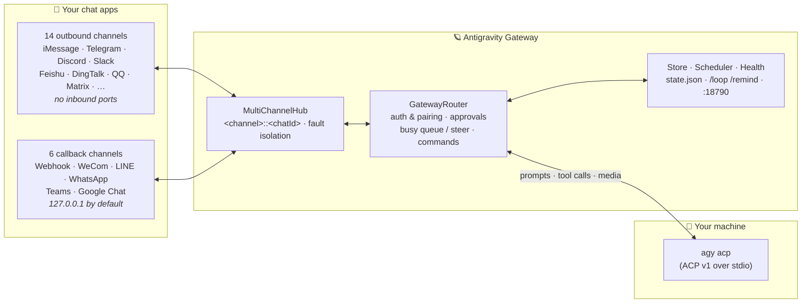

<div align="center">

# 🪐 Antigravity Gateway

### Drive your local Google Antigravity agent from any chat app.
### 在任何聊天软件里，远程驱动你本机的 Google Antigravity Agent。

One process bridges **`agy acp`** to **20 messaging platforms** (iMessage, Telegram, Discord, Slack, Feishu, DingTalk, QQ, WeCom, Matrix and more), with tool approvals, live progress, sessions and schedules, all **without a public domain, port forwarding or a reverse proxy**.

<p>
  <a href="https://github.com/Relogys/Antigravity-gateway/actions/workflows/ci.yml"></a>
  <a href="https://github.com/Relogys/Antigravity-gateway/actions/workflows/security.yml"></a>
  <a href="https://github.com/Relogys/Antigravity-gateway/releases"></a>
  = 22" />
  
  
  
  
</p>

<p>
  <a href="#-quick-start--快速开始"><b>Quick Start</b></a> ·
  <a href="docs/QUICKSTART.md">3-Minute Guide</a> ·
  <a href="#-supported-channels--支持平台">Channels</a> ·
  <a href="#-chat-commands--聊天命令">Commands</a> ·
  <a href="#%EF%B8%8F-configuration--配置">Configuration</a> ·
  <a href="#-security--安全">Security</a> ·
  <a href="CHANGELOG.md">Changelog</a>
</p>

</div>

---

## ✨ Why / 为什么需要它

`agy` is great at the keyboard. Antigravity Gateway lets you keep using it when you walk away:

- 📱 **Ask from your phone.** Send a message in iMessage, Telegram or Feishu; your agent works on your machine and replies in the same chat.
- ✅ **Approve tools remotely.** Permission prompts are forwarded to chat. Reply `/approve` or `/deny`, or switch to sandbox/auto mode.
- 🧭 **Stay in control of long turns.** A live progress card, `/stop`, `/steer`, a busy queue and stall alerts.
- ⏰ **Automate.** Recurring `/loop` prompts and zero-token `/remind` pushes that survive restarts.
- 🔒 **Safe by default.** Fail-closed allowlists with 8-character DM pairing, loopback-only listeners, and secrets stripped from the agent's environment.

> 中文简介：把本机已登录的 Antigravity CLI（`agy acp`）接到 20 个聊天平台。人不在电脑前，也能在手机上提问、审批工具调用、查看进度、管理会话和定时任务。14 个平台为纯出站连接，无需公网域名和内网穿透。

> [!IMPORTANT]
> **Compliance / 合规声明.** This is a client-side companion for the official CLI. It talks to **your own** signed-in `agy acp` over the official Agent Client Protocol, or to your own `GEMINI_API_KEY`. It does **not** proxy, extract or share OAuth tokens or accounts, and it does not bypass quotas.
> 本项目不提供反向代理、OAuth 凭据提取或中转、账号共享、额度绕过等任何违反 Google 服务条款的能力。

---

## 🧩 How it works / 工作原理



Each enabled channel feeds one shared router, so every platform gets the same auth, approvals, commands and session handling. If one channel fails, the others keep running.

---

## 📡 Supported channels / 支持平台

A channel turns on automatically once its credentials are in `.env`. Run any combination at the same time.

| Platform | Key | Connection | Needs inbound port? |
| :--- | :--- | :--- | :---: |
| 📱 **iMessage / SMS / RCS** (Photon) | `photon` | Spectrum gRPC over TLS (`spectrum-ts`) | No |
| ✈️ **Telegram** | `telegram` | Bot API long polling | No |
| 🎮 **Discord** | `discord` | Gateway WebSocket (`discord.js`) | No |
| 💼 **Slack** | `slack` | Socket Mode (`@slack/bolt`) | No |
| 🪶 **Feishu / Lark 飞书** | `feishu` | Official WSClient long connection | No |
| 🔔 **DingTalk 钉钉** | `dingtalk` | Stream Mode WebSocket | No |
| 🐧 **QQ via OneBot v11** (NapCat / LLOneBot / Lagrange) | `onebot` | Forward WebSocket | No |
| 🤖 **QQ Official Bot QQ 官方机器人** | `qqbot` | OpenAPI v2 WebSocket gateway | No |
| 🧩 **Matrix** (Element, Beeper, Synapse) | `matrix` | `/sync` long polling | No |
| 💬 **Mattermost** | `mattermost` | WebSocket + REST v4 | No |
| 🖥️ **IRC** | `irc` | TCP/TLS client | No |
| 💬 **Zulip** | `zulip` | Real-time events long polling | No |
| 🚀 **Rocket.Chat** | `rocketchat` | DDP WebSocket + REST | No |
| 🔒 **Signal** (signal-cli-rest-api) | `signal` | WebSocket, polling fallback | No |
| 🔗 **Generic Webhook / HTTP API** | `webhook` | `POST /v1/messages`, SSE `/v1/events` | Loopback `:18791` |
| 🏢 **WeCom 企业微信** (self-built app) | `wecom` | Encrypted callback + REST push | Loopback `:18792` |
| 🟢 **LINE** | `line` | Messaging API webhook | Loopback `:18793` |
| 📗 **WhatsApp Cloud API** | `whatsapp` | Graph API webhook | Loopback `:18794` |
| 🟣 **Microsoft Teams** | `teams` | Bot Framework / outgoing webhook | Loopback `:18795` |
| 🔵 **Google Chat** | `googlechat` | Chat app events / incoming webhook | Loopback `:18796` |

Only 5 channels use an SDK (`spectrum-ts`, `discord.js`, `@slack/bolt`, `@larksuiteoapi/node-sdk`, `dingtalk-stream`). The other 15 are dependency-free adapters built on Node's own `fetch`, `WebSocket`, `net`/`tls` and `crypto`.

> [!TIP]
> New to this? **Telegram is the quickest start**: one bot token, no public domain. Setup for every platform is in **[docs/QUICKSTART.md](docs/QUICKSTART.md)**.

---

## 🚀 Quick start / 快速开始

**You need / 准备：** Node.js **22+** (24 recommended), `pnpm` (`corepack enable pnpm`), the Antigravity CLI `agy` on your `PATH` and signed in (`agy --version`), plus credentials for at least one channel.

```bash
git clone https://github.com/Relogys/Antigravity-gateway.git
cd Antigravity-gateway

pnpm setup          # interactive wizard: pick channels, write .env
pnpm build          # compile once
pnpm cli doctor     # check Node, agy, channels, allowlist and ports
pnpm cli start      # start the background daemon
pnpm cli logs -n 120
```

<details>
<summary>Prefer manual setup? / 手动配置</summary>

```bash
pnpm install
cp .env.example .env      # PowerShell: Copy-Item .env.example .env
# fill in ONE channel in .env
pnpm build && pnpm cli doctor && pnpm cli start
```

For hot reload during development, use `pnpm dev`.
</details>

### Your first message / 第一次对话

1. DM your bot. With no allowlist configured, it replies with an **8-character pairing code**.
2. On your machine, approve it: `pnpm cli pair approve <CODE>`.
3. Chat normally. Your message gets marked read and a 👀 reaction while `agy` works, then 👍 when it's done (👎 on error).

> 中文提示：未登录 `agy` 时网关能启动但不会回复，请先在终端运行一次 `agy` 完成登录，或改用 `GEMINI_API_KEY`。

---

## 🎛️ Features / 功能一览

<table>
<tr>
<td width="50%" valign="top">

**Agent control**
- Interactive, sandbox or auto tool approval, switchable per chat
- Busy-turn policy: `queue`, `interrupt` or `steer`
- Switch model, effort and ACP mode from chat
- List, resume, title and compact ACP sessions
- Per-channel session groups and working directories
- Automatic retry of transient turn failures

</td>
<td width="50%" valign="top">

**Chat experience**
- Native rendering per platform: iMessage styling, Telegram HTML, plain-text cleanup for IRC, LINE, Signal and OneBot
- One live progress card edited in place on Telegram, Discord and Slack
- Images in from Photon, Telegram, Discord, WhatsApp and Matrix, passed to `agy` as attachments
- Bursts of quick messages merged into one prompt
- Long replies split cleanly, code fences kept intact

</td>
</tr>
<tr>
<td valign="top">

**Automation**
- `/loop` recurring prompts (`30m`, `2h`, `1d`)
- `/remind` one-way pushes that use 0 AI tokens
- `/usage` quota check that uses 0 tokens, with a low-quota warning
- `pnpm cli send` to push a message from scripts
- A GitHub Action to post CI events into your chat

</td>
<td valign="top">

**Operations**
- Daemon CLI with PID lock and graceful stop
- Autostart via launchd, systemd `--user` or Task Scheduler
- `/healthz`, `/readyz` and `/status` endpoints
- Docker image on GHCR (`amd64` + `arm64`)
- Photon heartbeat watchdog that reconnects half-open streams

</td>
</tr>
</table>

---

## 💬 Chat commands / 聊天命令

Send `/help` in any chat for the full list. Add `-h` to most commands for usage.

**Always available, even mid-turn / 运行中随时可用**

| Command | What it does |
| :--- | :--- |
| `/stop` | Cancel the active turn |
| `/new [title]` · `/reset` | Start a fresh session (optionally titled) |
| `/steer <prompt>` · `/s` | Interrupt and redirect the current turn |
| `/queue [prompt\|list\|clear]` · `/q` | Queue a follow-up, list or clear the queue |
| `/busy [queue\|interrupt\|steer]` | Choose what happens to messages sent mid-turn |
| `/approve [once\|session\|always]` · `/deny [reason]` | Answer a pending tool permission |
| `/yolo` | Toggle auto-approval for this chat (admins only in groups) |
| `/progress [auto\|edit\|silence\|off\|keep\|delete]` | Live progress style and whether the card stays |
| `/verbose [off\|brief\|full]` | How detailed progress pulses are |
| `/status` · `/ping` | Session, model, queue and uptime |
| `/channels` | Connection state of every channel |
| `/usage` | Antigravity 5-hour and weekly quota (0 tokens) |
| `/sethome` | Make this chat the recovery home |
| `/whoami` · `/version` · `/help` | Who you are to the gateway, version, help |

**When idle / 空闲时**

| Command | What it does |
| :--- | :--- |
| `/retry` | Re-run the last prompt in this chat |
| `/model [slug]` · `/effort [low\|medium\|high\|xhigh]` | Show or switch model and reasoning effort |
| `/mode [default\|accept-edits\|auto\|plan]` | ACP session mode |
| `/approvals [auto\|interactive\|sandbox]` | Tool approval policy |
| `/sessions [channel\|all]` · `/groups` | List sessions, summarize channel session groups |
| `/resume <id\|index>` · `/title [name]` | Resume a saved session, rename it |
| `/compact` · `/compress` | Summarize and compact context |
| `/cwd [path]` · `/discard` | Change working directory, drop local session state |
| `/loop [list\|add <dur> <prompt>\|rm\|pause\|resume <id>]` | Recurring prompts |
| `/remind <dur> <text>` | One-way reminder (0 tokens) |

**iMessage only (Photon) / 仅 iMessage**: `/poll <q> | <a> | <b>` native poll · `/bg [preset|clear|list]` one of 24 backgrounds · `/unsend` retract the last reply (~2 min) · `/card` share contact card.

---

## 🛠️ Admin CLI / 命令行

```bash
pnpm cli start [--foreground]     # start (daemon by default)
pnpm cli stop | restart           # graceful, PID-verified
pnpm cli logs -n 200              # tail the rotating log
pnpm cli status                   # live health + store summary
pnpm cli doctor                   # check Node, agy and every channel
pnpm cli usage                    # 0-token quota check
pnpm cli send --channel telegram --to <userId> "Hi"

pnpm cli pair list | clear
pnpm cli pair approve <CODE>
pnpm cli pair revoke telegram:<userId>

pnpm cli service install | uninstall | status
pnpm cli service print --platform darwin|linux   # preview the unit file
```

---

## ⚙️ Configuration / 配置

Everything lives in `.env`. **[`.env.example`](.env.example) is the full, commented reference.** Leave a value blank to turn that feature or channel off.

### Core settings / 核心配置

```env
# Who may talk to the agent. Photon: E.164 numbers or Apple ID emails.
# Other channels: "<channel>:<userId>", e.g. telegram:123456789
ALLOWED_SENDERS=
ADMIN_SENDERS=                 # may approve others' requests and /yolo in groups
ALLOW_GROUPS=false
GROUP_MENTION_PATTERNS=@agy,@antigravity

AGY_BIN=agy
DEFAULT_CWD=.                  # per channel: TELEGRAM_CWD=, PHOTON_CWD=, ...
APPROVAL_MODE=interactive      # interactive | sandbox | auto
DEFAULT_MODEL=
DEFAULT_EFFORT=
GEMINI_API_KEY=                # optional; disables /usage reporting
AGY_PASSTHROUGH_ENV=           # extra env var names to pass to agy

DATA_DIR=./data
LOG_DIR=
LOG_LEVEL=info
```

Empty allowlists everywhere mean **deny all**; DMs get a pairing code instead.

<details>
<summary><b>Channel credentials / 各平台凭据</b> (what turns each channel on)</summary>

| Channel | Required | Useful optional |
| :--- | :--- | :--- |
| `photon` | `SPECTRUM_PROJECT_ID`, `SPECTRUM_PROJECT_SECRET` | `PHOTON_READ_RECEIPTS`, `PHOTON_REACTIONS`, `PHOTON_MAX_CHUNK_CHARS=1600`, `PHOTON_HEARTBEAT_TIMEOUT_MS`, `PHOTON_PROBE_SPACE_ID` |
| `telegram` | `TELEGRAM_BOT_TOKEN` | `TELEGRAM_ALLOWED_USERS`, `TELEGRAM_POLL_TIMEOUT_SEC` |
| `discord` | `DISCORD_BOT_TOKEN` | `DISCORD_ALLOWED_USERS`, `DISCORD_ALLOW_GUILDS` |
| `slack` | `SLACK_BOT_TOKEN` (`xoxb-`), `SLACK_APP_TOKEN` (`xapp-`) | `SLACK_ALLOWED_USERS` |
| `feishu` | `FEISHU_APP_ID`, `FEISHU_APP_SECRET` | `FEISHU_DOMAIN=feishu\|lark`, `FEISHU_ALLOWED_USERS` |
| `dingtalk` | `DINGTALK_CLIENT_ID`, `DINGTALK_CLIENT_SECRET` | `DINGTALK_ALLOWED_USERS` |
| `onebot` | `ONEBOT_WS_URL` | `ONEBOT_ACCESS_TOKEN`, `ONEBOT_SELF_ID`, `ONEBOT_ALLOWED_USERS` |
| `qqbot` | `QQBOT_APP_ID`, `QQBOT_CLIENT_SECRET` | `QQBOT_SANDBOX`, `QQBOT_ALLOWED_USERS` |
| `wecom` | `WECOM_CORP_ID`, `WECOM_AGENT_ID`, `WECOM_SECRET` | `WECOM_TOKEN`, `WECOM_ENCODING_AES_KEY`, `WECOM_HOST`, `WECOM_PORT` |
| `matrix` | `MATRIX_HOMESERVER_URL`, `MATRIX_ACCESS_TOKEN` | `MATRIX_USER_ID`, `MATRIX_ALLOWED_USERS` |
| `mattermost` | `MATTERMOST_BASE_URL`, `MATTERMOST_BOT_TOKEN` | `MATTERMOST_ALLOWED_USERS` |
| `line` | `LINE_CHANNEL_ACCESS_TOKEN`, `LINE_CHANNEL_SECRET` | `LINE_HOST`, `LINE_PORT` |
| `irc` | `IRC_HOST`, `IRC_CHANNELS` | `IRC_PORT=6697`, `IRC_TLS`, `IRC_NICK`, `IRC_PASSWORD` |
| `whatsapp` | `WHATSAPP_ACCESS_TOKEN`, `WHATSAPP_PHONE_NUMBER_ID` | `WHATSAPP_VERIFY_TOKEN`, `WHATSAPP_APP_SECRET`, `WHATSAPP_WEBHOOK_*` |
| `zulip` | `ZULIP_SITE`, `ZULIP_BOT_EMAIL`, `ZULIP_API_KEY` | `ZULIP_STREAMS`, `ZULIP_REQUIRE_MENTION` |
| `rocketchat` | `ROCKETCHAT_URL`, `ROCKETCHAT_USER_ID`, `ROCKETCHAT_AUTH_TOKEN` | `ROCKETCHAT_REQUIRE_MENTION` |
| `signal` | `SIGNAL_API_URL`, `SIGNAL_ACCOUNT` | `SIGNAL_POLL_INTERVAL_MS` |
| `teams` | `TEAMS_WEBHOOK_SECRET`, **or** `TEAMS_APP_ID` + `TEAMS_APP_PASSWORD`, **or** `TEAMS_INCOMING_WEBHOOK_URL` | `TEAMS_TENANT_ID`, `TEAMS_WEBHOOK_*` |
| `googlechat` | any of `GOOGLECHAT_WEBHOOK_URL`, `GOOGLECHAT_ACCESS_TOKEN`, `GOOGLECHAT_VERIFICATION_TOKEN` | `GOOGLECHAT_AUDIENCE` (recommended), `GOOGLECHAT_WEBHOOK_*` |
| `webhook` | `WEBHOOK_ENABLED=true` | `WEBHOOK_TOKEN`, `WEBHOOK_SECRET`, `WEBHOOK_CALLBACK_URL`, `WEBHOOK_FIXED_SENDER`, `WEBHOOK_REPLAY_WINDOW_SEC`, `WEBHOOK_REQUIRE_TIMESTAMP` |

Every channel also accepts `<CHANNEL>_ALLOWED_USERS`, merged with `ALLOWED_SENDERS` and paired senders.

**Photon tips:** register the handle you send from under *Photon Dashboard → Users* (check the exact identifier at `https://debug.photon.codes`). On shared iMessage pools, send the **first** message from your Apple device to the project's number, or replies fail with `Target not allowed for this project`.
</details>

<details>
<summary><b>Long turns & progress / 长任务与进度</b></summary>

```env
TOOL_PROGRESS_MODE=auto            # auto | edit | silence | off
TOOL_PROGRESS_KEEP=false           # true keeps a summary card after the reply
TOOL_PROGRESS_EDIT_INTERVAL_MS=1500
PROGRESS_SILENCE_MS=120000         # pulse after this much silence (0 = off)
SESSION_STALL_TIMEOUT_MS=300000    # warn once when a turn stalls
TURN_MAX_RETRIES=2                 # retries for transient ACP failures
INGRESS_DEBOUNCE_MS=350            # merge rapid-fire bubbles
AUTO_BOOTSTRAP_CHANNEL_SESSION=true
QUOTA_WARN_THRESHOLD=15            # % of 5-hour quota left
```

`auto` edits one card in place where the platform allows it, and uses short pulses on iMessage to stay under Apple's 5-edit limit.
</details>

<details>
<summary><b>Health endpoint & local ports / 健康检查与端口</b></summary>

```env
HEALTH_ENABLED=false
HEALTH_HOST=127.0.0.1
HEALTH_PORT=18790
HEALTH_TOKEN=          # Bearer token for /status; set it if you bind beyond loopback
```

| Endpoint | Meaning |
| :--- | :--- |
| `GET /healthz` | Liveness: `200` while at least one channel is connected |
| `GET /readyz` | Readiness: `200` only when every configured channel is connected |
| `GET /status` | Full diagnostics per channel, errors redacted |

| Port | Used by |
| :--- | :--- |
| `18790` | Health server |
| `18791`–`18796` | `webhook`, `wecom`, `line`, `whatsapp`, `teams`, `googlechat` callbacks |

All bind to `127.0.0.1` by default. Expose a callback only through your own TLS reverse proxy or tunnel, and only when that platform requires it.
</details>

<details>
<summary><b>Webhook / HTTP API</b></summary>

```bash
curl -X POST http://127.0.0.1:18791/v1/messages \
  -H "Authorization: Bearer $WEBHOOK_TOKEN" \
  -H "Content-Type: application/json" \
  -d '{"chatId":"ops","text":"summarize the git log for today","wait":true}'
```

With `"wait": true` you get `{ "ok": true, "messageId": "...", "replies": [...] }` back synchronously. Otherwise subscribe to `GET /v1/events` (SSE) or set `WEBHOOK_CALLBACK_URL`. Requests can be signed with `X-Webhook-Signature: sha256=<hmac>` plus `X-Webhook-Timestamp` and `X-Webhook-Id` for replay protection. The gateway refuses to bind a non-loopback host without a token or secret.
</details>

---

## 📦 Deployment / 部署

### Run as a service / 开机自启

```bash
pnpm build
pnpm cli service install     # macOS launchd · Linux systemd --user · Windows Task Scheduler
```

Prefer plain scripts? See [`scripts/`](scripts/): `install-launchd.sh`, `install-systemd.sh`, `install-task.ps1`, and the crash-backoff supervisors `start-gateway.sh` / `start-gateway.ps1` (2s→60s backoff, 5 MB log rotation).

### Docker

```bash
cp .env.example .env               # fill in at least one channel
docker compose pull && docker compose up -d     # or: docker compose up -d --build
curl http://127.0.0.1:18790/healthz
```

Image: `ghcr.io/relogys/antigravity-gateway` (`latest` and `vX.Y.Z`, `amd64` + `arm64`). It runs as non-root, reads `.env` read-only, keeps state in `./data`, and publishes only `127.0.0.1:18790`. `agy` isn't bundled: mount your binary and credentials, or set `GEMINI_API_KEY`. On Linux, run `mkdir -p data && sudo chown -R 1000:1000 data` first. Details in the [Docker guide](docs/QUICKSTART.md#4-docker--容器部署).

### Notify from GitHub Actions

```yaml
- uses: Relogys/Antigravity-gateway/.github/actions/notify@v0.3.0
  with:
    url: ${{ secrets.GATEWAY_WEBHOOK_URL }}
    secret: ${{ secrets.GATEWAY_WEBHOOK_SECRET }}
    chat-id: ops-alerts
    text: "Deployed ${{ github.ref_name }}"
```

---

## 🔐 Security / 安全

- **Fail-closed access.** Unknown senders get nothing but a pairing code: 8 unambiguous characters, valid for 1 hour, locked after 5 wrong tries.
- **Group approvals are bound to the requester.** Only the person who triggered a tool call, or an `ADMIN_SENDERS` member, can approve it. `/yolo` in groups is admin-only.
- **Clean child environment.** Before spawning `agy acp`, the gateway strips every channel credential and internal token, passing only OS runtime variables, `GEMINI_API_KEY` and keys you list in `AGY_PASSTHROUGH_ENV`.
- **Verified callbacks.** Webhook (Bearer + HMAC + anti-replay), Google Chat (RS256 OIDC via `GOOGLECHAT_AUDIENCE`), WeCom (WXBizMsgCrypt), LINE, WhatsApp and Teams signatures are checked before dispatch.
- **No leaks into chat.** `file:///` IDE paths are stripped on every channel, outbound `MEDIA:` refuses `.env*`, `.ssh` and private keys, and health errors are redacted.
- **Durable state.** Cross-process store lock, `.bak` rollback and corrupt-file quarantine.
- **CI checks.** CodeQL, a dependency audit and `pnpm audit:secrets` on every push.

Found a vulnerability? Please follow [SECURITY.md](SECURITY.md) rather than opening a public issue.

---

## 🧱 Add your own channel / 扩展新平台

Create `src/channels/<name>.ts`, extend [`BaseChannelAdapter`](src/channels/base.ts), export `createAdapter(config)`, and add its config block in [`src/config.ts`](src/config.ts):

```ts
import type { GatewayConfig } from "../config.js";
import { BaseChannelAdapter, type InboundHandler } from "./base.js";
import type { ChannelAdapter, OutboundMessage } from "../types.js";

export class MyChatAdapter extends BaseChannelAdapter {
  readonly name = "my-chat";

  async start(onMessage: InboundHandler): Promise<void> {
    this.handler = onMessage;
    this.setConnected(true);
    // call `await this.emit({ ... })` with the raw chatId and senderId
  }

  async stop(): Promise<void> {
    this.setConnected(false);
  }

  async sendMessage(msg: OutboundMessage) {
    this.noteOutbound();
    return { messageId: "outbound-id" };
  }
}

export function createAdapter(config: GatewayConfig): ChannelAdapter {
  return new MyChatAdapter();
}
```

Optional hooks (`sendTyping`, `markRead`, `react`, `editMessage`, `deleteMessage`) are detected automatically. Implement `editMessage` and `deleteMessage` to get the live progress card.

---

## 🧪 Development / 开发

```bash
pnpm install
pnpm dev            # run from source with tsx
pnpm typecheck
pnpm test           # vitest: 500+ tests across 38 files
pnpm probe:acp      # smoke-test the agy ACP connection
pnpm audit:secrets
```

CI runs on Ubuntu (Node 22 and 24), macOS (Apple Silicon, Node 24), Windows (Node 24) and a Docker build. Tagging `vX.Y.Z` publishes the GHCR image and a GitHub Release with the npm tarball and `SHA256SUMS.txt`.

<details>
<summary>Project layout / 目录结构</summary>

```
src/
├── acp/           # agy acp client, sessions, permissions, quota
├── channels/      # 20 adapters + hub, registry, formatting, media
├── gateway/       # router, burst coalescing, progress, scheduler, store
│   └── commands/  # session, system, loop and Photon slash commands
├── photon/        # iMessage adapter, formatting, staleness probe
├── cli.ts         # admin CLI (start/stop/doctor/pair/service/…)
├── wizard.ts      # pnpm setup onboarding
├── health.ts      # /healthz /readyz /status
└── index.ts       # entry point
scripts/           # service installers, supervisors, audits
docs/QUICKSTART.md # per-platform setup and troubleshooting
```
</details>

---

## 📚 More / 更多

- [docs/QUICKSTART.md](docs/QUICKSTART.md): credentials for each platform, Docker, daily operations and troubleshooting
- [CHANGELOG.md](CHANGELOG.md): what changed in each release
- [SECURITY.md](SECURITY.md): reporting vulnerabilities

## 📄 License

[MIT](LICENSE) © Relogys

<sub>Antigravity Gateway is an independent open-source project and is not affiliated with or endorsed by Google.</sub>
