<div align="center">

# 🪐 Antigravity Gateway

**Universal, Extensible Multi-Channel Messaging Gateway for Google Antigravity (`agy acp`)**

*通用可扩展的 Google Antigravity 多通道消息网关 — 让你的 Antigravity Agent 随时随地通过 iMessage 与各类 IM 端远程协同工作*

<p>
  <a href="https://nodejs.org/"></a>
  <a href="https://www.typescriptlang.org/"></a>
  <a href="https://agentclientprotocol.com/"></a>
  <a href="https://docs.photon.codes/"></a>
  <a href="#zero-token-quota--slash-commands"></a>
  <a href="#license"></a>
</p>

<p>
  <a href="#architecture--架构设计">Architecture</a> •
  <a href="#features--核心能力">Features</a> •
  <a href="#quick-start--快速开始">Quick Start</a> •
  <a href="#slash-commands--斜杠命令">Slash Commands</a> •
  <a href="#build-a-custom-channeladapter--扩展新通道">Extend ChannelAdapter</a> •
  <a href="#security--compliance--安全与合规">Security</a>
</p>

</div>

---

## Overview / 项目定位

**Antigravity Gateway** turns local **Google Antigravity CLI (`agy acp`)** into an always-on, mobile-reachable personal engineering assistant across messaging platforms.

Rather than hardcoding a single chat vendor, the gateway separates **Channel Adapters (`ChannelAdapter`)**, **Routing & Policy (`GatewayRouter`, `GatewayStore`, `LoopScheduler`)**, and **Agent Execution (`AgentBackend` / `AgyAgentBackend`)**:

- **Photon Spectrum iMessage (`PhotonChannelAdapter`)** ships out-of-the-box as the flagship first-class adapter — delivering native Apple iMessage / SMS / RCS messaging over outbound TLS gRPC with **zero public webhook URLs**.
- **Pluggable Multi-Channel Core**: Implement the minimal `ChannelAdapter` interface (~30 lines) to connect **Telegram, Discord, Slack, Feishu/Lark, WeChat, or custom Webhooks** while reusing session persistence, fail-closed pairing, tool approval forwarding, media guards, and scheduled loops automatically.

---

## Architecture / 架构设计

```mermaid
flowchart LR
    subgraph Channels["Multi-Channel Adapters (ChannelAdapter)"]
        IM["📱 Photon iMessage ✅<br/>(Flagship Built-in)"]
        TG["✈️ Telegram / Discord / Slack 🔌<br/>(Pluggable Adapter)"]
        WX["💬 WeChat / Feishu / Webhook 🔌<br/>(Pluggable Adapter)"]
    end

    subgraph Core["Gateway Core (Node.js / TypeScript)"]
        RT["🛡️ GatewayRouter<br/>• Fail-closed Auth & 8-Char Pairing<br/>• Busy Queue / Steer / Interrupt<br/>• Slash Commands & Media Guard"]
        ST["💾 GatewayStore<br/>Atomic JSON state.json"]
        SC["⏰ LoopScheduler<br/>Loops & 0-Token Reminders"]
        HL["🩺 HealthServer<br/>127.0.0.1:18790 (Read-Only)"]
    end

    subgraph Agent["AgentBackend (agy acp)"]
        ACP["🤖 AgyAgentBackend<br/>• @agentclientprotocol/sdk (stdio)<br/>• Interactive / Sandbox / Auto Approvals<br/>• Multimodal Images & Session Resume"]
        QU["📊 Zero-Token Quota<br/>agy -p '/usage' --output-format json"]
    end

    IM <-->|gRPC Cloud| RT
    TG <-.->|ChannelAdapter| RT
    WX <-.->|ChannelAdapter| RT
    RT <--> ST
    RT <--> SC
    HL -.->|HealthSnapshot| RT
    RT <-->|AgentTurnInput / Result| ACP
    RT -.->|5h / Weekly Quota| QU
```



---

## Features / 核心能力

| Capability | Description | 中文说明 |
| :--- | :--- | :--- |
| **Native ACP v1 Engine** | Speaks official JSON-RPC 2.0 `agy acp` over `stdio` (`session/new`, `load`, `resume`, `list`, `cancel`, `set_config_option`) | 基于官方 `agy acp` 协议，支持会话恢复、取消、模型/思考强度切换 |
| **Flagship iMessage Channel** | Built-in `PhotonChannelAdapter` (`spectrum-ts`): 48h dedup, zombie-stream probe, `any;-;+E164` normalization, rich-link preview filter, 7500-char chunking | 原生 Photon iMessage 通道：去重、断流自愈、长消息智能分片、已读与表情反馈 |
| **Fail-Closed Auth & Pairing** | Default-deny access; 8-char unambiguous DM pairing codes (`1h` TTL, `10m` rate limit, max 3 pending, 5-attempt lockout) | 默认拒绝未授权访问；支持 8 位防混淆配对码审批、防爆破锁定与群聊 `@` 门控 |
| **Interactive Tool Approvals** | Forward ACP tool permission prompts directly to chat (`/approve [once\|session\|always]` or `/deny`), plus `sandbox` & `auto` modes | 远程审批工具权限（单次/会话/永久允许或拒绝），支持沙箱与自动模式 |
| **Busy-Turn Control** | Queue, interrupt, or steer running turns mid-flight without dropping messages (`/stop`, `/queue`, `/steer`, `/busy`) | 任务运行中随时插话引导、排队或中止，不丢消息、不阻塞状态查询 |
| **Zero-Token Quota & Alerts** | `/usage` queries `agy -p "/usage" --output-format json` burning **0 tokens**, and attaches subtle low-quota notices (`<= QUOTA_WARN_THRESHOLD`) | `/usage` 零 Token 消耗查询 5 小时/周额度，并在低配额时自动提示 |
| **Media & Secret Guard** | Inbound images/files forwarded to ACP; outbound `MEDIA:<path>` blocks `.env*`, `.ssh`, private keys, and paths outside `cwd` | 双向媒体附件支持，出站文件严格拦截密钥、环境变量与越界路径 |
| **Loops & Reminders** | `/loop` for recurring agent tasks and `/remind` for zero-token one-way notification pushes, persisted across restarts | 持久化定时 Prompt 循环与零消耗单向提醒推送 |

---

## Quick Start / 快速开始

### 1. Prerequisites / 环境准备

- **Node.js `>= 22`** (tested on Node `24`) and **`pnpm`**
- **Google Antigravity CLI (`agy`)** installed on `PATH` and signed in (`agy --version`)
- **Photon Spectrum Project** credentials (`SPECTRUM_PROJECT_ID` and `SPECTRUM_PROJECT_SECRET`) for the built-in iMessage adapter

### 2. Install & Configure / 安装与配置

```powershell
git clone https://github.com/Relogys/Antigravity-gateway.git
cd Antigravity-gateway
pnpm install
Copy-Item .env.example .env
```

Edit `.env` (never commit `.env`):

```env
SPECTRUM_PROJECT_ID=your-spectrum-project-id
SPECTRUM_PROJECT_SECRET=your-spectrum-project-secret

# Optional static allowlist (comma-separated E.164 phones or Apple ID emails).
# Leave empty to require explicit CLI pairing approval for every DM sender.
ALLOWED_SENDERS=+15550001111,user@example.com

AGY_BIN=agy
DEFAULT_CWD=.
APPROVAL_MODE=interactive
QUOTA_WARN_THRESHOLD=15
```

### 3. Photon Dashboard Setup & Inbound-First Rule / Photon 后台配置与先发规则

1. In your **Photon Dashboard -> Users** (or Photon CLI), register the exact Apple Messages handle you send from (E.164 phone number or Apple ID email).
   - Need to confirm your exact Apple Messages identifier? Check `https://debug.photon.codes`.
2. **Inbound-First Rule / 首条消息规则**: On Photon shared iMessage pools, **send the first message from your Apple device to your project's assigned number** before the gateway sends outbound replies (`Target not allowed for this project` otherwise).
3. **Side-by-Side Coexistence**: Running multiple Photon bots on one machine? Use a separate Photon project per bot so each gets an isolated iMessage thread, gRPC stream, and API quota with zero local port conflicts.

### 4. Diagnostics, Build & Start / 诊断、构建与启动

```powershell
pnpm cli doctor
pnpm build
pnpm start
```

For TypeScript hot execution during development:

```powershell
pnpm dev
```

---

## DM Pairing Workflow / 配对审批流程

When `ALLOWED_SENDERS` does not list an incoming DM sender:

1. The gateway replies once (10-minute cooldown) with an **8-character code** (valid for 1 hour, max 3 pending requests globally, 5-attempt brute-force lockout).
2. The host operator inspects and approves the request locally:

```powershell
pnpm cli pair list
pnpm cli pair approve ABCD2345
```

Manage paired senders or live status anytime:

```powershell
pnpm cli pair revoke +15550001111
pnpm cli pair clear
pnpm cli status
pnpm cli usage
```

---

## Slash Commands / 斜杠命令

### Always Dispatchable While Busy / 运行中随时可触发

| Command | Aliases | Purpose |
| :--- | :--- | :--- |
| `/stop` | `/cancel` | Cancel the active turn immediately |
| `/new` | `/reset` | Cancel active turn, clear queue, and start a fresh ACP session |
| `/status` | — | Show gateway health, uptime, active session, model, effort, mode, CWD, queue, loops |
| `/usage` | — | Run zero-token Antigravity 5h & weekly quota check |
| `/queue [prompt\|list\|clear]` | `/q` | Enqueue a follow-up prompt, inspect queue, or clear queued prompts |
| `/steer <prompt>` | `/s` | Cancel active turn and redirect immediately with `<prompt>` |
| `/busy [queue\|interrupt\|steer]` | — | Choose how messages arriving mid-turn are handled |
| `/approve [once\|session\|always]` | — | Approve a pending interactive tool permission request |
| `/deny [reason]` | — | Deny a pending interactive tool permission request |
| `/yolo` | — | Toggle `auto` approval mode for the current chat |
| `/whoami` | — | Display normalized sender ID, chat ID, service, and auth source |
| `/help` | `/commands` | Display command reference |
| `/version` | `/v` | Display gateway and Node.js versions |

### Session, Config & Automation (When Idle) / 会话配置与定时任务

| Command | Aliases | Purpose |
| :--- | :--- | :--- |
| `/model [slug]` | — | Show or switch model (supports composite slugs like `gemini-4-neon-high`) |
| `/effort [low\|medium\|high\|xhigh]` | — | Show or set reasoning effort (`thought_level`) |
| `/mode [default\|accept-edits\|auto\|plan]` | — | Show or set ACP session mode |
| `/approvals [auto\|interactive\|sandbox]` | — | Show or set tool approval policy |
| `/sessions` | — | List recent ACP sessions for the active workspace |
| `/resume <id\|index>` | — | Attach and resume a saved ACP session by ID or `/sessions` index |
| `/title [name]` | — | View or set a friendly title for the current chat session |
| `/compact` | `/compress` | Summarize and compact active conversation context |
| `/cwd [path]` | — | View or switch working directory (starts a clean session there) |
| `/discard` | — | Discard local session state and clear pending queue |
| `/loop [list\|add <dur> <prompt>\|rm <id>\|pause <id>\|resume <id>]` | — | Manage recurring prompt loops (e.g. `30m`, `2h`, `1d`) |
| `/remind <dur> <text>` | — | Schedule a one-way reminder push (`0` AI tokens) |

---

## Build a Custom `ChannelAdapter` / 扩展新通道

Want to plug in **Telegram, Discord, Slack, Feishu, WeChat, or a Webhook**? Implement `ChannelAdapter` from [`src/types.ts`](src/types.ts) (~30 lines) and pass it to `GatewayRouter`:

```ts
import type { ChannelAdapter, InboundMessage, OutboundMessage } from "./types.js";

export class MyChatAdapter implements ChannelAdapter {
  readonly name = "my-chat";
  private connected = false;

  async start(onMessage: (msg: InboundMessage) => Promise<void> | void): Promise<void> {
    this.connected = true;
    // Subscribe to your platform SDK and normalize events into InboundMessage:
    // await onMessage({ id, channel: this.name, chatId, senderId, isGroup, text, attachments, timestamp });
  }

  async stop(): Promise<void> {
    this.connected = false;
  }

  async sendMessage(msg: OutboundMessage): Promise<{ messageId?: string } | void> {
    // Deliver msg.text and msg.attachments to msg.chatId via your platform SDK
    return { messageId: "outbound-id" };
  }

  isConnected(): boolean {
    return this.connected;
  }
}
```

Optional hooks (`sendTyping`, `markRead`, `react`, `editMessage`) are automatically detected and invoked best-effort by `GatewayRouter`.

---

## Windows Autostart Scripts / Windows 开机自启脚本

Portable PowerShell scripts in [`scripts/`](scripts/) resolve paths dynamically via `$PSScriptRoot` (no hardcoded user directories):

| Script | Purpose |
| :--- | :--- |
| [`scripts/start-gateway.ps1`](scripts/start-gateway.ps1) | Builds `dist/index.js` if missing and launches the gateway |
| [`scripts/install-task.ps1`](scripts/install-task.ps1) | Registers Windows Scheduled Task `AntigravityGateway` (`AtLogOn`, hidden window, restart on failure) |
| [`scripts/uninstall-task.ps1`](scripts/uninstall-task.ps1) | Stops and unregisters `AntigravityGateway` |

```powershell
# Install Windows logon task (run when ready)
powershell -ExecutionPolicy Bypass -File .\scripts\install-task.ps1

# Uninstall Windows logon task
powershell -ExecutionPolicy Bypass -File .\scripts\uninstall-task.ps1
```

---

## Security & Compliance / 安全与合规

- **Official Protocol & Auth Compliance**: Connects strictly through official `agy acp` using your local cached `agy` session or `GEMINI_API_KEY`. Never extracts or reverse-proxies OAuth tokens. (Note: `GEMINI_API_KEY` mode disables `/usage` quota reporting inside `agy`.)
- **Zero Public Listening Ports**: Photon Spectrum uses outbound TLS gRPC; the optional localhost health endpoint (`HEALTH_ENABLED=false` by default) binds strictly to `127.0.0.1:18790` and omits secrets/PII.
- **Single-Instance Lock**: Prevents duplicate gateway processes via `<dataDir>/gateway.pid` with stale-PID cleanup.
- **Secret Audit**: Run `pnpm audit:secrets` before any commit or push to verify zero personal paths, credentials, or `.env` files are tracked.

---

## License

MIT
