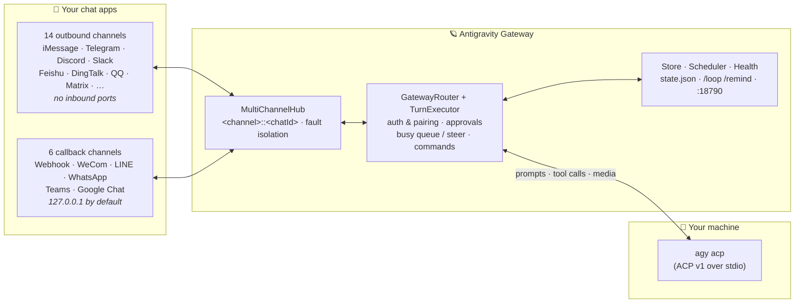

<div align="center">

**English** | [简体中文](README.zh-CN.md) | [繁體中文](README.zh-TW.md) | [日本語](README.ja.md) | [한국어](README.ko.md)

# 🪐 Antigravity Gateway

### Drive your local Google Antigravity agent from any chat app.

One self-hosted process bridges your own **`agy acp`** to **20 messaging platforms** (iMessage, Telegram, Discord, Slack, Feishu, DingTalk, QQ, WeCom, Matrix and more), with tool approvals, live progress, sessions and schedules. Most channels need **no public domain, port forwarding or reverse proxy**.

<p>
  <a href="https://github.com/Relogys/Antigravity-gateway/actions/workflows/ci.yml"></a>
  <a href="https://github.com/Relogys/Antigravity-gateway/actions/workflows/security.yml"></a>
  <a href="https://github.com/Relogys/Antigravity-gateway/releases"></a>
  = 22" />
  
  
  
  
</p>

<p>
  <a href="#compliance"><b>⚖️ Terms &amp; Compliance</b></a> ·
  <a href="#quick-start"><b>Quick Start</b></a> ·
  <a href="docs/QUICKSTART.md">3-Minute Guide</a> ·
  <a href="#channels">Channels</a> ·
  <a href="#commands">Commands</a> ·
  <a href="#configuration">Configuration</a> ·
  <a href="#security">Security</a> ·
  <a href="CHANGELOG.md">Changelog</a>
</p>

</div>

---

<a id="compliance"></a>

## ⚖️ Terms of Service & Compliance

> [!CAUTION]
> **Read this section before you install.** Antigravity Gateway is unofficial third-party software. Google's own Antigravity terms restrict third-party access to the service, and **you alone** are responsible for every account, plan and chat platform you connect to it.

### What this project is

- **Independent and unofficial.** This is a community open-source project. It is **not** made by, affiliated with, sponsored by or endorsed by Google, Apple, Photon or any chat platform. "Google", "Gemini" and "Antigravity" are trademarks of Google LLC; all other names belong to their owners.
- **A single-user, self-hosted client of your own `agy`.** The gateway starts the official Antigravity CLI that **you** installed and signed in to **on your own machine**, as a local subprocess (`agy acp`, Agent Client Protocol v1, JSON-RPC over stdio, the same interface Google documents for editors). Quota checks run `agy -p /usage --output-format json`. Authentication is whatever your `agy` is configured with: your own interactive sign-in, or your own `GEMINI_API_KEY`.

### What it does not do, and must not be used or modified to do

- ❌ **No reverse proxy and no relay.** It exposes no OpenAI-compatible or other model API, and never calls Google model endpoints directly.
- ❌ **No OAuth token extraction or relay.** It never reads, copies, stores, refreshes or forwards `agy`'s cached credentials or OAuth tokens.
- ❌ **No account or quota sharing, pooling, rotation or resale.** One gateway, one owner, one owner's account.
- ❌ **No bypassing of quotas, rate limits, safety filters or human-confirmation prompts.**
- ❌ **No public multi-user service on a personal account.** Keep `ALLOWED_SENDERS` and pairings to yourself. Letting other people (group members, friends, customers) drive your personal account is not something this project supports.

Forks or modifications that add any of the above are outside this project's purpose, and their authors and users carry the full consequences.

### Known risk with personal (consumer) Antigravity sign-ins

Please read this part carefully:

- The **[Google Antigravity Additional Terms of Service](https://antigravity.google/terms)** say you must not abuse, harm, interfere with or disrupt the Service, *"including … using the Service in connection with products not provided by us"*, that *"using third party software, tools, or services to access the Service … is a breach of this Agreement"*, and that this *"may be grounds for suspension or termination of your Antigravity and/or Gemini CLI accounts"*.
- The **[Google Antigravity FAQ](https://antigravity.google/docs/faq)** says *"Wrapping `agy` inside third-party coding agents or applications, or automating account rotation, is not supported under consumer plans"*, and recommends a **Gemini Enterprise** or **Google AI Studio API key** for third-party tools.
- This gateway **is** a third-party application that wraps `agy`. Google has not publicly confirmed whether local ACP clients like it are allowed on consumer plans (an open clarification request: [google-antigravity/antigravity-cli#711](https://github.com/google-antigravity/antigravity-cli/issues/711)).

**So do not assume that running this gateway on a personal Google account (free, Google AI Pro or Google AI Ultra) is permitted.** The lower-risk setup is to have `agy` authenticate with your own **`GEMINI_API_KEY`**, a **Gemini Enterprise** sign-in, or **Gemini Enterprise Agent Platform** credentials, the methods Google lists for ACP clients in its [ACP guide](https://antigravity.google/docs/ide/extensions/acp/). Those products have their own terms, and you must follow them too.

### If you use a Gemini API key

The **[Gemini API Additional Terms of Service](https://ai.google.dev/gemini-api/terms)** apply, including: you must be 18 or older; you may only use the service in available regions; Google AI Studio and the Gemini API are for professional or business purposes, not consumer use; the **[Generative AI Prohibited Use Policy](https://policies.google.com/terms/generative-ai/use-policy)** applies; and for agentic services *"you will not automatically bypass any requests for human confirmation"*. For that reason:

- Keep `APPROVAL_MODE=interactive` (or `sandbox`). `APPROVAL_MODE=auto` and `/yolo` start `agy` with `--dangerously-skip-permissions`, which auto-approves every tool call.
- On unpaid quota, Google may use your prompts and responses to improve its products, and human reviewers may read them. Do not send sensitive, confidential or personal data.

### Your data

Everything you send through any chat channel reaches Google as a prompt. The Antigravity terms say Google records your interactions, that human reviewers may read them, and that you should not submit confidential information. The chat platforms you connect also see and store the messages under their own policies.

### One opt-in feature to know about

`ANTIGRAVITY_LS_ADDRESS` + `ANTIGRAVITY_CSRF_TOKEN` (not in `.env.example`; off unless **both** are set) make the gateway post session titles and tags to the local Antigravity app's `ConversationService/UpdateConversation` endpoint, so gateway sessions are grouped in its sidebar. This is not a documented public interface. **For the strictest compliance, leave both unset.**

### Chat platform terms

Each platform you connect has its own terms, developer policies, bot and automation rules, rate limits and content rules, and you must follow all of them. That includes Apple (iMessage) and Photon, Telegram, Discord, Slack, Feishu/Lark, DingTalk, QQ, WeCom, LINE, WhatsApp (Meta), Microsoft Teams, Google Chat, Matrix homeservers, Mattermost, Zulip, Rocket.Chat, Signal and IRC networks.

### Responsibility and warranty

- You are solely responsible for complying with the Google terms above and with every chat platform's terms. **Any account suspension, ban, quota loss, charge, data loss or other consequence of a violation is your own responsibility.**
- This software is provided under the [MIT License](LICENSE), **"AS IS", without warranty of any kind**. The authors and contributors are not liable for any claim or damage arising from its use.
- This section is not legal advice. Terms change: read the current versions yourself before and while you use this project.

<details>
<summary><b>Terms and policies this section is based on</b> (read 2026-11-26)</summary>

- Google Antigravity Additional Terms of Service: <https://antigravity.google/terms>
- Google Antigravity FAQ: <https://antigravity.google/docs/faq>
- Google Antigravity, Other editors (ACP): <https://antigravity.google/docs/ide/extensions/acp/>
- Google Terms of Service: <https://policies.google.com/terms>
- Generative AI Prohibited Use Policy: <https://policies.google.com/terms/generative-ai/use-policy>
- Gemini API Additional Terms of Service: <https://ai.google.dev/gemini-api/terms>
- Open clarification request on ACP integrations: <https://github.com/google-antigravity/antigravity-cli/issues/711>

</details>

---

## ✨ Why

`agy` is great at the keyboard. Antigravity Gateway lets you keep using your own agent when you walk away:

- 📱 **Ask from your phone.** Send a message in iMessage, Telegram or Feishu; your agent works on your machine and replies in the same chat.
- ✅ **Approve tools remotely.** Permission prompts are forwarded to chat. Tap the native buttons on Telegram and Discord, or reply `/approve` or `/deny` anywhere.
- 🧭 **Stay in control of long turns.** A live progress card, `/stop`, `/steer`, a busy queue and stall alerts.
- ⏰ **Automate.** Recurring `/loop` prompts (intervals, daily times or 5-field cron) and zero-token `/remind` pushes that survive restarts.
- 🔒 **Safe by default.** Fail-closed allowlists with 8-character DM pairing, loopback-only listeners, and channel secrets stripped from the agent's environment.

---

## 🧩 How it works



Each enabled channel feeds one shared router, so every platform gets the same auth, approvals, commands and session handling. If one channel fails, the others keep running.

---

<a id="channels"></a>
<a id="supported-channels--支持通道一览"></a>

## 📡 Supported channels

A channel turns on automatically once its credentials are in `.env`. Run any combination at the same time.

| Platform | Key | Connection | Needs inbound port? |
| :--- | :--- | :--- | :---: |
| 📱 **iMessage / SMS / RCS** (Photon) | `photon` | Spectrum gRPC over TLS (`spectrum-ts`) | No |
| ✈️ **Telegram** | `telegram` | Bot API long polling | No |
| 🎮 **Discord** | `discord` | Gateway WebSocket (`discord.js`) | No |
| 💼 **Slack** | `slack` | Socket Mode (`@slack/bolt`) | No |
| 🪶 **Feishu / Lark** | `feishu` | Official WSClient long connection | No |
| 🔔 **DingTalk** | `dingtalk` | Stream Mode WebSocket | No |
| 🐧 **QQ via OneBot v11** (NapCat / LLOneBot / Lagrange) | `onebot` | Forward WebSocket | No |
| 🤖 **QQ Official Bot** | `qqbot` | OpenAPI v2 WebSocket gateway | No |
| 🧩 **Matrix** (Element, Beeper, Synapse) | `matrix` | `/sync` long polling | No |
| 💬 **Mattermost** | `mattermost` | WebSocket + REST v4 | No |
| 🖥️ **IRC** | `irc` | TCP/TLS client | No |
| 💬 **Zulip** | `zulip` | Real-time events long polling | No |
| 🚀 **Rocket.Chat** | `rocketchat` | DDP WebSocket + REST | No |
| 🔒 **Signal** (signal-cli-rest-api) | `signal` | WebSocket, polling fallback | No |
| 🔗 **Generic Webhook / HTTP API** | `webhook` | `POST /v1/messages`, SSE `/v1/events` | Loopback `:18791` |
| 🏢 **WeCom** (self-built app) | `wecom` | Encrypted callback + REST push | Loopback `:18792` |
| 🟢 **LINE** | `line` | Messaging API webhook | Loopback `:18793` |
| 📗 **WhatsApp Cloud API** | `whatsapp` | Graph API webhook | Loopback `:18794` |
| 🟣 **Microsoft Teams** | `teams` | Bot Framework / outgoing webhook | Loopback `:18795` |
| 🔵 **Google Chat** | `googlechat` | Chat app events / incoming webhook | Loopback `:18796` |

Only 5 channels use an SDK (`spectrum-ts`, `discord.js`, `@slack/bolt`, `@larksuiteoapi/node-sdk`, `dingtalk-stream`). The other 15 are dependency-free adapters built on Node's own `fetch`, `WebSocket`, `net`/`tls` and `crypto`.

> [!TIP]
> New to this? **Telegram is the quickest start**: one bot token, no public domain. Setup for every platform is in **[docs/QUICKSTART.md](docs/QUICKSTART.md)**.

---

<a id="quick-start"></a>

## 🚀 Quick start

**You need:** Node.js **22+** (24 recommended), `pnpm` (`corepack enable pnpm`), the Antigravity CLI `agy` on your `PATH` and authenticated (`agy --version`; see [compliance](#compliance) for which sign-in to use), plus credentials for at least one channel.

### From source

```bash
git clone https://github.com/Relogys/Antigravity-gateway.git
cd Antigravity-gateway

pnpm setup          # interactive wizard: pick channels, write .env
pnpm build          # compile once
pnpm cli doctor     # check Node, agy, channels, allowlist and ports
pnpm cli start      # start the background daemon
pnpm cli logs -n 120
```

<details>
<summary>Prefer manual setup?</summary>

```bash
pnpm install
cp .env.example .env      # PowerShell: Copy-Item .env.example .env
# fill in ONE channel in .env
pnpm build && pnpm cli doctor && pnpm cli start
```

For hot reload during development, use `pnpm dev`.
</details>

### From a release (installer pinned to a tag)

The installer downloads the release tarball and `SHA256SUMS.txt` from GitHub Releases, verifies the tarball's SHA-256 checksum, then runs `npm install -g`. That checksum covers the tarball only, not the installer script itself. So download the installer from a release tag (never from `main`), read it, and only then run it.

```bash
# macOS / Linux: download from the release tag, inspect, then run
curl -fsSLO https://raw.githubusercontent.com/Relogys/Antigravity-gateway/v0.4.2/scripts/install.sh
less install.sh
bash install.sh --version v0.4.2
```

```powershell
# Windows (PowerShell): download from the release tag, inspect, then run
Invoke-WebRequest https://raw.githubusercontent.com/Relogys/Antigravity-gateway/v0.4.2/scripts/install.ps1 -OutFile install.ps1
notepad .\install.ps1
powershell -ExecutionPolicy Bypass -File .\install.ps1 -Version v0.4.2
```

The global command is `antigravity-gateway` (`antigravity-gateway init`, `antigravity-gateway doctor`, `antigravity-gateway service install`, …). Run it from the directory that holds your `.env`.

### Your first message

1. DM your bot. With no allowlist configured, it replies with an **8-character pairing code**.
2. On your machine, approve it: `pnpm cli pair approve <CODE>`.
3. Chat normally. Your message gets marked read and a 👀 reaction while `agy` works, then 👍 when it's done (👎 on error).

> [!NOTE]
> If `agy` is not authenticated, the gateway starts but never replies. Run `agy` once in a terminal to sign in, or configure `GEMINI_API_KEY`.

---

## 🎛️ Features

<table>
<tr>
<td width="50%" valign="top">

**Agent control**
- Interactive, sandbox or auto tool approval, switchable per chat
- Native approval buttons on Telegram (inline keyboard) and Discord (button components), with the same allowlist and requester checks as typed commands
- Busy-turn policy: `queue`, `interrupt` or `steer`
- Switch model, effort and ACP mode from chat
- List, resume, title and compact ACP sessions
- Per-channel session groups, working directories and workspace bookmarks (`/cwd @alias`)
- Automatic retry of transient turn failures, and self-healing when an upstream ACP session has expired

</td>
<td width="50%" valign="top">

**Chat experience**
- Native rendering per platform: iMessage styling, Telegram HTML, plain-text cleanup for IRC, LINE, Signal and OneBot
- One live progress card edited in place on Telegram, Discord and Slack
- Images in from Photon, Telegram, Discord, WhatsApp and Matrix, passed to `agy` as attachments
- Bursts of quick messages merged into one prompt
- Long replies split cleanly, code fences kept intact

</td>
</tr>
<tr>
<td valign="top">

**Automation**
- `/loop` recurring prompts: intervals (`30m`, `2h`, `1d`), `daily HH:MM`, or standard 5-field cron
- Scheduled loops run in their own isolated session, so they never touch your chat's history or working directory
- `/remind` one-way pushes that use 0 AI tokens
- `/usage` quota check that uses 0 tokens, with a low-quota warning
- `pnpm cli send` to push a message from scripts
- A GitHub Action to post CI events into your chat

</td>
<td valign="top">

**Operations**
- Daemon CLI with PID lock and graceful stop
- Autostart via launchd, systemd `--user` or Task Scheduler
- `/healthz`, `/readyz`, `/status` and Prometheus `/metrics` endpoints
- Optional JSON logs (`LOG_FORMAT=json`) with secret redaction
- Secret-free backup and migration (`pnpm cli export` / `import`)
- Docker image on GHCR (`amd64` + `arm64`)
- Photon heartbeat watchdog that reconnects half-open streams

</td>
</tr>
</table>

---

<a id="commands"></a>

## 💬 Chat commands

Send `/help` in any chat for the full list. Add `-h` to most commands for usage.

**Always available, even mid-turn**

| Command | What it does |
| :--- | :--- |
| `/stop` | Cancel the active turn |
| `/new [title]` · `/reset` | Start a fresh session (optionally titled) |
| `/steer <prompt>` · `/s` | Interrupt and redirect the current turn |
| `/queue [prompt\|list\|clear]` · `/q` | Queue a follow-up, list or clear the queue |
| `/busy [queue\|interrupt\|steer]` | Choose what happens to messages sent mid-turn |
| `/approve [once\|session\|always]` · `/deny [reason]` | Answer a pending tool permission (or tap the buttons on Telegram / Discord) |
| `/yolo` | Toggle auto-approval for this chat (admins only in groups) |
| `/progress [auto\|edit\|silence\|off\|keep\|delete]` | Live progress style and whether the card stays |
| `/verbose [off\|brief\|full]` | How detailed progress pulses are |
| `/status` · `/ping` | Session, model, queue and uptime |
| `/channels` | Connection state of every channel |
| `/usage` | Antigravity 5-hour and weekly quota (0 tokens) |
| `/sethome` | Make this chat the recovery home |
| `/whoami` · `/version` · `/help` | Who you are to the gateway, version, help |

**When idle**

| Command | What it does |
| :--- | :--- |
| `/retry` | Re-run the last prompt in this chat |
| `/model [slug]` · `/effort [low\|medium\|high\|xhigh]` | Show or switch model and reasoning effort |
| `/mode [default\|accept-edits\|auto\|plan]` | ACP session mode |
| `/approvals [auto\|interactive\|sandbox]` | Tool approval policy |
| `/sessions [channel\|all]` · `/groups` | List sessions, summarize channel session groups |
| `/resume <id\|index>` · `/title [name]` | Resume a saved session, rename it |
| `/compact` · `/compress` | Summarize and compact context |
| `/cwd [path\|@alias]` | Change working directory (starts a clean session) |
| `/cwd save <alias> [path]` · `/cwd rm <alias>` · `/cwd list` | Manage workspace bookmarks |
| `/discard` | Drop local session state and queue |
| `/loop [list\|add <dur> <prompt>\|rm\|pause\|resume <id>]` | Interval loops |
| `/loop daily <HH:MM> <prompt>` · `/loop cron "<m h dom mon dow>" <prompt>` | Daily or 5-field cron loops |
| `/remind <dur> <text>` | One-way reminder (0 tokens) |

**iMessage only (Photon)**: `/poll <q> | <a> | <b>` native poll · `/bg [preset|clear|list]` one of 24 backgrounds · `/unsend` retract the last reply (~2 min) · `/card` share contact card.

---

## 🛠️ Admin CLI

```bash
pnpm cli init [--yes] [--channels 1,2]   # setup wizard (alias: pnpm setup)
pnpm cli start [--foreground]     # start (daemon by default)
pnpm cli stop | restart           # graceful, PID-verified
pnpm cli logs -n 200              # tail the rotating log
pnpm cli status                   # live health + store summary
pnpm cli doctor [--json] [--probe-acp]   # check Node, agy and every channel
pnpm cli usage                    # 0-token quota check
pnpm cli send --channel telegram --to <chatId> "Hi"

pnpm cli pair list | clear
pnpm cli pair approve <CODE>
pnpm cli pair revoke telegram:<userId>

pnpm cli export [--out <file>] [--include-auth]
pnpm cli import <file> [--dry-run] [--overwrite] [--include-auth] [--remap-cwd <from>=<to>]

pnpm cli service install | uninstall | status
pnpm cli service print --platform darwin|linux   # preview the unit file
```

`export` writes a versioned JSON bundle of sessions, scheduled loops and workspace bookmarks. It never includes `.env`, and leaves out allowlists and pairings unless you pass `--include-auth`. `--remap-cwd` rewrites paths when you move between machines or operating systems.

---

<a id="configuration"></a>

## ⚙️ Configuration

Everything lives in `.env`. **[`.env.example`](.env.example) is the full, commented reference.** Leave a value blank to turn that feature or channel off.

### Core settings

```env
# Who may talk to the agent. Photon: E.164 numbers or Apple ID emails.
# Other channels: "<channel>:<userId>", e.g. telegram:123456789
ALLOWED_SENDERS=
ADMIN_SENDERS=                 # may approve others' requests and /yolo in groups
ALLOW_GROUPS=false
GROUP_MENTION_PATTERNS=@agy,@antigravity

AGY_BIN=agy
DEFAULT_CWD=.                  # per channel: TELEGRAM_CWD=, PHOTON_CWD=, ...
WORKSPACE_ALIASES=             # e.g. api=/srv/api,web=/srv/web  ->  /cwd @api
APPROVAL_MODE=interactive      # interactive | sandbox | auto
DEFAULT_MODEL=
DEFAULT_EFFORT=
GEMINI_API_KEY=                # optional; disables /usage reporting
AGY_PASSTHROUGH_ENV=           # stripped env var names to pass to agy anyway

DATA_DIR=./data
LOG_DIR=
LOG_LEVEL=info
LOG_FORMAT=text                # text | json
```

Empty allowlists everywhere mean **deny all**; DMs get a pairing code instead.

<details>
<summary><b>Channel credentials</b> (what turns each channel on)</summary>

| Channel | Required | Useful optional |
| :--- | :--- | :--- |
| `photon` | `SPECTRUM_PROJECT_ID`, `SPECTRUM_PROJECT_SECRET` | `PHOTON_READ_RECEIPTS`, `PHOTON_REACTIONS`, `PHOTON_MAX_CHUNK_CHARS=1600`, `PHOTON_HEARTBEAT_TIMEOUT_MS`, `PHOTON_PROBE_SPACE_ID` |
| `telegram` | `TELEGRAM_BOT_TOKEN` | `TELEGRAM_ALLOWED_USERS`, `TELEGRAM_POLL_TIMEOUT_SEC` |
| `discord` | `DISCORD_BOT_TOKEN` | `DISCORD_ALLOWED_USERS`, `DISCORD_ALLOW_GUILDS` |
| `slack` | `SLACK_BOT_TOKEN` (`xoxb-`), `SLACK_APP_TOKEN` (`xapp-`) | `SLACK_ALLOWED_USERS` |
| `feishu` | `FEISHU_APP_ID`, `FEISHU_APP_SECRET` | `FEISHU_DOMAIN=feishu\|lark`, `FEISHU_ALLOWED_USERS` |
| `dingtalk` | `DINGTALK_CLIENT_ID`, `DINGTALK_CLIENT_SECRET` | `DINGTALK_ALLOWED_USERS` |
| `onebot` | `ONEBOT_WS_URL` | `ONEBOT_ACCESS_TOKEN`, `ONEBOT_SELF_ID`, `ONEBOT_ALLOWED_USERS` |
| `qqbot` | `QQBOT_APP_ID`, `QQBOT_CLIENT_SECRET` | `QQBOT_SANDBOX`, `QQBOT_ALLOWED_USERS` |
| `wecom` | `WECOM_CORP_ID`, `WECOM_AGENT_ID`, `WECOM_SECRET` | `WECOM_TOKEN`, `WECOM_ENCODING_AES_KEY`, `WECOM_HOST`, `WECOM_PORT` |
| `matrix` | `MATRIX_HOMESERVER_URL`, `MATRIX_ACCESS_TOKEN` | `MATRIX_USER_ID`, `MATRIX_ALLOWED_USERS` |
| `mattermost` | `MATTERMOST_BASE_URL`, `MATTERMOST_BOT_TOKEN` | `MATTERMOST_ALLOWED_USERS` |
| `line` | `LINE_CHANNEL_ACCESS_TOKEN`, `LINE_CHANNEL_SECRET` | `LINE_HOST`, `LINE_PORT` |
| `irc` | `IRC_HOST`, `IRC_CHANNELS` | `IRC_PORT=6697`, `IRC_TLS`, `IRC_NICK`, `IRC_PASSWORD` |
| `whatsapp` | `WHATSAPP_ACCESS_TOKEN`, `WHATSAPP_PHONE_NUMBER_ID` | `WHATSAPP_VERIFY_TOKEN`, `WHATSAPP_APP_SECRET`, `WHATSAPP_WEBHOOK_*` |
| `zulip` | `ZULIP_SITE`, `ZULIP_BOT_EMAIL`, `ZULIP_API_KEY` | `ZULIP_STREAMS`, `ZULIP_REQUIRE_MENTION` |
| `rocketchat` | `ROCKETCHAT_URL`, `ROCKETCHAT_USER_ID`, `ROCKETCHAT_AUTH_TOKEN` | `ROCKETCHAT_REQUIRE_MENTION` |
| `signal` | `SIGNAL_API_URL`, `SIGNAL_ACCOUNT` | `SIGNAL_POLL_INTERVAL_MS` |
| `teams` | `TEAMS_WEBHOOK_SECRET`, **or** `TEAMS_APP_ID` + `TEAMS_APP_PASSWORD`, **or** `TEAMS_INCOMING_WEBHOOK_URL` | `TEAMS_TENANT_ID`, `TEAMS_WEBHOOK_*` |
| `googlechat` | any of `GOOGLECHAT_WEBHOOK_URL`, `GOOGLECHAT_ACCESS_TOKEN`, `GOOGLECHAT_VERIFICATION_TOKEN` | `GOOGLECHAT_AUDIENCE` (recommended), `GOOGLECHAT_WEBHOOK_*` |
| `webhook` | `WEBHOOK_ENABLED=true` | `WEBHOOK_TOKEN`, `WEBHOOK_SECRET`, `WEBHOOK_CALLBACK_URL`, `WEBHOOK_FIXED_SENDER`, `WEBHOOK_REPLAY_WINDOW_SEC`, `WEBHOOK_REQUIRE_TIMESTAMP` |

Every channel also accepts `<CHANNEL>_ALLOWED_USERS`, merged with `ALLOWED_SENDERS` and paired senders.

**Photon tips:** register the handle you send from under *Photon Dashboard → Users* (check the exact identifier at `https://debug.photon.codes`). On shared iMessage pools, send the **first** message from your Apple device to the project's number, or replies fail with `Target not allowed for this project`.
</details>

<details>
<summary><b>Long turns & progress</b></summary>

```env
TOOL_PROGRESS_MODE=auto            # auto | edit | silence | off
TOOL_PROGRESS_KEEP=false           # true keeps a summary card after the reply
TOOL_PROGRESS_EDIT_INTERVAL_MS=1500
PROGRESS_SILENCE_MS=120000         # pulse after this much silence (0 = off)
SESSION_STALL_TIMEOUT_MS=300000    # warn once when a turn stalls
TURN_MAX_RETRIES=2                 # retries for transient ACP failures
INGRESS_DEBOUNCE_MS=350            # merge rapid-fire bubbles
AUTO_BOOTSTRAP_CHANNEL_SESSION=true
QUOTA_WARN_THRESHOLD=15            # % of 5-hour quota left
```

`auto` edits one card in place where the platform allows it, and uses short pulses on iMessage to stay under Apple's 5-edit limit.
</details>

<details>
<summary><b>Health, metrics & local ports</b></summary>

```env
HEALTH_ENABLED=false
HEALTH_HOST=127.0.0.1
HEALTH_PORT=18790
HEALTH_TOKEN=          # Bearer token for /status and /metrics; set it if you bind beyond loopback
```

| Endpoint | Meaning |
| :--- | :--- |
| `GET /healthz` | Liveness: `200` while at least one channel is connected |
| `GET /readyz` | Readiness: `200` only when every configured channel is connected |
| `GET /status` | Full diagnostics per channel, errors redacted |
| `GET /metrics` | Prometheus text format, bounded cardinality, no sender or chat IDs |

| Port | Used by |
| :--- | :--- |
| `18790` | Health server |
| `18791`–`18796` | `webhook`, `wecom`, `line`, `whatsapp`, `teams`, `googlechat` callbacks |

All bind to `127.0.0.1` by default. Expose a callback only through your own TLS reverse proxy or tunnel, and only when that platform requires it.
</details>

<details>
<summary><b>Webhook / HTTP API</b></summary>

```bash
curl -X POST http://127.0.0.1:18791/v1/messages \
  -H "Authorization: Bearer $WEBHOOK_TOKEN" \
  -H "Content-Type: application/json" \
  -d '{"chatId":"ops","text":"summarize the git log for today","wait":true}'
```

With `"wait": true` you get `{ "ok": true, "messageId": "...", "replies": [...] }` back synchronously. Otherwise subscribe to `GET /v1/events` (SSE) or set `WEBHOOK_CALLBACK_URL`. Requests can be signed with `X-Webhook-Signature: sha256=<hmac>` plus `X-Webhook-Timestamp` and `X-Webhook-Id` for replay protection. The gateway refuses to bind a non-loopback host without a token or secret.

This endpoint is for your own scripts and tools. Do not use it to offer the agent to other people (see [compliance](#compliance)).
</details>

---

## 📦 Deployment

### Run as a service

```bash
pnpm build
pnpm cli service install     # macOS launchd · Linux systemd --user · Windows Task Scheduler
```

Prefer plain scripts? See [`scripts/`](scripts/): `install-launchd.sh`, `install-systemd.sh`, `install-task.ps1`, and the crash-backoff supervisors `start-gateway.sh` / `start-gateway.ps1` (2s→60s backoff, 5 MB log rotation).

### Docker

```bash
cp .env.example .env               # fill in at least one channel
docker compose pull && docker compose up -d     # or: docker compose up -d --build
curl http://127.0.0.1:18790/healthz
```

Image: `ghcr.io/relogys/antigravity-gateway` (`latest` and `vX.Y.Z`, `amd64` + `arm64`). It runs as non-root, reads `.env` read-only, keeps state in `./data`, and publishes only `127.0.0.1:18790`. `agy` isn't bundled: mount your own binary and your own credentials, or set your own `GEMINI_API_KEY`. On Linux, run `mkdir -p data && sudo chown -R 1000:1000 data` first. Details in the [Docker guide](docs/QUICKSTART.md#4-docker--容器部署).

### Notify from GitHub Actions

```yaml
- uses: Relogys/Antigravity-gateway/.github/actions/notify@v0.4.2
  with:
    url: ${{ secrets.GATEWAY_WEBHOOK_URL }}
    secret: ${{ secrets.GATEWAY_WEBHOOK_SECRET }}
    chat-id: ops-alerts
    text: "Deployed ${{ github.ref_name }}"
```

---

<a id="security"></a>

## 🔐 Security

- **Fail-closed access.** Unknown senders get nothing but a pairing code: 8 unambiguous characters, valid for 1 hour, locked after 5 wrong tries.
- **Group approvals are bound to the requester.** Only the person who triggered a tool call, or an `ADMIN_SENDERS` member, can approve it, whether by command or by button. `/yolo` in groups is admin-only.
- **Clean child environment.** Before spawning `agy acp`, the gateway removes every channel credential family (`TELEGRAM_*`, `SLACK_*`, …) and its own internal settings (allowlists, health and progress settings, `ANTIGRAVITY_*`). Other variables, such as `PATH`, `HOME`, `GEMINI_API_KEY` and Google Cloud settings, still reach `agy`. `AGY_PASSTHROUGH_ENV` opts specific removed keys back in.
- **Verified callbacks.** Webhook (Bearer + HMAC + anti-replay), Google Chat (RS256 OIDC via `GOOGLECHAT_AUDIENCE`), WeCom (WXBizMsgCrypt), LINE, WhatsApp and Teams signatures are checked before dispatch. Authorization headers are parsed in linear time.
- **No leaks into chat.** `file:///` IDE paths are stripped on every channel, outbound `MEDIA:` refuses `.env*`, `.ssh` and private keys, and health errors are redacted.
- **Durable state.** Cross-process store lock, `.bak` rollback and corrupt-file quarantine.
- **CI checks.** CodeQL, a dependency audit and `pnpm audit:secrets` on every push.

Found a vulnerability? Please follow [SECURITY.md](SECURITY.md) rather than opening a public issue.

---

## 🧱 Add your own channel

Create `src/channels/<name>.ts`, extend [`BaseChannelAdapter`](src/channels/base.ts), export `createAdapter(config)`, and add its config block in [`src/config.ts`](src/config.ts):

```ts
import type { GatewayConfig } from "../config.js";
import { BaseChannelAdapter, type InboundHandler } from "./base.js";
import type { ChannelAdapter, OutboundMessage } from "../types.js";

export class MyChatAdapter extends BaseChannelAdapter {
  readonly name = "my-chat";

  async start(onMessage: InboundHandler): Promise<void> {
    this.handler = onMessage;
    this.setConnected(true);
    // call `await this.emit({ ... })` with the raw chatId and senderId
  }

  async stop(): Promise<void> {
    this.setConnected(false);
  }

  async sendMessage(msg: OutboundMessage) {
    this.noteOutbound();
    return { messageId: "outbound-id" };
  }
}

export function createAdapter(config: GatewayConfig): ChannelAdapter {
  return new MyChatAdapter();
}
```

Optional hooks (`sendTyping`, `markRead`, `react`, `editMessage`, `deleteMessage`) are detected automatically. Implement `editMessage` and `deleteMessage` to get the live progress card.

---

## 🧪 Development

```bash
pnpm install
pnpm dev            # run from source with tsx
pnpm typecheck
pnpm test           # vitest, 42 test files
pnpm probe:acp      # smoke-test the agy ACP connection
pnpm audit:secrets
```

CI runs on Ubuntu (Node 22 and 24), macOS (Apple Silicon, Node 24), Windows (Node 24) and a Docker build. Pull requests that only touch Markdown or `LICENSE` skip the heavy matrix but still report their required checks. Tagging `vX.Y.Z` publishes the GHCR image and a GitHub Release with the npm tarball and `SHA256SUMS.txt`.

<details>
<summary>Project layout</summary>

```
src/
├── acp/           # agy acp client, sessions, permissions, quota
├── channels/      # 20 adapters + hub, registry, formatting, media
├── gateway/       # router, turn executor, burst coalescing, progress, scheduler, store
│   └── commands/  # session, system, loop and Photon slash commands
├── photon/        # iMessage adapter, formatting, staleness probe
├── backup.ts      # export / import bundles
├── cli.ts         # admin CLI (start/stop/doctor/pair/export/service/…)
├── wizard.ts      # pnpm setup onboarding
├── health.ts      # /healthz /readyz /status /metrics
└── index.ts       # entry point
scripts/           # installers, service installers, supervisors, audits
docs/QUICKSTART.md # per-platform setup and troubleshooting
```
</details>

---

## 📚 More

- [docs/QUICKSTART.md](docs/QUICKSTART.md): credentials for each platform, Docker, daily operations and troubleshooting
- [CHANGELOG.md](CHANGELOG.md): what changed in each release
- [SECURITY.md](SECURITY.md): reporting vulnerabilities

## 📄 License

[MIT](LICENSE) © Relogys. Provided "AS IS", without warranty of any kind.

<sub>Antigravity Gateway is an independent open-source project and is not affiliated with, sponsored by or endorsed by Google. See [Terms of Service & Compliance](#compliance).</sub>
