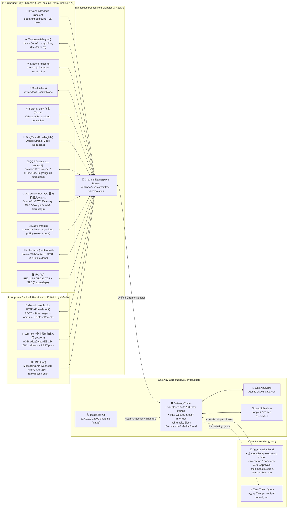

<div align="center">

# 🪐 Antigravity Gateway

**Universal 14-Platform Multi-Channel Messaging Gateway for Google Antigravity (`agy acp`)**

*通用 14 平台多通道 Google Antigravity 消息网关 — 无需公网域名与内网穿透，随时随地通过 iMessage / Telegram / Discord / Slack / 飞书 / 钉钉 / QQ / QQ 官方机器人 / 企业微信 / Matrix / Mattermost / LINE / IRC / Webhook 远程驱动你的本地 Antigravity Agent*

<p>
  <a href="https://nodejs.org/"></a>
  <a href="https://www.typescriptlang.org/"></a>
  <a href="https://agentclientprotocol.com/"></a>
  <a href="#supported-channels--支持通道一览"></a>
  <a href="#supported-channels--支持通道一览"></a>
  <a href="#slash-commands--斜杠命令"></a>
  <a href="#license"></a>
</p>

<p>
  <a href="#architecture--架构设计">Architecture</a> •
  <a href="#supported-channels--支持通道一览">14 Channels</a> •
  <a href="#quick-start--快速开始">Quick Start</a> •
  <a href="#channel-configuration--各平台环境变量">Env Vars</a> •
  <a href="#cli--health-endpoint--命令行与健康检查">CLI &amp; Health</a> •
  <a href="#slash-commands--斜杠命令">Slash Commands</a> •
  <a href="#security--compliance--安全与合规">Security</a>
</p>

</div>

---

## Overview / 项目定位

**Antigravity Gateway** turns local **Google Antigravity CLI (`agy acp`)** into an always-on, multi-platform engineering assistant. Enable any combination of the **14 built-in adapters** simultaneously via [`MultiChannelHub`](src/channels/hub.ts) — every platform runs behind NAT with **zero public domain or reverse-proxy setup required**.

- **Concurrent Multi-Channel Hub (`MultiChannelHub`)**: Runs up to all 14 channels side by side in one process, namespacing conversations as `<channel>::<rawChatId>` with per-channel health tracking and non-blocking inbound dispatch (a failing channel never crashes healthy ones).
- **11 Outbound-Only + 3 Loopback Receivers**: `photon`, `telegram`, `discord`, `slack`, `feishu`, `dingtalk`, `onebot`, `qqbot`, `matrix`, `mattermost` and `irc` dial out (long polling / WebSocket / TLS) and need **zero inbound ports**; only `webhook`, `wecom` and `line` listen on callbacks, and they bind to `127.0.0.1` by default.
- **Unified Gateway Core**: Every adapter shares fail-closed auth (`ALLOWED_SENDERS` + per-channel `*_ALLOWED_USERS` + 8-char DM pairing), interactive tool approval forwarding, busy turn control (`queue` / `interrupt` / `steer`), media/secret guards, zero-token `/usage`, and persistent `/loop` & `/remind` schedules.
- **Extensible by Design**: Drop in a new `src/channels/<name>.ts` exporting `createAdapter(config)` against [`ChannelAdapter`](src/types.ts) to add any custom platform.

---

## Architecture / 架构设计



---

## Supported Channels / 支持通道一览

Every channel is **optional** and automatically enabled when its credentials are configured in `.env`. Multiple channels run concurrently in `MultiChannelHub`; only 5 adapters pull a third-party SDK (`spectrum-ts`, `discord.js`, `@slack/bolt`, `@larksuiteoapi/node-sdk`, `dingtalk-stream`), while the other **9 run on Node 24 built-ins only (0 extra deps)**.

| Channel | Name | Transport / SDK | Highlights &amp; NAT Traversal |
| :--- | :--- | :--- | :--- |
| **Photon iMessage** | `photon` | `spectrum-ts` Outbound TLS gRPC | Flagship iMessage / SMS / RCS adapter; Spectrum gRPC behind NAT, 48h dedupe, zombie-stream probe, read receipts &amp; reactions |
| **Telegram** | `telegram` | Native Bot API `getUpdates` Long Polling (**0 extra deps**) | Node 24 built-in `fetch`, no inbound port; group `@bot` / reply gating, photo/doc/voice/audio download, multipart uploads, typing &amp; reactions |
| **Discord** | `discord` | `discord.js` Gateway WebSocket | Outbound gateway socket behind NAT; DM + guild mention gating (`DISCORD_ALLOW_GUILDS`), attachment download/upload, reply references, typing, reactions &amp; edits |
| **Slack** | `slack` | `@slack/bolt` Socket Mode (`xoxb-` + `xapp-`) | Zero public URL; `app_mention` &amp; DM support, `thread_ts` continuity, Bearer file downloads, `filesUploadV2`, emoji reactions |
| **Feishu / Lark 飞书** | `feishu` | Official `@larksuiteoapi/node-sdk` `WSClient` | Feishu (`feishu`) &amp; Lark (`lark`) domains; long connection behind NAT, resource downloads, image/file uploads &amp; reactions |
| **DingTalk 钉钉** | `dingtalk` | Official Stream Mode WebSocket | Stream WebSocket robot callback (`TOPIC_ROBOT`) behind NAT; `sessionWebhook` reply caching, `@mention` detection, Markdown replies |
| **QQ / OneBot v11** | `onebot` | Forward WebSocket client (**0 extra deps**) | Built-in Node 24 `WebSocket` for NapCat / LLOneBot / Lagrange; full string CQ-code &amp; segment array parsing, auto-reconnect, behind NAT |
| **QQ Official Bot / QQ 官方机器人** | `qqbot` | Official OpenAPI v2 WebSocket Gateway (**0 extra deps**) | C2C / group / guild delivery; access-token refresh, heartbeat &amp; resume handled natively, `QQBOT_SANDBOX` toggle, no inbound port |
| **WeCom / 企业微信** | `wecom` | `WXBizMsgCrypt` AES-256-CBC callback + REST push (**0 extra deps**) | Self-built app (自建应用) callback receiver on `127.0.0.1:18792` by default, SHA1 signature + AES decrypt/encrypt, passive XML replies and active REST `message/send` pushes |
| **Matrix** | `matrix` | Native `/_matrix/client/v3/sync` long polling (**0 extra deps**) | Works with Element / Beeper / Synapse &amp; friends; `since`-token sync, encrypted-room plain-text replies, outbound upload via media repo |
| **Mattermost** | `mattermost` | Native WebSocket + REST v4 (**0 extra deps**) | Self-hosted team chat behind NAT; `posted` event filtering, thread replies, file download/upload, typing indicators |
| **LINE** | `line` | Messaging API Webhook (HMAC-SHA256 + replyToken / push) (**0 extra deps**) | Webhook listener on `127.0.0.1:18793` by default; `X-Line-Signature` verification over the raw body, `replyToken` fast replies with `push` fallback, image/file messages |
| **IRC** | `irc` | Native RFC 1459 / IRCv3 TCP + TLS (**0 extra deps**) | Outbound client socket behind NAT; `NICK`/`USER` registration, SASL-free `PASS` auth, channel join list, PRIVMSG/NOTICE, auto-reconnect with backoff |
| **Generic Webhook / HTTP API** | `webhook` | Built-in Node `http` (`127.0.0.1:18791`) | `POST /v1/messages` (Bearer + HMAC-SHA256 + synchronous `wait: true` mode), `callbackUrl` webhooks &amp; `GET /v1/events` SSE stream for Siri Shortcuts, custom apps or bridges |

---

## Quick Start / 快速开始

### 1. Prerequisites / 环境准备

- **Node.js `>= 22`** (tested on Node `24`) and **`pnpm`**
- **Google Antigravity CLI (`agy`)** installed on `PATH` and signed in (`agy --version`)
- Credentials for **at least one** of the 14 supported channels

### 2. Install &amp; Configure / 安装与配置

```powershell
git clone https://github.com/Relogys/Antigravity-gateway.git
cd Antigravity-gateway
pnpm install
Copy-Item .env.example .env
```

Edit `.env` (never commit `.env`), configure any channels you want to enable, then validate and start:

```powershell
pnpm cli doctor
pnpm build
pnpm start
```

For TypeScript hot execution during development:

```powershell
pnpm dev
```

---

## Channel Configuration / 各平台环境变量

Every variable below matches [`.env.example`](.env.example). Empty everywhere = deny all (DMs receive an 8-character pairing code instead). Leave unused values blank — a channel is simply not registered.

### Enablement Rules / 通道启用规则

| Channel | Registered when |
| :--- | :--- |
| `photon` | **both** `SPECTRUM_PROJECT_ID` and `SPECTRUM_PROJECT_SECRET` are set |
| `telegram` | `TELEGRAM_BOT_TOKEN` is set |
| `discord` | `DISCORD_BOT_TOKEN` is set |
| `slack` | **both** `SLACK_BOT_TOKEN` and `SLACK_APP_TOKEN` are set |
| `feishu` | **both** `FEISHU_APP_ID` and `FEISHU_APP_SECRET` are set |
| `dingtalk` | **both** `DINGTALK_CLIENT_ID` and `DINGTALK_CLIENT_SECRET` are set |
| `onebot` | `ONEBOT_WS_URL` is set (gateway dials out to the OneBot implementation) |
| `qqbot` | **both** `QQBOT_APP_ID` and `QQBOT_CLIENT_SECRET` are set |
| `wecom` | **corp id**, **agent id** and **secret** are all set |
| `matrix` | **both** `MATRIX_HOMESERVER_URL` and `MATRIX_ACCESS_TOKEN` are set |
| `mattermost` | **both** `MATTERMOST_BASE_URL` and `MATTERMOST_BOT_TOKEN` are set |
| `line` | **both** `LINE_CHANNEL_ACCESS_TOKEN` and `LINE_CHANNEL_SECRET` are set |
| `irc` | `IRC_HOST` is set (comma-separated `IRC_CHANNELS` to actually join rooms) |
| `webhook` | `WEBHOOK_ENABLED=true` |

### Per-Channel Credentials &amp; Allowlists / 各平台配置

| Channel | Required Env Vars | Optional Env Vars |
| :--- | :--- | :--- |
| **Photon iMessage** | `SPECTRUM_PROJECT_ID`, `SPECTRUM_PROJECT_SECRET` | `PHOTON_READ_RECEIPTS=true`, `PHOTON_REACTIONS=true` |
| **Telegram** | `TELEGRAM_BOT_TOKEN` | `TELEGRAM_ALLOWED_USERS`, `TELEGRAM_POLL_TIMEOUT_SEC=30` |
| **Discord** | `DISCORD_BOT_TOKEN` | `DISCORD_ALLOWED_USERS`, `DISCORD_ALLOW_GUILDS=false` |
| **Slack** | `SLACK_BOT_TOKEN` (`xoxb-...`), `SLACK_APP_TOKEN` (`xapp-...`) | `SLACK_ALLOWED_USERS` |
| **Feishu / Lark 飞书** | `FEISHU_APP_ID`, `FEISHU_APP_SECRET` | `FEISHU_DOMAIN=feishu` (`feishu` \| `lark`), `FEISHU_ALLOWED_USERS` |
| **DingTalk 钉钉** | `DINGTALK_CLIENT_ID`, `DINGTALK_CLIENT_SECRET` | `DINGTALK_ALLOWED_USERS` |
| **QQ / OneBot v11** | `ONEBOT_WS_URL` (`ws://` or `wss://`) | `ONEBOT_ACCESS_TOKEN`, `ONEBOT_SELF_ID`, `ONEBOT_ALLOWED_USERS` |
| **QQ Official Bot / QQ 官方机器人** | `QQBOT_APP_ID`, `QQBOT_CLIENT_SECRET` | `QQBOT_SANDBOX=false`, `QQBOT_ALLOWED_USERS` |
| **WeCom / 企业微信** | `WECOM_CORP_ID`, `WECOM_AGENT_ID`, `WECOM_SECRET` | `WECOM_TOKEN`, `WECOM_ENCODING_AES_KEY`, `WECOM_HOST=127.0.0.1`, `WECOM_PORT=18792`, `WECOM_ALLOWED_USERS` |
| **Matrix** | `MATRIX_HOMESERVER_URL`, `MATRIX_ACCESS_TOKEN` | `MATRIX_USER_ID`, `MATRIX_ALLOWED_USERS` |
| **Mattermost** | `MATTERMOST_BASE_URL`, `MATTERMOST_BOT_TOKEN` | `MATTERMOST_ALLOWED_USERS` |
| **LINE** | `LINE_CHANNEL_ACCESS_TOKEN`, `LINE_CHANNEL_SECRET` | `LINE_HOST=127.0.0.1`, `LINE_PORT=18793`, `LINE_ALLOWED_USERS` |
| **IRC** | `IRC_HOST`, `IRC_CHANNELS` (comma-separated) | `IRC_PORT=6697`, `IRC_TLS=true`, `IRC_NICK=antigravity-bot`, `IRC_PASSWORD`, `IRC_ALLOWED_USERS` |
| **Generic Webhook / HTTP API** | `WEBHOOK_ENABLED=true` | `WEBHOOK_HOST=127.0.0.1`, `WEBHOOK_PORT=18791`, `WEBHOOK_TOKEN`, `WEBHOOK_SECRET`, `WEBHOOK_CALLBACK_URL`, `WEBHOOK_ALLOWED_USERS` |

### Per-Channel `.env` Blocks / 各平台配置块

```env
# Photon / Spectrum iMessage (enabled iff BOTH are set)
SPECTRUM_PROJECT_ID=
SPECTRUM_PROJECT_SECRET=
PHOTON_READ_RECEIPTS=true
PHOTON_REACTIONS=true

# Telegram (Bot API long polling)
TELEGRAM_BOT_TOKEN=
TELEGRAM_ALLOWED_USERS=
TELEGRAM_POLL_TIMEOUT_SEC=30

# Discord (discord.js)
DISCORD_BOT_TOKEN=
DISCORD_ALLOWED_USERS=
DISCORD_ALLOW_GUILDS=false

# Slack (Socket Mode: bot token xoxb-... + app-level token xapp-...)
SLACK_BOT_TOKEN=
SLACK_APP_TOKEN=
SLACK_ALLOWED_USERS=

# Feishu / Lark (domain: feishu | lark)
FEISHU_APP_ID=
FEISHU_APP_SECRET=
FEISHU_DOMAIN=feishu
FEISHU_ALLOWED_USERS=

# DingTalk (Stream mode)
DINGTALK_CLIENT_ID=
DINGTALK_CLIENT_SECRET=
DINGTALK_ALLOWED_USERS=

# OneBot v11 / QQ (forward-WS client; e.g. ws://127.0.0.1:<port>)
ONEBOT_WS_URL=
ONEBOT_ACCESS_TOKEN=
ONEBOT_SELF_ID=
ONEBOT_ALLOWED_USERS=

# QQ Bot (enabled iff app id and client secret are set)
QQBOT_APP_ID=
QQBOT_CLIENT_SECRET=
QQBOT_SANDBOX=false
QQBOT_ALLOWED_USERS=

# WeCom / Enterprise WeChat (enabled iff corp id, agent id, and secret are set)
WECOM_CORP_ID=
WECOM_AGENT_ID=
WECOM_SECRET=
WECOM_TOKEN=
WECOM_ENCODING_AES_KEY=
WECOM_HOST=127.0.0.1
WECOM_PORT=18792
WECOM_ALLOWED_USERS=

# Matrix (enabled iff homeserver URL and access token are set)
MATRIX_HOMESERVER_URL=
MATRIX_ACCESS_TOKEN=
MATRIX_USER_ID=
MATRIX_ALLOWED_USERS=

# Mattermost (enabled iff base URL and bot token are set)
MATTERMOST_BASE_URL=
MATTERMOST_BOT_TOKEN=
MATTERMOST_ALLOWED_USERS=

# LINE Messaging API (enabled iff access token and channel secret are set)
LINE_CHANNEL_ACCESS_TOKEN=
LINE_CHANNEL_SECRET=
LINE_HOST=127.0.0.1
LINE_PORT=18793
LINE_ALLOWED_USERS=

# IRC (enabled when a host is set; channels are comma-separated)
IRC_HOST=
IRC_PORT=6697
IRC_TLS=true
IRC_NICK=antigravity-bot
IRC_PASSWORD=
IRC_CHANNELS=
IRC_ALLOWED_USERS=

# Generic Webhook / HTTP (avoid other local agents' ports 8789/9119/8765; health uses 18790)
WEBHOOK_ENABLED=false
WEBHOOK_HOST=127.0.0.1
WEBHOOK_PORT=18791
WEBHOOK_TOKEN=
WEBHOOK_SECRET=
WEBHOOK_CALLBACK_URL=
WEBHOOK_ALLOWED_USERS=
```

> [!NOTE]
> **Loopback Listeners / 本地回调端口**: `webhook` (`18791`), `wecom` (`18792`) and `line` (`18793`) bind to `127.0.0.1` by default, alongside the optional `HealthServer` (`18790`). Only expose a callback receiver through your own TLS reverse proxy or tunnel when the platform genuinely requires it — the other 11 channels never listen at all.

> [!IMPORTANT]
> **Webhook Security Guard**: `webhook` refuses to bind to a non-loopback `WEBHOOK_HOST` unless `WEBHOOK_TOKEN` or `WEBHOOK_SECRET` is configured. For `POST /v1/messages`, pass `Authorization: Bearer <token>` and/or `X-Webhook-Signature: sha256=<hmac-hex>`. Set `"wait": true` in the request body to receive `{ "ok": true, "messageId": "...", "replies": [...] }` synchronously, or subscribe to `GET /v1/events` (SSE) / `WEBHOOK_CALLBACK_URL`.

> [!TIP]
> **Inbound Callback Signature Verification / 回调验签**: `wecom` verifies the SHA1 `msg_signature` + `timestamp` + `nonce` triple and decrypts `Encrypt` payloads with `WECOM_ENCODING_AES_KEY` (WXBizMsgCrypt AES-256-CBC), replying passively in XML; `line` verifies `X-Line-Signature` with `LINE_CHANNEL_SECRET` (HMAC-SHA256 over the raw body) and answers via `replyToken`, falling back to `push`. Both reject unsigned or tampered requests.

### Global Access Control &amp; Core Settings / 全局访问控制与核心配置

```env
# Global allowlist: Photon entries are E.164 phone numbers or Apple ID emails.
# Entries for other channels use "<channel>:<userId>" (e.g. telegram:<userId>, irc:<nick>).
# Unioned with per-channel *_ALLOWED_USERS and CLI-paired senders.
ALLOWED_SENDERS=<E.164-number>,<apple-id>@example.com
ALLOW_GROUPS=false
GROUP_MENTION_PATTERNS=@agy,@antigravity

# Antigravity CLI (`agy`) backend
AGY_BIN=agy
DEFAULT_CWD=.
APPROVAL_MODE=interactive
DEFAULT_MODEL=
DEFAULT_EFFORT=
GEMINI_API_KEY=

# Optional local health endpoint (disabled by default; strictly localhost)
HEALTH_ENABLED=false
HEALTH_HOST=127.0.0.1
HEALTH_PORT=18790
QUOTA_WARN_THRESHOLD=15

DATA_DIR=./data
LOG_LEVEL=info
```

### Photon Dashboard &amp; Inbound-First Note / Photon 后台与首条消息规则

1. In **Photon Dashboard -> Users**, register the Apple Messages handle you send from (E.164 phone number or Apple ID email; verify your exact identifier at `https://debug.photon.codes`).
2. **Inbound-First Rule**: On Photon shared iMessage pools, **send the first message from your Apple device to your project's assigned number** before the gateway sends outbound replies (`Target not allowed for this project` otherwise).

---

## CLI &amp; Health Endpoint / 命令行与健康检查

### Admin CLI (`pnpm cli ...`)

```powershell
pnpm cli doctor                                        # Check Node, agy, and status of all 14 channels
pnpm cli send --channel telegram --to <userId> "Hi"    # Send a one-off message through any configured channel
pnpm cli status                                        # Query live health endpoint + local store summary
pnpm cli usage                                         # Zero-token Antigravity quota check
pnpm cli pair list                                     # List pending pairing codes & approved senders
pnpm cli pair approve ABCD2345                         # Approve an 8-character DM pairing code
pnpm cli pair revoke telegram:<userId>                  # Revoke an approved sender
pnpm cli pair clear                                    # Clear all pending pairing requests
```

### `GET /status` &amp; `GET /healthz` Per-Channel Health Output

When `HEALTH_ENABLED=true`, [`HealthServer`](src/health.ts) serves read-only JSON on `127.0.0.1:18790` with per-channel connectivity and timestamps (no secrets or PII):

```json
{
  "status": "ok",
  "startedAt": 1700000000000,
  "uptimeMs": 42500,
  "channelConnected": true,
  "activeSessions": 2,
  "activeTurns": 0,
  "pendingPermissions": 0,
  "activeLoops": 1,
  "channels": {
    "photon": { "name": "photon", "connected": true, "lastInboundAt": 1700000030000, "lastOutboundAt": 1700000032000 },
    "telegram": { "name": "telegram", "connected": true, "lastInboundAt": 1700000040000 },
    "wecom": { "name": "wecom", "connected": true, "lastInboundAt": 1700000050000 }
  }
}
```

- `GET /healthz` returns HTTP `200` (`ok: true`) when `status === "ok"` (or `503` otherwise) with a compact `{ channels: { "<name>": boolean } }` map.
- From any chat, run `/channels` to print the live connection status, last inbound/outbound ages, and any per-channel errors for **all 14 adapters**.

---

## Slash Commands / 斜杠命令

### Always Dispatchable While Busy / 运行中随时可触发

| Command | Aliases | Purpose |
| :--- | :--- | :--- |
| `/stop` | `/cancel` | Cancel the active turn immediately |
| `/new` | `/reset` | Cancel active turn, clear queue, and start a fresh ACP session |
| `/status` | — | Show gateway health, uptime, active session, model, effort, mode, CWD, queue, loops |
| `/channels` | — | Show all registered channels, connection state, and last inbound/outbound timing |
| `/usage` | — | Run zero-token Antigravity 5h &amp; weekly quota check |
| `/queue [prompt\|list\|clear]` | `/q` | Enqueue a follow-up prompt, inspect queue, or clear queued prompts |
| `/steer <prompt>` | `/s` | Cancel active turn and redirect immediately with `<prompt>` |
| `/busy [queue\|interrupt\|steer]` | — | Choose how messages arriving mid-turn are handled |
| `/approve [once\|session\|always]` | — | Approve a pending interactive tool permission request |
| `/deny [reason]` | — | Deny a pending interactive tool permission request |
| `/yolo` | — | Toggle `auto` approval mode for the current chat |
| `/whoami` | — | Display normalized sender ID, chat ID, service, and auth source |
| `/help` | `/commands` | Display command reference |
| `/version` | `/v` | Display gateway and Node.js versions |

### Session, Config &amp; Automation (When Idle) / 会话配置与定时任务

| Command | Aliases | Purpose |
| :--- | :--- | :--- |
| `/model [slug]` | — | Show or switch model (supports composite slugs like `gemini-4-neon-high`) |
| `/effort [low\|medium\|high\|xhigh]` | — | Show or set reasoning effort (`thought_level`) |
| `/mode [default\|accept-edits\|auto\|plan]` | — | Show or set ACP session mode |
| `/approvals [auto\|interactive\|sandbox]` | — | Show or set tool approval policy |
| `/sessions` | — | List recent ACP sessions for the active workspace |
| `/resume <id\|index>` | — | Attach and resume a saved ACP session by ID or `/sessions` index |
| `/title [name]` | — | View or set a friendly title for the current chat session |
| `/compact` | `/compress` | Summarize and compact active conversation context |
| `/cwd [path]` | — | View or switch working directory (starts a clean session there) |
| `/discard` | — | Discard local session state and clear pending queue |
| `/loop [list\|add <dur> <prompt>\|rm <id>\|pause <id>\|resume <id>]` | — | Manage recurring prompt loops (e.g. `30m`, `2h`, `1d`) |
| `/remind <dur> <text>` | — | Schedule a one-way reminder push (`0` AI tokens) |

---

## Build a Custom `ChannelAdapter` / 扩展新通道

Add a new module `src/channels/<name>.ts` exporting `createAdapter(config: GatewayConfig): ChannelAdapter` (extend [`BaseChannelAdapter`](src/channels/base.ts) for built-in stats and error isolation), and register its config block in [`src/config.ts`](src/config.ts):

```ts
import type { GatewayConfig } from "../config.js";
import { BaseChannelAdapter, type InboundHandler } from "./base.js";
import type { ChannelAdapter, OutboundMessage } from "../types.js";

export class MyChatAdapter extends BaseChannelAdapter {
  readonly name = "my-chat";

  async start(onMessage: InboundHandler): Promise<void> {
    this.handler = onMessage;
    this.setConnected(true);
    // Emit raw chatId & senderId via `await this.emit({ ... })`; MultiChannelHub namespaces chatId.
  }

  async stop(): Promise<void> {
    this.setConnected(false);
  }

  async sendMessage(msg: OutboundMessage): Promise<{ messageId?: string } | void> {
    this.noteOutbound();
    return { messageId: "outbound-id" };
  }
}

export function createAdapter(config: GatewayConfig): ChannelAdapter {
  return new MyChatAdapter();
}
```

Optional hooks (`sendTyping`, `markRead`, `react`, `editMessage`) are automatically detected and invoked best-effort by `GatewayRouter`.

---

## Windows Autostart Scripts / Windows 开机自启脚本

Portable PowerShell scripts in [`scripts/`](scripts/) resolve paths dynamically via `$PSScriptRoot` (no hardcoded user directories):

| Script | Purpose |
| :--- | :--- |
| [`scripts/start-gateway.ps1`](scripts/start-gateway.ps1) | Builds `dist/index.js` if missing and launches the gateway |
| [`scripts/install-task.ps1`](scripts/install-task.ps1) | Registers Windows Scheduled Task `AntigravityGateway` (`AtLogOn`, hidden window, restart on failure) |
| [`scripts/uninstall-task.ps1`](scripts/uninstall-task.ps1) | Stops and unregisters `AntigravityGateway` |

```powershell
powershell -ExecutionPolicy Bypass -File .\scripts\install-task.ps1
powershell -ExecutionPolicy Bypass -File .\scripts\uninstall-task.ps1
```

---

## Security &amp; Compliance / 安全与合规

- **Official Protocol &amp; Auth Compliance**: Connects strictly through official `agy acp` using your local cached `agy` session or `GEMINI_API_KEY`. Never extracts or reverse-proxies OAuth tokens. (Note: `GEMINI_API_KEY` mode disables `/usage` quota reporting inside `agy`.)
- **Zero Public Listening Ports by Default**: The 11 outbound transports (`photon`, `telegram`, `discord`, `slack`, `feishu`, `dingtalk`, `onebot`, `qqbot`, `matrix`, `mattermost`, `irc`) dial out over long polling / WebSocket / TLS and require zero inbound ports. The 3 callback receivers (`webhook` `127.0.0.1:18791`, `wecom` `127.0.0.1:18792`, `line` `127.0.0.1:18793`) and `HealthServer` (`127.0.0.1:18790`) are disabled or loopback-only by default; `webhook` additionally blocks non-loopback hosts without `WEBHOOK_TOKEN`/`WEBHOOK_SECRET`.
- **Signed Callbacks**: Every inbound HTTP callback is verified before dispatch — `webhook` (Bearer token + HMAC-SHA256 `X-Webhook-Signature`), `wecom` (SHA1 `msg_signature` + AES-256-CBC WXBizMsgCrypt decrypt), `line` (`X-Line-Signature` HMAC-SHA256 over the raw body).
- **Fail-Closed Auth &amp; Secret Audit**: Default-deny DM pairing (8-char unambiguous code, 1h TTL, 5-attempt lockout) across all 14 channels, outbound `MEDIA:<path>` guard against `.env*`/`.ssh`/private keys, single-instance lock (`<dataDir>/gateway.pid`), and `pnpm audit:secrets` before commits.

---

## License

MIT
