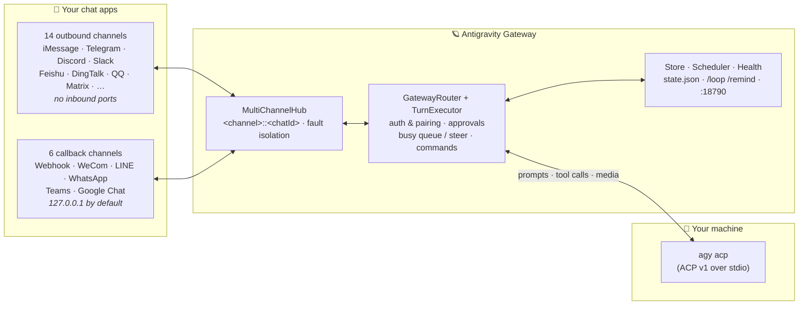

<div align="center">

[English](README.md) | **简体中文** | [繁體中文](README.zh-TW.md) | [日本語](README.ja.md) | [한국어](README.ko.md)

# 🪐 Antigravity Gateway

### 在任何聊天软件里，驱动你本机的 Google Antigravity Agent。

一个自托管进程，把你自己的 **`agy acp`** 接到 **20 个聊天平台**（iMessage、Telegram、Discord、Slack、飞书、钉钉、QQ、企业微信、Matrix 等），支持工具审批、实时进度、会话管理和定时任务。大多数平台**无需公网域名、端口转发或反向代理**。

<p>
  <a href="https://github.com/Relogys/Antigravity-gateway/actions/workflows/ci.yml"></a>
  <a href="https://github.com/Relogys/Antigravity-gateway/actions/workflows/security.yml"></a>
  <a href="https://github.com/Relogys/Antigravity-gateway/releases"></a>
  = 22" />
  
  
  
  
</p>

<p>
  <a href="#compliance"><b>⚖️ 服务条款与合规</b></a> ·
  <a href="#quick-start"><b>快速开始</b></a> ·
  <a href="docs/QUICKSTART.md">3 分钟指南</a> ·
  <a href="#channels">支持平台</a> ·
  <a href="#commands">聊天命令</a> ·
  <a href="#configuration">配置</a> ·
  <a href="#security">安全</a> ·
  <a href="CHANGELOG.md">更新日志</a>
</p>

</div>

---

<a id="compliance"></a>

## ⚖️ 服务条款与合规

> [!CAUTION]
> **安装前请先读完本节。** Antigravity Gateway 是非官方的第三方软件。Google 自己的 Antigravity 条款对第三方访问该服务有限制，你接入的每一个账号、套餐和聊天平台，责任**完全由你自己承担**。

### 本项目是什么

- **独立、非官方。** 这是社区开源项目，**不是** Google、Apple、Photon 或任何聊天平台出品，与它们无关联，也未获其赞助或背书。"Google"、"Gemini"、"Antigravity" 是 Google LLC 的商标，其他名称归各自所有者。
- **你自己 `agy` 的单用户、自托管客户端。** 网关以本地子进程方式启动**你本人**在**你自己的电脑上**安装并登录的官方 Antigravity CLI（`agy acp`，Agent Client Protocol v1，通过 stdio 传输 JSON-RPC，即 Google 为编辑器提供的同一接口）。额度查询运行 `agy -p /usage --output-format json`。认证方式完全取决于你的 `agy` 配置：你本人的交互式登录，或你自己的 `GEMINI_API_KEY`。

### 本项目不做、也不得被用于或改造为做的事

- ❌ **不做反向代理，不做中转。** 不暴露任何 OpenAI 兼容或其他模型 API，也从不直接调用 Google 模型接口。
- ❌ **不提取、不中转 OAuth 令牌。** 从不读取、复制、存储、刷新或转发 `agy` 缓存的凭据或 OAuth 令牌。
- ❌ **不共享、不合用、不轮换、不转售账号或额度。** 一个网关，一个所有者，只用所有者本人的账号。
- ❌ **不绕过配额、速率限制、安全过滤或人工确认提示。**
- ❌ **不把个人账号做成多人公共服务。** `ALLOWED_SENDERS` 和配对只留给你自己。让其他人（群成员、朋友、客户）驱动你的个人账号，不在本项目支持范围之内。

任何加入上述功能的分支或改造都超出本项目的用途，其作者和使用者自行承担全部后果。

### 使用个人（消费者）Antigravity 登录的已知风险

请仔细阅读这一部分：

- **[Google Antigravity 附加服务条款](https://antigravity.google/terms)** 规定：你不得滥用、损害、干扰或破坏本服务，*"包括……将本服务与非由我们提供的产品结合使用"*；*"使用第三方软件、工具或服务访问本服务……即违反本协议"*；并且这*"可能成为暂停或终止你的 Antigravity 和/或 Gemini CLI 账号的理由"*。
- **[Google Antigravity 常见问题](https://antigravity.google/docs/faq)** 写明：*"在消费者套餐下，不支持将 `agy` 封装在第三方编码代理或应用中，或自动轮换账号"*，并建议第三方工具使用 **Gemini Enterprise** 或 **Google AI Studio API 密钥**。
- 本网关**就是**一个封装了 `agy` 的第三方应用。Google 尚未公开确认此类本地 ACP 客户端在消费者套餐下是否被允许（公开的澄清请求：[google-antigravity/antigravity-cli#711](https://github.com/google-antigravity/antigravity-cli/issues/711)）。

**因此，请不要默认在个人 Google 账号（免费版、Google AI Pro 或 Google AI Ultra）上运行本网关是被允许的。** 风险更低的做法是让 `agy` 使用你自己的 **`GEMINI_API_KEY`**、**Gemini Enterprise** 登录，或 **Gemini Enterprise Agent Platform** 凭据进行认证，这些是 Google 在其 [ACP 指南](https://antigravity.google/docs/ide/extensions/acp/)中为 ACP 客户端列出的方式。这些产品各有条款，你同样必须遵守。

（上述条款引文为中文译文，以英文原文为准。）

### 如果你使用 Gemini API 密钥

适用 **[Gemini API 附加服务条款](https://ai.google.dev/gemini-api/terms)**，其中包括：必须年满 18 岁；只能在支持的地区使用；Google AI Studio 和 Gemini API 面向专业或商业用途，而非消费者用途；须遵守 **[生成式 AI 禁止使用政策](https://policies.google.com/terms/generative-ai/use-policy)**；对于代理类服务，*"你不得自动绕过任何人工确认请求"*。因此：

- 请保持 `APPROVAL_MODE=interactive`（或 `sandbox`）。`APPROVAL_MODE=auto` 和 `/yolo` 会以 `--dangerously-skip-permissions` 启动 `agy`，自动批准所有工具调用。
- 使用免费额度时，Google 可能用你的提示和回复改进其产品，人工审核员也可能阅读这些内容。请勿发送敏感、机密或个人信息。

### 你的数据

你通过任何聊天渠道发送的内容，都会作为提示发送给 Google。Antigravity 条款说明 Google 会记录你的交互内容，人工审核员可能阅读，并提醒你不要提交机密信息。你接入的聊天平台也会依其自身政策查看并存储这些消息。

### 一个需要知道的可选功能

`ANTIGRAVITY_LS_ADDRESS` + `ANTIGRAVITY_CSRF_TOKEN`（不在 `.env.example` 中；只有**两者都**设置时才启用）会让网关把会话标题和标签发送到本机 Antigravity 应用的 `ConversationService/UpdateConversation` 端点，以便在其侧边栏中对网关会话分组。这不是公开文档化的接口。**若要最严格地合规，请两者都不要设置。**

### 聊天平台条款

你接入的每个平台都有自己的服务条款、开发者政策、机器人与自动化规则、速率限制和内容规则，你必须全部遵守。包括 Apple（iMessage）与 Photon、Telegram、Discord、Slack、飞书/Lark、钉钉、QQ、企业微信、LINE、WhatsApp（Meta）、Microsoft Teams、Google Chat、Matrix 服务器、Mattermost、Zulip、Rocket.Chat、Signal 及 IRC 网络。

### 责任与免责

- 遵守上述 Google 条款及各聊天平台条款是你本人的责任。**因违规导致的封号、额度损失、费用、数据丢失或任何其他后果，均由使用者自行承担。**
- 本软件依 [MIT 许可证](LICENSE)**"按原样"提供，不附带任何形式的担保**。作者和贡献者对使用本软件引起的任何索赔或损害不承担责任。
- 本节不构成法律意见。条款会变化：使用前和使用期间，请自行阅读最新版本。

<details>
<summary><b>本节所依据的条款与政策</b>（阅读于 2026-11-26）</summary>

- Google Antigravity 附加服务条款：<https://antigravity.google/terms>
- Google Antigravity 常见问题：<https://antigravity.google/docs/faq>
- Google Antigravity，其他编辑器（ACP）：<https://antigravity.google/docs/ide/extensions/acp/>
- Google 服务条款：<https://policies.google.com/terms>
- 生成式 AI 禁止使用政策：<https://policies.google.com/terms/generative-ai/use-policy>
- Gemini API 附加服务条款：<https://ai.google.dev/gemini-api/terms>
- 关于 ACP 集成的公开澄清请求：<https://github.com/google-antigravity/antigravity-cli/issues/711>

</details>

---

## ✨ 为什么需要它

`agy` 在键盘前很好用。Antigravity Gateway 让你离开电脑后仍能继续使用自己的 Agent：

- 📱 **用手机提问。** 在 iMessage、Telegram 或飞书里发一条消息，Agent 在你的电脑上干活，并在同一个对话里回复。
- ✅ **远程审批工具调用。** 权限请求会转发到聊天中。在 Telegram 和 Discord 上点原生按钮，或在任何平台回复 `/approve` 或 `/deny`。
- 🧭 **掌控长任务。** 实时进度卡片、`/stop`、`/steer`、忙碌队列和卡顿提醒。
- ⏰ **自动化。** 周期性 `/loop` 提示（间隔、每日定时或 5 字段 cron），以及重启后依然有效、不消耗 token 的 `/remind` 推送。
- 🔒 **默认安全。** 失败即拒绝的白名单加 8 位私聊配对码，只监听本机回环地址，并从 Agent 环境中剥离各平台密钥。

---

## 🧩 工作原理



每个已启用的平台都汇入同一个路由器，因此所有平台共享相同的认证、审批、命令和会话处理。某个平台出故障时，其他平台照常运行。

---

<a id="channels"></a>

## 📡 支持平台

只要在 `.env` 中填入凭据，对应平台就会自动启用。可以任意组合同时运行。

| 平台 | 键名 | 连接方式 | 需要入站端口？ |
| :--- | :--- | :--- | :---: |
| 📱 **iMessage / SMS / RCS**（Photon） | `photon` | 基于 TLS 的 Spectrum gRPC（`spectrum-ts`） | 否 |
| ✈️ **Telegram** | `telegram` | Bot API 长轮询 | 否 |
| 🎮 **Discord** | `discord` | Gateway WebSocket（`discord.js`） | 否 |
| 💼 **Slack** | `slack` | Socket Mode（`@slack/bolt`） | 否 |
| 🪶 **飞书 / Lark** | `feishu` | 官方 WSClient 长连接 | 否 |
| 🔔 **钉钉** | `dingtalk` | Stream 模式 WebSocket | 否 |
| 🐧 **QQ（OneBot v11）**（NapCat / LLOneBot / Lagrange） | `onebot` | 正向 WebSocket | 否 |
| 🤖 **QQ 官方机器人** | `qqbot` | OpenAPI v2 WebSocket 网关 | 否 |
| 🧩 **Matrix**（Element、Beeper、Synapse） | `matrix` | `/sync` 长轮询 | 否 |
| 💬 **Mattermost** | `mattermost` | WebSocket + REST v4 | 否 |
| 🖥️ **IRC** | `irc` | TCP/TLS 客户端 | 否 |
| 💬 **Zulip** | `zulip` | 实时事件长轮询 | 否 |
| 🚀 **Rocket.Chat** | `rocketchat` | DDP WebSocket + REST | 否 |
| 🔒 **Signal**（signal-cli-rest-api） | `signal` | WebSocket，轮询兜底 | 否 |
| 🔗 **通用 Webhook / HTTP API** | `webhook` | `POST /v1/messages`，SSE `/v1/events` | 回环 `:18791` |
| 🏢 **企业微信**（自建应用） | `wecom` | 加密回调 + REST 推送 | 回环 `:18792` |
| 🟢 **LINE** | `line` | Messaging API webhook | 回环 `:18793` |
| 📗 **WhatsApp Cloud API** | `whatsapp` | Graph API webhook | 回环 `:18794` |
| 🟣 **Microsoft Teams** | `teams` | Bot Framework / 传出 webhook | 回环 `:18795` |
| 🔵 **Google Chat** | `googlechat` | Chat 应用事件 / 传入 webhook | 回环 `:18796` |

只有 5 个平台使用 SDK（`spectrum-ts`、`discord.js`、`@slack/bolt`、`@larksuiteoapi/node-sdk`、`dingtalk-stream`）。其余 15 个是零依赖适配器，基于 Node 自带的 `fetch`、`WebSocket`、`net`/`tls` 和 `crypto` 实现。

> [!TIP]
> 第一次用？**Telegram 上手最快**：一个 bot token，无需公网域名。所有平台的配置方法见 **[docs/QUICKSTART.md](docs/QUICKSTART.md)**。

---

<a id="quick-start"></a>

## 🚀 快速开始

**你需要：** Node.js **22+**（推荐 24）、`pnpm`（`corepack enable pnpm`）、在 `PATH` 中且已完成认证的 Antigravity CLI `agy`（`agy --version`；应使用哪种登录方式见[合规](#compliance)），以及至少一个平台的凭据。

### 从源码安装

```bash
git clone https://github.com/Relogys/Antigravity-gateway.git
cd Antigravity-gateway

pnpm setup          # interactive wizard: pick channels, write .env
pnpm build          # compile once
pnpm cli doctor     # check Node, agy, channels, allowlist and ports
pnpm cli start      # start the background daemon
pnpm cli logs -n 120
```

<details>
<summary>想手动配置？</summary>

```bash
pnpm install
cp .env.example .env      # PowerShell: Copy-Item .env.example .env
# fill in ONE channel in .env
pnpm build && pnpm cli doctor && pnpm cli start
```

开发时需要热重载，请用 `pnpm dev`。
</details>

### 从 Release 安装（校验和验证安装脚本）

安装脚本会从 GitHub Releases 下载发布包和 `SHA256SUMS.txt`，校验 SHA-256 后再执行 `npm install -g`。

```bash
# macOS / Linux
curl -fsSL https://raw.githubusercontent.com/Relogys/Antigravity-gateway/main/scripts/install.sh | bash
curl -fsSL https://raw.githubusercontent.com/Relogys/Antigravity-gateway/main/scripts/install.sh | bash -s -- --version v0.4.2
```

```powershell
# Windows: download scripts/install.ps1, then
powershell -ExecutionPolicy Bypass -File .\install.ps1 -Version v0.4.2
```

全局命令为 `antigravity-gateway`（`antigravity-gateway init`、`antigravity-gateway doctor`、`antigravity-gateway service install` 等）。请在存放 `.env` 的目录中运行。

### 第一次对话

1. 私聊你的机器人。未配置白名单时，它会回复一个 **8 位配对码**。
2. 在你的电脑上批准：`pnpm cli pair approve <CODE>`。
3. 正常聊天。`agy` 工作时你的消息会被标为已读并加上 👀，完成后变为 👍（出错时为 👎）。

> [!NOTE]
> 如果 `agy` 未完成认证，网关能启动但不会回复。请先在终端运行一次 `agy` 登录，或配置 `GEMINI_API_KEY`。

---

## 🎛️ 功能一览

<table>
<tr>
<td width="50%" valign="top">

**Agent 控制**
- 交互、沙箱或自动三种工具审批模式，可按对话切换
- Telegram（内联键盘）和 Discord（按钮组件）原生审批按钮，与文字命令走同样的白名单和发起人校验
- 忙碌时策略：`queue`、`interrupt` 或 `steer`
- 在聊天中切换模型、推理强度和 ACP 模式
- 列出、恢复、命名和压缩 ACP 会话
- 按平台划分的会话组、工作目录和工作区书签（`/cwd @alias`）
- 临时性失败自动重试，上游 ACP 会话过期时自动修复

</td>
<td width="50%" valign="top">

**聊天体验**
- 按平台原生渲染：iMessage 样式、Telegram HTML，IRC、LINE、Signal 和 OneBot 转为整洁纯文本
- 在 Telegram、Discord 和 Slack 上原地编辑同一张实时进度卡片
- 接收来自 Photon、Telegram、Discord、WhatsApp 和 Matrix 的图片，并作为附件传给 `agy`
- 连续快速发送的多条消息合并为一个提示
- 长回复干净分段，代码块保持完整

</td>
</tr>
<tr>
<td valign="top">

**自动化**
- `/loop` 周期提示：间隔（`30m`、`2h`、`1d`）、`daily HH:MM` 或标准 5 字段 cron
- 定时任务在独立会话中运行，不会影响对话的历史或工作目录
- `/remind` 单向推送，消耗 0 个 AI token
- `/usage` 额度查询，消耗 0 token，并在额度不足时提醒
- `pnpm cli send` 可从脚本推送消息
- 提供 GitHub Action，把 CI 事件发到你的聊天中

</td>
<td valign="top">

**运维**
- 带 PID 锁和优雅停止的守护进程 CLI
- 通过 launchd、systemd `--user` 或任务计划程序开机自启
- `/healthz`、`/readyz`、`/status` 和 Prometheus `/metrics` 端点
- 可选 JSON 日志（`LOG_FORMAT=json`），自动脱敏密钥
- 不含密钥的备份与迁移（`pnpm cli export` / `import`）
- GHCR 上的 Docker 镜像（`amd64` + `arm64`）
- Photon 心跳看门狗，自动重连半开连接

</td>
</tr>
</table>

---

<a id="commands"></a>

## 💬 聊天命令

在任意对话中发送 `/help` 查看完整列表。大多数命令加 `-h` 可查看用法。

**运行中随时可用**

| 命令 | 作用 |
| :--- | :--- |
| `/stop` | 取消当前任务 |
| `/new [title]` · `/reset` | 开始新会话（可指定标题） |
| `/steer <prompt>` · `/s` | 打断并改变当前任务方向 |
| `/queue [prompt\|list\|clear]` · `/q` | 排队追加提示，或查看、清空队列 |
| `/busy [queue\|interrupt\|steer]` | 设置任务进行中收到的消息如何处理 |
| `/approve [once\|session\|always]` · `/deny [reason]` | 答复待处理的工具权限请求（Telegram / Discord 上也可点按钮） |
| `/yolo` | 切换本对话的自动批准（群聊中仅管理员可用） |
| `/progress [auto\|edit\|silence\|off\|keep\|delete]` | 实时进度样式，以及卡片是否保留 |
| `/verbose [off\|brief\|full]` | 进度提示的详细程度 |
| `/status` · `/ping` | 会话、模型、队列和运行时长 |
| `/channels` | 各平台连接状态 |
| `/usage` | Antigravity 5 小时和每周额度（0 token） |
| `/sethome` | 把当前对话设为恢复主对话 |
| `/whoami` · `/version` · `/help` | 你在网关中的身份、版本、帮助 |

**空闲时**

| 命令 | 作用 |
| :--- | :--- |
| `/retry` | 重新运行本对话的上一条提示 |
| `/model [slug]` · `/effort [low\|medium\|high\|xhigh]` | 查看或切换模型和推理强度 |
| `/mode [default\|accept-edits\|auto\|plan]` | ACP 会话模式 |
| `/approvals [auto\|interactive\|sandbox]` | 工具审批策略 |
| `/sessions [channel\|all]` · `/groups` | 列出会话，汇总各平台会话组 |
| `/resume <id\|index>` · `/title [name]` | 恢复已保存的会话，重命名 |
| `/compact` · `/compress` | 总结并压缩上下文 |
| `/cwd [path\|@alias]` | 切换工作目录（会开始新会话） |
| `/cwd save <alias> [path]` · `/cwd rm <alias>` · `/cwd list` | 管理工作区书签 |
| `/discard` | 丢弃本地会话状态和队列 |
| `/loop [list\|add <dur> <prompt>\|rm\|pause\|resume <id>]` | 间隔循环任务 |
| `/loop daily <HH:MM> <prompt>` · `/loop cron "<m h dom mon dow>" <prompt>` | 每日或 5 字段 cron 循环任务 |
| `/remind <dur> <text>` | 单向提醒（0 token） |

**仅 iMessage（Photon）**：`/poll <q> | <a> | <b>` 原生投票 · `/bg [preset|clear|list]` 24 种背景之一 · `/unsend` 撤回上一条回复（约 2 分钟内）· `/card` 分享联系人名片。

---

## 🛠️ 管理命令行

```bash
pnpm cli init [--yes] [--channels 1,2]   # setup wizard (alias: pnpm setup)
pnpm cli start [--foreground]     # start (daemon by default)
pnpm cli stop | restart           # graceful, PID-verified
pnpm cli logs -n 200              # tail the rotating log
pnpm cli status                   # live health + store summary
pnpm cli doctor [--json] [--probe-acp]   # check Node, agy and every channel
pnpm cli usage                    # 0-token quota check
pnpm cli send --channel telegram --to <chatId> "Hi"

pnpm cli pair list | clear
pnpm cli pair approve <CODE>
pnpm cli pair revoke telegram:<userId>

pnpm cli export [--out <file>] [--include-auth]
pnpm cli import <file> [--dry-run] [--overwrite] [--include-auth] [--remap-cwd <from>=<to>]

pnpm cli service install | uninstall | status
pnpm cli service print --platform darwin|linux   # preview the unit file
```

`export` 会导出包含会话、定时任务和工作区书签的版本化 JSON 包。它从不包含 `.env`，除非传入 `--include-auth`，否则也不包含白名单和配对信息。`--remap-cwd` 用于在不同机器或操作系统之间迁移时改写路径。

---

<a id="configuration"></a>

## ⚙️ 配置

所有配置都在 `.env` 中。**[`.env.example`](.env.example) 是带注释的完整参考。** 留空即关闭对应功能或平台。

### 核心配置

```env
# Who may talk to the agent. Photon: E.164 numbers or Apple ID emails.
# Other channels: "<channel>:<userId>", e.g. telegram:123456789
ALLOWED_SENDERS=
ADMIN_SENDERS=                 # may approve others' requests and /yolo in groups
ALLOW_GROUPS=false
GROUP_MENTION_PATTERNS=@agy,@antigravity

AGY_BIN=agy
DEFAULT_CWD=.                  # per channel: TELEGRAM_CWD=, PHOTON_CWD=, ...
WORKSPACE_ALIASES=             # e.g. api=/srv/api,web=/srv/web  ->  /cwd @api
APPROVAL_MODE=interactive      # interactive | sandbox | auto
DEFAULT_MODEL=
DEFAULT_EFFORT=
GEMINI_API_KEY=                # optional; disables /usage reporting
AGY_PASSTHROUGH_ENV=           # stripped env var names to pass to agy anyway

DATA_DIR=./data
LOG_DIR=
LOG_LEVEL=info
LOG_FORMAT=text                # text | json
```

所有白名单都为空时表示**全部拒绝**；私聊会改为收到配对码。

<details>
<summary><b>各平台凭据</b>（填入即启用对应平台）</summary>

| 平台 | 必填 | 常用可选项 |
| :--- | :--- | :--- |
| `photon` | `SPECTRUM_PROJECT_ID`, `SPECTRUM_PROJECT_SECRET` | `PHOTON_READ_RECEIPTS`, `PHOTON_REACTIONS`, `PHOTON_MAX_CHUNK_CHARS=1600`, `PHOTON_HEARTBEAT_TIMEOUT_MS`, `PHOTON_PROBE_SPACE_ID` |
| `telegram` | `TELEGRAM_BOT_TOKEN` | `TELEGRAM_ALLOWED_USERS`, `TELEGRAM_POLL_TIMEOUT_SEC` |
| `discord` | `DISCORD_BOT_TOKEN` | `DISCORD_ALLOWED_USERS`, `DISCORD_ALLOW_GUILDS` |
| `slack` | `SLACK_BOT_TOKEN` (`xoxb-`), `SLACK_APP_TOKEN` (`xapp-`) | `SLACK_ALLOWED_USERS` |
| `feishu` | `FEISHU_APP_ID`, `FEISHU_APP_SECRET` | `FEISHU_DOMAIN=feishu\|lark`, `FEISHU_ALLOWED_USERS` |
| `dingtalk` | `DINGTALK_CLIENT_ID`, `DINGTALK_CLIENT_SECRET` | `DINGTALK_ALLOWED_USERS` |
| `onebot` | `ONEBOT_WS_URL` | `ONEBOT_ACCESS_TOKEN`, `ONEBOT_SELF_ID`, `ONEBOT_ALLOWED_USERS` |
| `qqbot` | `QQBOT_APP_ID`, `QQBOT_CLIENT_SECRET` | `QQBOT_SANDBOX`, `QQBOT_ALLOWED_USERS` |
| `wecom` | `WECOM_CORP_ID`, `WECOM_AGENT_ID`, `WECOM_SECRET` | `WECOM_TOKEN`, `WECOM_ENCODING_AES_KEY`, `WECOM_HOST`, `WECOM_PORT` |
| `matrix` | `MATRIX_HOMESERVER_URL`, `MATRIX_ACCESS_TOKEN` | `MATRIX_USER_ID`, `MATRIX_ALLOWED_USERS` |
| `mattermost` | `MATTERMOST_BASE_URL`, `MATTERMOST_BOT_TOKEN` | `MATTERMOST_ALLOWED_USERS` |
| `line` | `LINE_CHANNEL_ACCESS_TOKEN`, `LINE_CHANNEL_SECRET` | `LINE_HOST`, `LINE_PORT` |
| `irc` | `IRC_HOST`, `IRC_CHANNELS` | `IRC_PORT=6697`, `IRC_TLS`, `IRC_NICK`, `IRC_PASSWORD` |
| `whatsapp` | `WHATSAPP_ACCESS_TOKEN`, `WHATSAPP_PHONE_NUMBER_ID` | `WHATSAPP_VERIFY_TOKEN`, `WHATSAPP_APP_SECRET`, `WHATSAPP_WEBHOOK_*` |
| `zulip` | `ZULIP_SITE`, `ZULIP_BOT_EMAIL`, `ZULIP_API_KEY` | `ZULIP_STREAMS`, `ZULIP_REQUIRE_MENTION` |
| `rocketchat` | `ROCKETCHAT_URL`, `ROCKETCHAT_USER_ID`, `ROCKETCHAT_AUTH_TOKEN` | `ROCKETCHAT_REQUIRE_MENTION` |
| `signal` | `SIGNAL_API_URL`, `SIGNAL_ACCOUNT` | `SIGNAL_POLL_INTERVAL_MS` |
| `teams` | `TEAMS_WEBHOOK_SECRET`，**或** `TEAMS_APP_ID` + `TEAMS_APP_PASSWORD`，**或** `TEAMS_INCOMING_WEBHOOK_URL` | `TEAMS_TENANT_ID`, `TEAMS_WEBHOOK_*` |
| `googlechat` | `GOOGLECHAT_WEBHOOK_URL`、`GOOGLECHAT_ACCESS_TOKEN`、`GOOGLECHAT_VERIFICATION_TOKEN` 任选其一 | `GOOGLECHAT_AUDIENCE`（推荐）, `GOOGLECHAT_WEBHOOK_*` |
| `webhook` | `WEBHOOK_ENABLED=true` | `WEBHOOK_TOKEN`, `WEBHOOK_SECRET`, `WEBHOOK_CALLBACK_URL`, `WEBHOOK_FIXED_SENDER`, `WEBHOOK_REPLAY_WINDOW_SEC`, `WEBHOOK_REQUIRE_TIMESTAMP` |

每个平台也都支持 `<CHANNEL>_ALLOWED_USERS`，会与 `ALLOWED_SENDERS` 和已配对的发送者合并。

**Photon 提示：** 在 *Photon Dashboard → Users* 中登记你用来发消息的账号（可在 `https://debug.photon.codes` 查看准确标识）。在共享 iMessage 号码池上，必须先用你的 Apple 设备向项目号码发送**第一条**消息，否则回复会失败并报 `Target not allowed for this project`。
</details>

<details>
<summary><b>长任务与进度</b></summary>

```env
TOOL_PROGRESS_MODE=auto            # auto | edit | silence | off
TOOL_PROGRESS_KEEP=false           # true keeps a summary card after the reply
TOOL_PROGRESS_EDIT_INTERVAL_MS=1500
PROGRESS_SILENCE_MS=120000         # pulse after this much silence (0 = off)
SESSION_STALL_TIMEOUT_MS=300000    # warn once when a turn stalls
TURN_MAX_RETRIES=2                 # retries for transient ACP failures
INGRESS_DEBOUNCE_MS=350            # merge rapid-fire bubbles
AUTO_BOOTSTRAP_CHANNEL_SESSION=true
QUOTA_WARN_THRESHOLD=15            # % of 5-hour quota left
```

`auto` 会在平台允许时原地编辑同一张卡片；在 iMessage 上则使用简短提示，以免超出 Apple 的 5 次编辑上限。
</details>

<details>
<summary><b>健康检查、指标与本地端口</b></summary>

```env
HEALTH_ENABLED=false
HEALTH_HOST=127.0.0.1
HEALTH_PORT=18790
HEALTH_TOKEN=          # Bearer token for /status and /metrics; set it if you bind beyond loopback
```

| 端点 | 含义 |
| :--- | :--- |
| `GET /healthz` | 存活检查：至少一个平台已连接时返回 `200` |
| `GET /readyz` | 就绪检查：所有已配置平台都连接时才返回 `200` |
| `GET /status` | 各平台完整诊断信息，错误已脱敏 |
| `GET /metrics` | Prometheus 文本格式，基数有界，不含发送者或对话 ID |

| 端口 | 用途 |
| :--- | :--- |
| `18790` | 健康检查服务 |
| `18791`–`18796` | `webhook`、`wecom`、`line`、`whatsapp`、`teams`、`googlechat` 回调 |

默认全部绑定 `127.0.0.1`。只有在平台要求时，才通过你自己的 TLS 反向代理或隧道暴露回调地址。
</details>

<details>
<summary><b>Webhook / HTTP API</b></summary>

```bash
curl -X POST http://127.0.0.1:18791/v1/messages \
  -H "Authorization: Bearer $WEBHOOK_TOKEN" \
  -H "Content-Type: application/json" \
  -d '{"chatId":"ops","text":"summarize the git log for today","wait":true}'
```

使用 `"wait": true` 时会同步返回 `{ "ok": true, "messageId": "...", "replies": [...] }`。否则可订阅 `GET /v1/events`（SSE）或设置 `WEBHOOK_CALLBACK_URL`。请求可以用 `X-Webhook-Signature: sha256=<hmac>` 签名，并配合 `X-Webhook-Timestamp` 和 `X-Webhook-Id` 防重放。没有 token 或 secret 时，网关拒绝绑定非回环地址。

此端点供你自己的脚本和工具使用。请勿用它向其他人提供 Agent 服务（见[合规](#compliance)）。
</details>

---

## 📦 部署

### 作为服务运行

```bash
pnpm build
pnpm cli service install     # macOS launchd · Linux systemd --user · Windows Task Scheduler
```

更喜欢用脚本？见 [`scripts/`](scripts/)：`install-launchd.sh`、`install-systemd.sh`、`install-task.ps1`，以及崩溃退避守护脚本 `start-gateway.sh` / `start-gateway.ps1`（2 秒→60 秒退避，5 MB 日志轮转）。

### Docker

```bash
cp .env.example .env               # fill in at least one channel
docker compose pull && docker compose up -d     # or: docker compose up -d --build
curl http://127.0.0.1:18790/healthz
```

镜像：`ghcr.io/relogys/antigravity-gateway`（`latest` 和 `vX.Y.Z`，`amd64` + `arm64`）。以非 root 运行，只读挂载 `.env`，状态保存在 `./data`，只发布 `127.0.0.1:18790`。镜像不包含 `agy`：请挂载你自己的二进制和你自己的凭据，或设置你自己的 `GEMINI_API_KEY`。在 Linux 上请先运行 `mkdir -p data && sudo chown -R 1000:1000 data`。详见 [Docker 指南](docs/QUICKSTART.md#4-docker--容器部署)。

### 从 GitHub Actions 发通知

```yaml
- uses: Relogys/Antigravity-gateway/.github/actions/notify@v0.4.2
  with:
    url: ${{ secrets.GATEWAY_WEBHOOK_URL }}
    secret: ${{ secrets.GATEWAY_WEBHOOK_SECRET }}
    chat-id: ops-alerts
    text: "Deployed ${{ github.ref_name }}"
```

---

<a id="security"></a>

## 🔐 安全

- **失败即拒绝。** 陌生发送者只会收到配对码：8 位无歧义字符，有效期 1 小时，输错 5 次即锁定。
- **群聊审批绑定发起人。** 只有触发工具调用的人或 `ADMIN_SENDERS` 成员可以批准，无论是用命令还是按钮。群聊中 `/yolo` 仅限管理员。
- **干净的子进程环境。** 启动 `agy acp` 前，网关会移除所有平台凭据变量族（`TELEGRAM_*`、`SLACK_*` 等）及其内部设置（白名单、健康检查和进度设置、`ANTIGRAVITY_*`）。其他变量，例如 `PATH`、`HOME`、`GEMINI_API_KEY` 和 Google Cloud 设置，仍会传给 `agy`。`AGY_PASSTHROUGH_ENV` 可把特定被移除的变量重新放行。
- **回调验签。** Webhook（Bearer + HMAC + 防重放）、Google Chat（通过 `GOOGLECHAT_AUDIENCE` 的 RS256 OIDC）、企业微信（WXBizMsgCrypt）、LINE、WhatsApp 和 Teams 的签名都会在分发前校验。Authorization 头以线性时间解析。
- **不向聊天泄露。** 所有平台都会剥离 `file:///` IDE 路径，出站 `MEDIA:` 拒绝 `.env*`、`.ssh` 和私钥，健康检查错误已脱敏。
- **持久状态可靠。** 跨进程存储锁、`.bak` 回滚以及损坏文件隔离。
- **CI 检查。** 每次推送都运行 CodeQL、依赖审计和 `pnpm audit:secrets`。

发现漏洞？请按 [SECURITY.md](SECURITY.md) 报告，不要公开提 issue。

---

## 🧱 扩展新平台

新建 `src/channels/<name>.ts`，继承 [`BaseChannelAdapter`](src/channels/base.ts)，导出 `createAdapter(config)`，并在 [`src/config.ts`](src/config.ts) 中添加对应配置块：

```ts
import type { GatewayConfig } from "../config.js";
import { BaseChannelAdapter, type InboundHandler } from "./base.js";
import type { ChannelAdapter, OutboundMessage } from "../types.js";

export class MyChatAdapter extends BaseChannelAdapter {
  readonly name = "my-chat";

  async start(onMessage: InboundHandler): Promise<void> {
    this.handler = onMessage;
    this.setConnected(true);
    // call `await this.emit({ ... })` with the raw chatId and senderId
  }

  async stop(): Promise<void> {
    this.setConnected(false);
  }

  async sendMessage(msg: OutboundMessage) {
    this.noteOutbound();
    return { messageId: "outbound-id" };
  }
}

export function createAdapter(config: GatewayConfig): ChannelAdapter {
  return new MyChatAdapter();
}
```

可选钩子（`sendTyping`、`markRead`、`react`、`editMessage`、`deleteMessage`）会被自动识别。实现 `editMessage` 和 `deleteMessage` 即可获得实时进度卡片。

---

## 🧪 开发

```bash
pnpm install
pnpm dev            # run from source with tsx
pnpm typecheck
pnpm test           # vitest, 42 test files
pnpm probe:acp      # smoke-test the agy ACP connection
pnpm audit:secrets
```

CI 在 Ubuntu（Node 22 和 24）、macOS（Apple Silicon，Node 24）、Windows（Node 24）上运行，并进行 Docker 构建。只改动 Markdown 或 `LICENSE` 的 PR 会跳过繁重的矩阵任务，但必过检查仍会正常上报。打 `vX.Y.Z` 标签会发布 GHCR 镜像，以及附带 npm 包和 `SHA256SUMS.txt` 的 GitHub Release。

<details>
<summary>目录结构</summary>

```
src/
├── acp/           # agy acp client, sessions, permissions, quota
├── channels/      # 20 adapters + hub, registry, formatting, media
├── gateway/       # router, turn executor, burst coalescing, progress, scheduler, store
│   └── commands/  # session, system, loop and Photon slash commands
├── photon/        # iMessage adapter, formatting, staleness probe
├── backup.ts      # export / import bundles
├── cli.ts         # admin CLI (start/stop/doctor/pair/export/service/…)
├── wizard.ts      # pnpm setup onboarding
├── health.ts      # /healthz /readyz /status /metrics
└── index.ts       # entry point
scripts/           # installers, service installers, supervisors, audits
docs/QUICKSTART.md # per-platform setup and troubleshooting
```
</details>

---

## 📚 更多

- [docs/QUICKSTART.md](docs/QUICKSTART.md)：各平台凭据、Docker、日常运维和故障排查
- [CHANGELOG.md](CHANGELOG.md)：每个版本的变更
- [SECURITY.md](SECURITY.md)：漏洞报告

## 📄 许可证

[MIT](LICENSE) © Relogys。"按原样"提供，不附带任何形式的担保。

<sub>Antigravity Gateway 是独立的开源项目，与 Google 无关联，也未获 Google 赞助或背书。详见[服务条款与合规](#compliance)。</sub>
