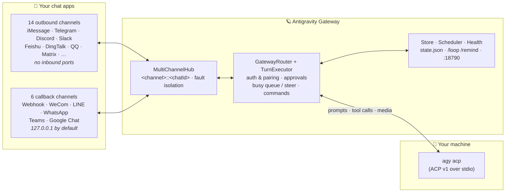

<div align="center">

[English](README.md) | [简体中文](README.zh-CN.md) | **繁體中文** | [日本語](README.ja.md) | [한국어](README.ko.md)

# 🪐 Antigravity Gateway

### 在任何聊天軟體裡，驅動你本機的 Google Antigravity Agent。

一個自託管程序，把你自己的 **`agy acp`** 接到 **20 個聊天平台**（iMessage、Telegram、Discord、Slack、飛書、釘釘、QQ、企業微信、Matrix 等），支援工具審批、即時進度、工作階段管理和定時任務。大多數平台**無需公網域名、埠轉發或反向代理**。

<p>
  <a href="https://github.com/Relogys/Antigravity-gateway/actions/workflows/ci.yml"></a>
  <a href="https://github.com/Relogys/Antigravity-gateway/actions/workflows/security.yml"></a>
  <a href="https://github.com/Relogys/Antigravity-gateway/releases"></a>
  = 22" />
  
  
  
  
</p>

<p>
  <a href="#compliance"><b>⚖️ 服務條款與合規</b></a> ·
  <a href="#quick-start"><b>快速開始</b></a> ·
  <a href="docs/QUICKSTART.md">3 分鐘指南</a> ·
  <a href="#channels">支援平台</a> ·
  <a href="#commands">聊天命令</a> ·
  <a href="#configuration">設定</a> ·
  <a href="#security">安全</a> ·
  <a href="CHANGELOG.md">更新日誌</a>
</p>

</div>

---

<a id="compliance"></a>

## ⚖️ 服務條款與合規

> [!CAUTION]
> **安裝前請先讀完本節。** Antigravity Gateway 是非官方的第三方軟體。Google 自己的 Antigravity 條款對第三方存取該服務有限制，你接入的每一個帳號、方案和聊天平台，責任**完全由你自己承擔**。

### 本專案是什麼

- **獨立、非官方。** 這是社群開源專案，**不是** Google、Apple、Photon 或任何聊天平台出品，與它們無關聯，也未獲其贊助或背書。"Google"、"Gemini"、"Antigravity" 是 Google LLC 的商標，其他名稱歸各自所有者。
- **你自己 `agy` 的單使用者、自託管客戶端。** 閘道以本地子程序方式啟動**你本人**在**你自己的電腦上**安裝並登入的官方 Antigravity CLI（`agy acp`，Agent Client Protocol v1，透過 stdio 傳輸 JSON-RPC，即 Google 為編輯器提供的同一介面）。額度查詢執行 `agy -p /usage --output-format json`。認證方式完全取決於你的 `agy` 設定：你本人的互動式登入，或你自己的 `GEMINI_API_KEY`。

### 本專案不做、也不得被用於或改造為做的事

- ❌ **不做反向代理，不做中轉。** 不暴露任何 OpenAI 相容或其他模型 API，也從不直接呼叫 Google 模型介面。
- ❌ **不提取、不中轉 OAuth 權杖。** 從不讀取、複製、儲存、重新整理或轉發 `agy` 快取的憑證或 OAuth 權杖。
- ❌ **不共享、不合用、不輪換、不轉售帳號或額度。** 一個閘道，一個所有者，只用所有者本人的帳號。
- ❌ **不繞過配額、速率限制、安全過濾或人工確認提示。**
- ❌ **不把個人帳號做成多人公共服務。** `ALLOWED_SENDERS` 和配對只留給你自己。讓其他人（群成員、朋友、客戶）驅動你的個人帳號，不在本專案支援範圍之內。

任何加入上述功能的分支或改造都超出本專案的用途，其作者和使用者自行承擔全部後果。

### 使用個人（消費者）Antigravity 登入的已知風險

請仔細閱讀這一部分：

- **[Google Antigravity 附加服務條款](https://antigravity.google/terms)** 規定：你不得濫用、損害、干擾或破壞本服務，*"包括……將本服務與非由我們提供的產品結合使用"*；*"使用第三方軟體、工具或服務存取本服務……即違反本協議"*；並且這*"可能成為暫停或終止你的 Antigravity 和/或 Gemini CLI 帳號的理由"*。
- **[Google Antigravity 常見問題](https://antigravity.google/docs/faq)** 寫明：*"在消費者方案下，不支援將 `agy` 封裝在第三方編碼代理或應用中，或自動輪換帳號"*，並建議第三方工具使用 **Gemini Enterprise** 或 **Google AI Studio API 金鑰**。
- 本閘道**就是**一個封裝了 `agy` 的第三方應用。Google 尚未公開確認此類本地 ACP 客戶端在消費者方案下是否被允許（公開的澄清請求：[google-antigravity/antigravity-cli#711](https://github.com/google-antigravity/antigravity-cli/issues/711)）。

**因此，請不要預設在個人 Google 帳號（免費版、Google AI Pro 或 Google AI Ultra）上執行本閘道是被允許的。** 風險更低的做法是讓 `agy` 使用你自己的 **`GEMINI_API_KEY`**、**Gemini Enterprise** 登入，或 **Gemini Enterprise Agent Platform** 憑證進行認證，這些是 Google 在其 [ACP 指南](https://antigravity.google/docs/ide/extensions/acp/)中為 ACP 客戶端列出的方式。這些產品各有條款，你同樣必須遵守。

（上述條款引文為中文譯文，以英文原文為準。）

### 如果你使用 Gemini API 金鑰

適用 **[Gemini API 附加服務條款](https://ai.google.dev/gemini-api/terms)**，其中包括：必須年滿 18 歲；只能在支援的地區使用；Google AI Studio 和 Gemini API 面向專業或商業用途，而非消費者用途；須遵守 **[生成式 AI 禁止使用政策](https://policies.google.com/terms/generative-ai/use-policy)**；對於代理類服務，*"你不得自動繞過任何人工確認請求"*。因此：

- 請保持 `APPROVAL_MODE=interactive`（或 `sandbox`）。`APPROVAL_MODE=auto` 和 `/yolo` 會以 `--dangerously-skip-permissions` 啟動 `agy`，自動批准所有工具呼叫。
- 使用免費額度時，Google 可能用你的提示和回覆改進其產品，人工審查人員也可能閱讀這些內容。請勿傳送敏感、機密或個人資訊。

### 你的資料

你透過任何聊天管道傳送的內容，都會作為提示傳送給 Google。Antigravity 條款說明 Google 會記錄你的互動內容，人工審查人員可能閱讀，並提醒你不要提交機密資訊。你接入的聊天平台也會依其自身政策檢視並儲存這些訊息。

### 一個需要知道的可選功能

`ANTIGRAVITY_LS_ADDRESS` + `ANTIGRAVITY_CSRF_TOKEN`（不在 `.env.example` 中；只有**兩者都**設定時才啟用）會讓閘道把工作階段標題和標籤傳送到本機 Antigravity 應用的 `ConversationService/UpdateConversation` 端點，以便在其側邊欄中對閘道工作階段分組。這不是公開文件化的介面。**若要最嚴格地合規，請兩者都不要設定。**

### 聊天平台條款

你接入的每個平台都有自己的服務條款、開發者政策、機器人與自動化規則、速率限制和內容規則，你必須全部遵守。包括 Apple（iMessage）與 Photon、Telegram、Discord、Slack、飛書/Lark、釘釘、QQ、企業微信、LINE、WhatsApp（Meta）、Microsoft Teams、Google Chat、Matrix 伺服器、Mattermost、Zulip、Rocket.Chat、Signal 及 IRC 網路。

### 責任與免責

- 遵守上述 Google 條款及各聊天平台條款是你本人的責任。**因違規導致的封號、額度損失、費用、資料遺失或任何其他後果，均由使用者自行承擔。**
- 本軟體依 [MIT 授權條款](LICENSE)**"按原樣"提供，不附帶任何形式的擔保**。作者和貢獻者對使用本軟體引起的任何索賠或損害不承擔責任。
- 本節不構成法律意見。條款會變化：使用前和使用期間，請自行閱讀最新版本。

<details>
<summary><b>本節所依據的條款與政策</b>（閱讀於 2026-11-26）</summary>

- Google Antigravity 附加服務條款：<https://antigravity.google/terms>
- Google Antigravity 常見問題：<https://antigravity.google/docs/faq>
- Google Antigravity，其他編輯器（ACP）：<https://antigravity.google/docs/ide/extensions/acp/>
- Google 服務條款：<https://policies.google.com/terms>
- 生成式 AI 禁止使用政策：<https://policies.google.com/terms/generative-ai/use-policy>
- Gemini API 附加服務條款：<https://ai.google.dev/gemini-api/terms>
- 關於 ACP 整合的公開澄清請求：<https://github.com/google-antigravity/antigravity-cli/issues/711>

</details>

---

## ✨ 為什麼需要它

`agy` 在鍵盤前很好用。Antigravity Gateway 讓你離開電腦後仍能繼續使用自己的 Agent：

- 📱 **用手機提問。** 在 iMessage、Telegram 或飛書裡發一條訊息，Agent 在你的電腦上工作，並在同一個對話裡回覆。
- ✅ **遠端審批工具呼叫。** 權限請求會轉發到聊天中。在 Telegram 和 Discord 上點原生按鈕，或在任何平台回覆 `/approve` 或 `/deny`。
- 🧭 **掌控長任務。** 即時進度卡片、`/stop`、`/steer`、忙碌佇列和卡頓提醒。
- ⏰ **自動化。** 週期性 `/loop` 提示（間隔、每日定時或 5 欄位 cron），以及重啟後依然有效、不消耗 token 的 `/remind` 推送。
- 🔒 **預設即安全。** 失敗即拒絕的白名單加 8 位私聊配對碼，只監聽本機迴環地址，並從 Agent 環境中剝離各平台金鑰。

---

## 🧩 工作原理



每個已啟用的平台都匯入同一個路由器，因此所有平台共享相同的認證、審批、命令和工作階段處理。某個平台出故障時，其他平台照常執行。

---

<a id="channels"></a>

## 📡 支援平台

只要在 `.env` 中填入憑證，對應平台就會自動啟用。可以任意組合同時執行。

| 平台 | 鍵名 | 連線方式 | 需要入站埠？ |
| :--- | :--- | :--- | :---: |
| 📱 **iMessage / SMS / RCS**（Photon） | `photon` | 基於 TLS 的 Spectrum gRPC（`spectrum-ts`） | 否 |
| ✈️ **Telegram** | `telegram` | Bot API 長輪詢 | 否 |
| 🎮 **Discord** | `discord` | Gateway WebSocket（`discord.js`） | 否 |
| 💼 **Slack** | `slack` | Socket Mode（`@slack/bolt`） | 否 |
| 🪶 **飛書 / Lark** | `feishu` | 官方 WSClient 長連線 | 否 |
| 🔔 **釘釘** | `dingtalk` | Stream 模式 WebSocket | 否 |
| 🐧 **QQ（OneBot v11）**（NapCat / LLOneBot / Lagrange） | `onebot` | 正向 WebSocket | 否 |
| 🤖 **QQ 官方機器人** | `qqbot` | OpenAPI v2 WebSocket 閘道 | 否 |
| 🧩 **Matrix**（Element、Beeper、Synapse） | `matrix` | `/sync` 長輪詢 | 否 |
| 💬 **Mattermost** | `mattermost` | WebSocket + REST v4 | 否 |
| 🖥️ **IRC** | `irc` | TCP/TLS 客戶端 | 否 |
| 💬 **Zulip** | `zulip` | 即時事件長輪詢 | 否 |
| 🚀 **Rocket.Chat** | `rocketchat` | DDP WebSocket + REST | 否 |
| 🔒 **Signal**（signal-cli-rest-api） | `signal` | WebSocket，輪詢備援 | 否 |
| 🔗 **通用 Webhook / HTTP API** | `webhook` | `POST /v1/messages`，SSE `/v1/events` | 迴環 `:18791` |
| 🏢 **企業微信**（自建應用） | `wecom` | 加密回呼 + REST 推送 | 迴環 `:18792` |
| 🟢 **LINE** | `line` | Messaging API webhook | 迴環 `:18793` |
| 📗 **WhatsApp Cloud API** | `whatsapp` | Graph API webhook | 迴環 `:18794` |
| 🟣 **Microsoft Teams** | `teams` | Bot Framework / 傳出 webhook | 迴環 `:18795` |
| 🔵 **Google Chat** | `googlechat` | Chat 應用事件 / 傳入 webhook | 迴環 `:18796` |

只有 5 個平台使用 SDK（`spectrum-ts`、`discord.js`、`@slack/bolt`、`@larksuiteoapi/node-sdk`、`dingtalk-stream`）。其餘 15 個是零相依轉接器，基於 Node 內建的 `fetch`、`WebSocket`、`net`/`tls` 和 `crypto` 實作。

> [!TIP]
> 第一次用？**Telegram 上手最快**：一個 bot token，無需公網域名。所有平台的設定方法見 **[docs/QUICKSTART.md](docs/QUICKSTART.md)**。

---

<a id="quick-start"></a>

## 🚀 快速開始

**你需要：** Node.js **22+**（推薦 24）、`pnpm`（`corepack enable pnpm`）、在 `PATH` 中且已完成認證的 Antigravity CLI `agy`（`agy --version`；應使用哪種登入方式見[合規](#compliance)），以及至少一個平台的憑證。

### 從原始碼安裝

```bash
git clone https://github.com/Relogys/Antigravity-gateway.git
cd Antigravity-gateway

pnpm setup          # interactive wizard: pick channels, write .env
pnpm build          # compile once
pnpm cli doctor     # check Node, agy, channels, allowlist and ports
pnpm cli start      # start the background daemon
pnpm cli logs -n 120
```

<details>
<summary>想手動設定？</summary>

```bash
pnpm install
cp .env.example .env      # PowerShell: Copy-Item .env.example .env
# fill in ONE channel in .env
pnpm build && pnpm cli doctor && pnpm cli start
```

開發時需要熱重載，請用 `pnpm dev`。
</details>

### 從 Release 安裝（驗證和驗證安裝腳本）

安裝腳本會從 GitHub Releases 下載發佈包和 `SHA256SUMS.txt`，驗證 SHA-256 後再執行 `npm install -g`。

```bash
# macOS / Linux
curl -fsSL https://raw.githubusercontent.com/Relogys/Antigravity-gateway/main/scripts/install.sh | bash
curl -fsSL https://raw.githubusercontent.com/Relogys/Antigravity-gateway/main/scripts/install.sh | bash -s -- --version v0.4.2
```

```powershell
# Windows: download scripts/install.ps1, then
powershell -ExecutionPolicy Bypass -File .\install.ps1 -Version v0.4.2
```

全域命令為 `antigravity-gateway`（`antigravity-gateway init`、`antigravity-gateway doctor`、`antigravity-gateway service install` 等）。請在存放 `.env` 的目錄中執行。

### 第一次對話

1. 私聊你的機器人。未設定白名單時，它會回覆一個 **8 位配對碼**。
2. 在你的電腦上批准：`pnpm cli pair approve <CODE>`。
3. 正常聊天。`agy` 工作時你的訊息會被標為已讀並加上 👀，完成後變為 👍（出錯時為 👎）。

> [!NOTE]
> 如果 `agy` 未完成認證，閘道能啟動但不會回覆。請先在終端執行一次 `agy` 登入，或設定 `GEMINI_API_KEY`。

---

## 🎛️ 功能一覽

<table>
<tr>
<td width="50%" valign="top">

**Agent 控制**
- 互動、沙箱或自動三種工具審批模式，可按對話切換
- Telegram（內嵌鍵盤）和 Discord（按鈕元件）原生審批按鈕，與文字命令走同樣的白名單和發起人檢查
- 忙碌時策略：`queue`、`interrupt` 或 `steer`
- 在聊天中切換模型、推理強度和 ACP 模式
- 列出、恢復、命名和壓縮 ACP 工作階段
- 按平台劃分的工作階段組、工作目錄和工作區書籤（`/cwd @alias`）
- 臨時性失敗自動重試，上游 ACP 工作階段過期時自動修復

</td>
<td width="50%" valign="top">

**聊天體驗**
- 按平台原生渲染：iMessage 樣式、Telegram HTML，IRC、LINE、Signal 和 OneBot 轉為整潔純文字
- 在 Telegram、Discord 和 Slack 上原地編輯同一張即時進度卡片
- 接收來自 Photon、Telegram、Discord、WhatsApp 和 Matrix 的圖片，並作為附件傳給 `agy`
- 連續快速傳送的多條訊息合併為一個提示
- 長回覆乾淨分段，程式碼區塊保持完整

</td>
</tr>
<tr>
<td valign="top">

**自動化**
- `/loop` 週期提示：間隔（`30m`、`2h`、`1d`）、`daily HH:MM` 或標準 5 欄位 cron
- 定時任務在獨立工作階段中執行，不會影響對話的歷史或工作目錄
- `/remind` 單向推送，消耗 0 個 AI token
- `/usage` 額度查詢，消耗 0 token，並在額度不足時提醒
- `pnpm cli send` 可從腳本推送訊息
- 提供 GitHub Action，把 CI 事件發到你的聊天中

</td>
<td valign="top">

**維運**
- 帶 PID 鎖和優雅停止的守護程序 CLI
- 透過 launchd、systemd `--user` 或工作排程器開機自啟
- `/healthz`、`/readyz`、`/status` 和 Prometheus `/metrics` 端點
- 可選 JSON 日誌（`LOG_FORMAT=json`），自動遮蔽金鑰
- 不含金鑰的備份與遷移（`pnpm cli export` / `import`）
- GHCR 上的 Docker 映像檔（`amd64` + `arm64`）
- Photon 心跳看門狗，自動重連半開連線

</td>
</tr>
</table>

---

<a id="commands"></a>

## 💬 聊天命令

在任意對話中傳送 `/help` 檢視完整列表。大多數命令加 `-h` 可檢視用法。

**執行中隨時可用**

| 命令 | 作用 |
| :--- | :--- |
| `/stop` | 取消當前任務 |
| `/new [title]` · `/reset` | 開始新工作階段（可指定標題） |
| `/steer <prompt>` · `/s` | 打斷並改變當前任務方向 |
| `/queue [prompt\|list\|clear]` · `/q` | 排隊追加提示，或檢視、清空佇列 |
| `/busy [queue\|interrupt\|steer]` | 設定任務進行中收到的訊息如何處理 |
| `/approve [once\|session\|always]` · `/deny [reason]` | 答覆待處理的工具權限請求（Telegram / Discord 上也可點按鈕） |
| `/yolo` | 切換本對話的自動批准（群聊中僅管理員可用） |
| `/progress [auto\|edit\|silence\|off\|keep\|delete]` | 即時進度樣式，以及卡片是否保留 |
| `/verbose [off\|brief\|full]` | 進度提示的詳細程度 |
| `/status` · `/ping` | 工作階段、模型、佇列和執行時長 |
| `/channels` | 各平台連線狀態 |
| `/usage` | Antigravity 5 小時和每週額度（0 token） |
| `/sethome` | 把當前對話設為恢復主對話 |
| `/whoami` · `/version` · `/help` | 你在閘道中的身份、版本、幫助 |

**閒置時**

| 命令 | 作用 |
| :--- | :--- |
| `/retry` | 重新執行本對話的上一條提示 |
| `/model [slug]` · `/effort [low\|medium\|high\|xhigh]` | 檢視或切換模型和推理強度 |
| `/mode [default\|accept-edits\|auto\|plan]` | ACP 工作階段模式 |
| `/approvals [auto\|interactive\|sandbox]` | 工具審批策略 |
| `/sessions [channel\|all]` · `/groups` | 列出工作階段，彙總各平台工作階段組 |
| `/resume <id\|index>` · `/title [name]` | 恢復已儲存的工作階段，重新命名 |
| `/compact` · `/compress` | 總結並壓縮上下文 |
| `/cwd [path\|@alias]` | 切換工作目錄（會開始新工作階段） |
| `/cwd save <alias> [path]` · `/cwd rm <alias>` · `/cwd list` | 管理工作區書籤 |
| `/discard` | 丟棄本地工作階段狀態和佇列 |
| `/loop [list\|add <dur> <prompt>\|rm\|pause\|resume <id>]` | 間隔循環任務 |
| `/loop daily <HH:MM> <prompt>` · `/loop cron "<m h dom mon dow>" <prompt>` | 每日或 5 欄位 cron 循環任務 |
| `/remind <dur> <text>` | 單向提醒（0 token） |

**僅 iMessage（Photon）**：`/poll <q> | <a> | <b>` 原生投票 · `/bg [preset|clear|list]` 24 種背景之一 · `/unsend` 撤回上一條回覆（約 2 分鐘內）· `/card` 分享聯絡人名片。

---

## 🛠️ 管理命令列

```bash
pnpm cli init [--yes] [--channels 1,2]   # setup wizard (alias: pnpm setup)
pnpm cli start [--foreground]     # start (daemon by default)
pnpm cli stop | restart           # graceful, PID-verified
pnpm cli logs -n 200              # tail the rotating log
pnpm cli status                   # live health + store summary
pnpm cli doctor [--json] [--probe-acp]   # check Node, agy and every channel
pnpm cli usage                    # 0-token quota check
pnpm cli send --channel telegram --to <chatId> "Hi"

pnpm cli pair list | clear
pnpm cli pair approve <CODE>
pnpm cli pair revoke telegram:<userId>

pnpm cli export [--out <file>] [--include-auth]
pnpm cli import <file> [--dry-run] [--overwrite] [--include-auth] [--remap-cwd <from>=<to>]

pnpm cli service install | uninstall | status
pnpm cli service print --platform darwin|linux   # preview the unit file
```

`export` 會匯出包含工作階段、定時任務和工作區書籤的版本化 JSON 包。它從不包含 `.env`，除非傳入 `--include-auth`，否則也不包含白名單和配對資訊。`--remap-cwd` 用於在不同機器或作業系統之間遷移時改寫路徑。

---

<a id="configuration"></a>

## ⚙️ 設定

所有設定都在 `.env` 中。**[`.env.example`](.env.example) 是帶註釋的完整參考。** 留空即關閉對應功能或平台。

### 核心設定

```env
# Who may talk to the agent. Photon: E.164 numbers or Apple ID emails.
# Other channels: "<channel>:<userId>", e.g. telegram:123456789
ALLOWED_SENDERS=
ADMIN_SENDERS=                 # may approve others' requests and /yolo in groups
ALLOW_GROUPS=false
GROUP_MENTION_PATTERNS=@agy,@antigravity

AGY_BIN=agy
DEFAULT_CWD=.                  # per channel: TELEGRAM_CWD=, PHOTON_CWD=, ...
WORKSPACE_ALIASES=             # e.g. api=/srv/api,web=/srv/web  ->  /cwd @api
APPROVAL_MODE=interactive      # interactive | sandbox | auto
DEFAULT_MODEL=
DEFAULT_EFFORT=
GEMINI_API_KEY=                # optional; disables /usage reporting
AGY_PASSTHROUGH_ENV=           # stripped env var names to pass to agy anyway

DATA_DIR=./data
LOG_DIR=
LOG_LEVEL=info
LOG_FORMAT=text                # text | json
```

所有白名單都為空時表示**全部拒絕**；私聊會改為收到配對碼。

<details>
<summary><b>各平台憑證</b>（填入即啟用對應平台）</summary>

| 平台 | 必填 | 常用可選項 |
| :--- | :--- | :--- |
| `photon` | `SPECTRUM_PROJECT_ID`, `SPECTRUM_PROJECT_SECRET` | `PHOTON_READ_RECEIPTS`, `PHOTON_REACTIONS`, `PHOTON_MAX_CHUNK_CHARS=1600`, `PHOTON_HEARTBEAT_TIMEOUT_MS`, `PHOTON_PROBE_SPACE_ID` |
| `telegram` | `TELEGRAM_BOT_TOKEN` | `TELEGRAM_ALLOWED_USERS`, `TELEGRAM_POLL_TIMEOUT_SEC` |
| `discord` | `DISCORD_BOT_TOKEN` | `DISCORD_ALLOWED_USERS`, `DISCORD_ALLOW_GUILDS` |
| `slack` | `SLACK_BOT_TOKEN` (`xoxb-`), `SLACK_APP_TOKEN` (`xapp-`) | `SLACK_ALLOWED_USERS` |
| `feishu` | `FEISHU_APP_ID`, `FEISHU_APP_SECRET` | `FEISHU_DOMAIN=feishu\|lark`, `FEISHU_ALLOWED_USERS` |
| `dingtalk` | `DINGTALK_CLIENT_ID`, `DINGTALK_CLIENT_SECRET` | `DINGTALK_ALLOWED_USERS` |
| `onebot` | `ONEBOT_WS_URL` | `ONEBOT_ACCESS_TOKEN`, `ONEBOT_SELF_ID`, `ONEBOT_ALLOWED_USERS` |
| `qqbot` | `QQBOT_APP_ID`, `QQBOT_CLIENT_SECRET` | `QQBOT_SANDBOX`, `QQBOT_ALLOWED_USERS` |
| `wecom` | `WECOM_CORP_ID`, `WECOM_AGENT_ID`, `WECOM_SECRET` | `WECOM_TOKEN`, `WECOM_ENCODING_AES_KEY`, `WECOM_HOST`, `WECOM_PORT` |
| `matrix` | `MATRIX_HOMESERVER_URL`, `MATRIX_ACCESS_TOKEN` | `MATRIX_USER_ID`, `MATRIX_ALLOWED_USERS` |
| `mattermost` | `MATTERMOST_BASE_URL`, `MATTERMOST_BOT_TOKEN` | `MATTERMOST_ALLOWED_USERS` |
| `line` | `LINE_CHANNEL_ACCESS_TOKEN`, `LINE_CHANNEL_SECRET` | `LINE_HOST`, `LINE_PORT` |
| `irc` | `IRC_HOST`, `IRC_CHANNELS` | `IRC_PORT=6697`, `IRC_TLS`, `IRC_NICK`, `IRC_PASSWORD` |
| `whatsapp` | `WHATSAPP_ACCESS_TOKEN`, `WHATSAPP_PHONE_NUMBER_ID` | `WHATSAPP_VERIFY_TOKEN`, `WHATSAPP_APP_SECRET`, `WHATSAPP_WEBHOOK_*` |
| `zulip` | `ZULIP_SITE`, `ZULIP_BOT_EMAIL`, `ZULIP_API_KEY` | `ZULIP_STREAMS`, `ZULIP_REQUIRE_MENTION` |
| `rocketchat` | `ROCKETCHAT_URL`, `ROCKETCHAT_USER_ID`, `ROCKETCHAT_AUTH_TOKEN` | `ROCKETCHAT_REQUIRE_MENTION` |
| `signal` | `SIGNAL_API_URL`, `SIGNAL_ACCOUNT` | `SIGNAL_POLL_INTERVAL_MS` |
| `teams` | `TEAMS_WEBHOOK_SECRET`，**或** `TEAMS_APP_ID` + `TEAMS_APP_PASSWORD`，**或** `TEAMS_INCOMING_WEBHOOK_URL` | `TEAMS_TENANT_ID`, `TEAMS_WEBHOOK_*` |
| `googlechat` | `GOOGLECHAT_WEBHOOK_URL`、`GOOGLECHAT_ACCESS_TOKEN`、`GOOGLECHAT_VERIFICATION_TOKEN` 任選其一 | `GOOGLECHAT_AUDIENCE`（推薦）, `GOOGLECHAT_WEBHOOK_*` |
| `webhook` | `WEBHOOK_ENABLED=true` | `WEBHOOK_TOKEN`, `WEBHOOK_SECRET`, `WEBHOOK_CALLBACK_URL`, `WEBHOOK_FIXED_SENDER`, `WEBHOOK_REPLAY_WINDOW_SEC`, `WEBHOOK_REQUIRE_TIMESTAMP` |

每個平台也都支援 `<CHANNEL>_ALLOWED_USERS`，會與 `ALLOWED_SENDERS` 和已配對的傳送者合併。

**Photon 提示：** 在 *Photon Dashboard → Users* 中登記你用來傳訊息的帳號（可在 `https://debug.photon.codes` 檢視準確標識）。在共享 iMessage 號碼池上，必須先用你的 Apple 裝置向專案號碼傳送**第一條**訊息，否則回覆會失敗並報 `Target not allowed for this project`。
</details>

<details>
<summary><b>長任務與進度</b></summary>

```env
TOOL_PROGRESS_MODE=auto            # auto | edit | silence | off
TOOL_PROGRESS_KEEP=false           # true keeps a summary card after the reply
TOOL_PROGRESS_EDIT_INTERVAL_MS=1500
PROGRESS_SILENCE_MS=120000         # pulse after this much silence (0 = off)
SESSION_STALL_TIMEOUT_MS=300000    # warn once when a turn stalls
TURN_MAX_RETRIES=2                 # retries for transient ACP failures
INGRESS_DEBOUNCE_MS=350            # merge rapid-fire bubbles
AUTO_BOOTSTRAP_CHANNEL_SESSION=true
QUOTA_WARN_THRESHOLD=15            # % of 5-hour quota left
```

`auto` 會在平台允許時原地編輯同一張卡片；在 iMessage 上則使用簡短提示，以免超出 Apple 的 5 次編輯上限。
</details>

<details>
<summary><b>健康檢查、指標與本地埠</b></summary>

```env
HEALTH_ENABLED=false
HEALTH_HOST=127.0.0.1
HEALTH_PORT=18790
HEALTH_TOKEN=          # Bearer token for /status and /metrics; set it if you bind beyond loopback
```

| 端點 | 含義 |
| :--- | :--- |
| `GET /healthz` | 存活檢查：至少一個平台已連線時返回 `200` |
| `GET /readyz` | 就緒檢查：所有已設定平台都連線時才返回 `200` |
| `GET /status` | 各平台完整診斷資訊，錯誤已遮蔽 |
| `GET /metrics` | Prometheus 文字格式，基數有界，不含傳送者或對話 ID |

| 埠 | 用途 |
| :--- | :--- |
| `18790` | 健康檢查服務 |
| `18791`–`18796` | `webhook`、`wecom`、`line`、`whatsapp`、`teams`、`googlechat` 回呼 |

預設全部繫結 `127.0.0.1`。只有在平台要求時，才透過你自己的 TLS 反向代理或隧道暴露回呼地址。
</details>

<details>
<summary><b>Webhook / HTTP API</b></summary>

```bash
curl -X POST http://127.0.0.1:18791/v1/messages \
  -H "Authorization: Bearer $WEBHOOK_TOKEN" \
  -H "Content-Type: application/json" \
  -d '{"chatId":"ops","text":"summarize the git log for today","wait":true}'
```

使用 `"wait": true` 時會同步返回 `{ "ok": true, "messageId": "...", "replies": [...] }`。否則可訂閱 `GET /v1/events`（SSE）或設定 `WEBHOOK_CALLBACK_URL`。請求可以用 `X-Webhook-Signature: sha256=<hmac>` 簽名，並配合 `X-Webhook-Timestamp` 和 `X-Webhook-Id` 防重放。沒有 token 或 secret 時，閘道拒絕繫結非迴環地址。

此端點供你自己的腳本和工具使用。請勿用它向其他人提供 Agent 服務（見[合規](#compliance)）。
</details>

---

## 📦 部署

### 作為服務執行

```bash
pnpm build
pnpm cli service install     # macOS launchd · Linux systemd --user · Windows Task Scheduler
```

更喜歡用腳本？見 [`scripts/`](scripts/)：`install-launchd.sh`、`install-systemd.sh`、`install-task.ps1`，以及崩潰退避守護腳本 `start-gateway.sh` / `start-gateway.ps1`（2 秒→60 秒退避，5 MB 日誌輪轉）。

### Docker

```bash
cp .env.example .env               # fill in at least one channel
docker compose pull && docker compose up -d     # or: docker compose up -d --build
curl http://127.0.0.1:18790/healthz
```

映像檔：`ghcr.io/relogys/antigravity-gateway`（`latest` 和 `vX.Y.Z`，`amd64` + `arm64`）。以非 root 執行，唯讀掛載 `.env`，狀態儲存在 `./data`，只發佈 `127.0.0.1:18790`。映像檔不包含 `agy`：請掛載你自己的二進位檔和你自己的憑證，或設定你自己的 `GEMINI_API_KEY`。在 Linux 上請先執行 `mkdir -p data && sudo chown -R 1000:1000 data`。詳見 [Docker 指南](docs/QUICKSTART.md#4-docker--容器部署)。

### 從 GitHub Actions 發通知

```yaml
- uses: Relogys/Antigravity-gateway/.github/actions/notify@v0.4.2
  with:
    url: ${{ secrets.GATEWAY_WEBHOOK_URL }}
    secret: ${{ secrets.GATEWAY_WEBHOOK_SECRET }}
    chat-id: ops-alerts
    text: "Deployed ${{ github.ref_name }}"
```

---

<a id="security"></a>

## 🔐 安全

- **失敗即拒絕。** 陌生傳送者只會收到配對碼：8 位無歧義字元，有效期 1 小時，輸錯 5 次即鎖定。
- **群聊審批繫結發起人。** 只有觸發工具呼叫的人或 `ADMIN_SENDERS` 成員可以批准，無論是用命令還是按鈕。群聊中 `/yolo` 僅限管理員。
- **乾淨的子程序環境。** 啟動 `agy acp` 前，閘道會移除所有平台憑證變數族（`TELEGRAM_*`、`SLACK_*` 等）及其內部設定（白名單、健康檢查和進度設定、`ANTIGRAVITY_*`）。其他變數，例如 `PATH`、`HOME`、`GEMINI_API_KEY` 和 Google Cloud 設定，仍會傳給 `agy`。`AGY_PASSTHROUGH_ENV` 可把特定被移除的變數重新放行。
- **回呼驗證簽章。** Webhook（Bearer + HMAC + 防重放）、Google Chat（透過 `GOOGLECHAT_AUDIENCE` 的 RS256 OIDC）、企業微信（WXBizMsgCrypt）、LINE、WhatsApp 和 Teams 的簽名都會在分發前驗證。Authorization 頭以線性時間解析。
- **不向聊天洩露。** 所有平台都會剝離 `file:///` IDE 路徑，出站 `MEDIA:` 拒絕 `.env*`、`.ssh` 和私鑰，健康檢查錯誤已遮蔽。
- **持久狀態可靠。** 跨程序儲存鎖、`.bak` 回滾以及損壞檔案隔離。
- **CI 檢查。** 每次推送都執行 CodeQL、相依套件稽核和 `pnpm audit:secrets`。

發現漏洞？請按 [SECURITY.md](SECURITY.md) 報告，不要公開提 issue。

---

## 🧱 擴充套件新平台

新建 `src/channels/<name>.ts`，繼承 [`BaseChannelAdapter`](src/channels/base.ts)，匯出 `createAdapter(config)`，並在 [`src/config.ts`](src/config.ts) 中新增對應設定區塊：

```ts
import type { GatewayConfig } from "../config.js";
import { BaseChannelAdapter, type InboundHandler } from "./base.js";
import type { ChannelAdapter, OutboundMessage } from "../types.js";

export class MyChatAdapter extends BaseChannelAdapter {
  readonly name = "my-chat";

  async start(onMessage: InboundHandler): Promise<void> {
    this.handler = onMessage;
    this.setConnected(true);
    // call `await this.emit({ ... })` with the raw chatId and senderId
  }

  async stop(): Promise<void> {
    this.setConnected(false);
  }

  async sendMessage(msg: OutboundMessage) {
    this.noteOutbound();
    return { messageId: "outbound-id" };
  }
}

export function createAdapter(config: GatewayConfig): ChannelAdapter {
  return new MyChatAdapter();
}
```

可選鉤子（`sendTyping`、`markRead`、`react`、`editMessage`、`deleteMessage`）會被自動識別。實作 `editMessage` 和 `deleteMessage` 即可獲得即時進度卡片。

---

## 🧪 開發

```bash
pnpm install
pnpm dev            # run from source with tsx
pnpm typecheck
pnpm test           # vitest, 42 test files
pnpm probe:acp      # smoke-test the agy ACP connection
pnpm audit:secrets
```

CI 在 Ubuntu（Node 22 和 24）、macOS（Apple Silicon，Node 24）、Windows（Node 24）上執行，並進行 Docker 建置。只改動 Markdown 或 `LICENSE` 的 PR 會跳過繁重的矩陣任務，但必過檢查仍會正常上報。打 `vX.Y.Z` 標籤會發佈 GHCR 映像檔，以及附帶 npm 包和 `SHA256SUMS.txt` 的 GitHub Release。

<details>
<summary>目錄結構</summary>

```
src/
├── acp/           # agy acp client, sessions, permissions, quota
├── channels/      # 20 adapters + hub, registry, formatting, media
├── gateway/       # router, turn executor, burst coalescing, progress, scheduler, store
│   └── commands/  # session, system, loop and Photon slash commands
├── photon/        # iMessage adapter, formatting, staleness probe
├── backup.ts      # export / import bundles
├── cli.ts         # admin CLI (start/stop/doctor/pair/export/service/…)
├── wizard.ts      # pnpm setup onboarding
├── health.ts      # /healthz /readyz /status /metrics
└── index.ts       # entry point
scripts/           # installers, service installers, supervisors, audits
docs/QUICKSTART.md # per-platform setup and troubleshooting
```
</details>

---

## 📚 更多

- [docs/QUICKSTART.md](docs/QUICKSTART.md)：各平台憑證、Docker、日常維運和故障排查
- [CHANGELOG.md](CHANGELOG.md)：每個版本的變更
- [SECURITY.md](SECURITY.md)：漏洞報告

## 📄 授權條款

[MIT](LICENSE) © Relogys。"按原樣"提供，不附帶任何形式的擔保。

<sub>Antigravity Gateway 是獨立的開源專案，與 Google 無關聯，也未獲 Google 贊助或背書。詳見[服務條款與合規](#compliance)。</sub>
